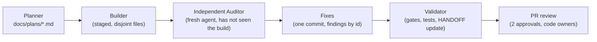
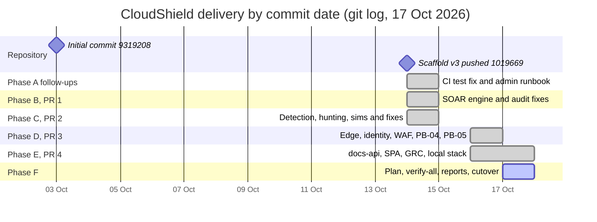

# 1. Project charter and management

| Field | Value |
|---|---|
| Report | CloudShield capstone report (DEPI AWS Cloud Security, Fall 2026) |
| Chapter | 01 of 07 |
| Version | 1.0 |
| Date | 17 Oct 2026 |
| Status | DRAFT |
| Owners | S1 @ELSHAHALY, S2 @YasseenAbdelghany, S3 @ahklsfg (jointly) |
| Reviewers | Each owner reviews the sections outside their own domain; the Phase F Independent Auditor (plan §11) |
| Sources and marks | See the legend in [`docs/reports/README.md` §2](README.md#2-sources-and-marks-legend); numbers policy in [§3](README.md#3-numbers-policy) |

> **What is measured vs pending (this chapter)**
> - **Measured / recorded:** delivery dates from `git log`; the PR stack and its green CI runs; the independent-audit outcomes recorded in `docs/HANDOFF.md`; the Terraform resource inventory per feature flag, counted from the code.
> - **Pending first apply:** every AWS cost. No bill exists, because nothing has been applied to AWS [repo: docs/HANDOFF.md §1]. All prices below are either figures the repository already states, cited, or `[verify: AWS pricing page, accessed —]` placeholders.
> - **Not in the repository:** the content of plan §1.1, the original RACI (plan §2.2), R7, FR-1, FR-6, FR-7, risk ratings other than R1, the DEPI rubric and the WBS Chapter 7 structure. These rows carry `[source: plan PDF, not in repo — team to verify]`.

---

## 1.1 Document control

| Version | Date | Status | Change | Author(s) |
|---|---|---|---|---|
| 1.0 | 17 Oct 2026 | DRAFT | First complete draft, Phase F (plan D15, D22) | S1, S2, S3 |

| Sign-off | Role | Date | Signature |
|---|---|---|---|
| S1 @ELSHAHALY | Platform / Infra / CI-CD | PENDING | |
| S2 @YasseenAbdelghany | App / Identity / Data | PENDING | |
| S3 @ahklsfg | SecOps / SOAR / Forensics | PENDING | |

Related documents: [`docs/HANDOFF.md`](../HANDOFF.md) (the running project record), the six ADRs in [`docs/adr/`](../adr/), the per-phase plans in [`docs/plans/`](../plans/), and the cutover runbook [`docs/runbooks/final-merge-and-cutover.md`](../runbooks/final-merge-and-cutover.md).

---

## 1.2 Executive summary

CloudShield is a multi-tenant document API on AWS with two defensive loops around it [repo: README.md, introduction]:

- **Shift-left:** a GitHub Actions pipeline whose security gates (secrets, SAST, SCA, IaC, image and DAST, plus the `soar` and `app` correctness gates) inspect every pull request before it can merge into `main`; DAST runs after merge, against a staging URL [repo: .github/workflows/ci.yml].
- **Shift-right:** GuardDuty findings flow through EventBridge into the Step Functions state machine `cs-ir-router`, which puts every Lambda playbook behind a fail-closed safety guard. The design is **automated containment with human-gated eradication**: the router stops at `CONTAINED`, captures evidence afterwards, and leaves eradication and recovery to people [repo: docs/HANDOFF.md §2.1; docs/adr/0002-module-map-and-scaffold-strategy.md §3].

The two loops are linked. The image is pushed to ECR only when every scan really passed (audit A9) [repo: docs/HANDOFF.md §12], the SOC posture banner shows those gate outcomes as baked into the image [repo: app/docs-api/src/posture/posture.ts], PB-04 redeploys the service from the same digest-pinned image [repo: soar/playbooks/pb04_ecs_task_contain.py, module docstring], and the PB-03 incident report proposes a Terraform block that feeds the fix back into the infrastructure code [repo: soar/tools/generate_ir_report.py `_terraform_label` and the snippet after it] (chapter 02 §2.5.1).

**What exists.** The infrastructure is written as nine Terraform modules plus a bootstrap root and one environment (`environments/dev`) [repo: docs/plans/depi-phase-f-capstone-complete.md F11]. The SOAR engine has five playbooks (PB-01…PB-05). The application consists of the docs-api, the SPA (portal, SOC dashboard, GRC hub) and a local stack that runs on moto. Each of phases A–E went through an independent audit whose findings were then fixed (§1.6.4); the Phase F audit is pending. Four stacked PRs (#1 → #2 → #3 → #4) are green in CI, and in each run the scan steps really passed, not just the jobs [repo: docs/plans/depi-phase-f-capstone-complete.md F1, F2].

**What does not exist yet.** Nothing has been applied to AWS [repo: docs/HANDOFF.md §1]. So there is no AWS cost figure, no GuardDuty finding from this account, no Step Functions execution, and no AWS-based MTTC result: classes M3 and M4 are pending first apply (see [README §5](README.md#5-mttc-definition-and-measurement-classes)). The build is a **single AWS account (ADR-0001); the multi-account design is the target state.** The top project risk, R1 (team size, rated H×H), is still open because the G1 waiver has not been confirmed [repo: docs/HANDOFF.md §1].

---

## 1.3 Charter

### 1.3.1 Purpose

The plan PDF's purpose statement (plan §1.1) is not in the repository, so this chapter does not paraphrase it.

| Item | Content |
|---|---|
| Plan §1.1 purpose and background | [source: plan PDF, not in repo — team to verify] |

What the repository itself states as the purpose: an "Automated DevSecOps & Cloud Incident Response (SOAR) platform" built as the DEPI AWS Cloud Security capstone for Fall 2026 [repo: README.md, title block]. The design review of 8 Oct rejected the word "autonomous" from the plan title as an overstatement; the accurate description is "automated containment with human-gated eradication" [repo: docs/HANDOFF.md §2.1].

### 1.3.2 Objectives and KPIs

| # | Objective | KPI or acceptance test | Where it is implemented | Status (17 Oct 2026) |
|---|---|---|---|---|
| O1 | Contain an in-scope incident quickly and verifiably | MTTC below the 60 s target per graded scenario run, defined in [README §5](README.md#5-mttc-definition-and-measurement-classes) [repo: docs/adr/0002-module-map-and-scaffold-strategy.md §3; soar/sims/runner.py L37, L137] | `cs-ir-router` (`RecordDetected` → `MarkContained`), `soar/sims/` | Logic proven in CI under moto (M2, not MTTC). **M3/M4 PENDING (first lab apply).** |
| O2 | Catch a seeded SQL injection before merge | KPI §2.4: seeded SQLi caught by SAST [repo: README.md "Testing" note] | `gate: sast (semgrep)`; `scripts/gate-selftest.sh sast` | The seed trips Semgrep `tainted-sql-string`; whether that rule is in the configured packs is unconfirmed [HANDOFF §5]. |
| O3 | Infrastructure code passes policy scanning | Checkov reports 0 failed checks | `gate: iac (terraform + checkov)` | Previous record: 953 terraform and 202 dockerfile checks passed, 0 failed [HANDOFF §13]. Phase F re-measures (chapter 07 §3). |
| O4 | Security gates block merges (FR-5) | `ENFORCE_GATES=true` and the gate jobs required on `main` | `.github/workflows/ci.yml` header; branch protection | Gates are fail-open until the variable is set [repo: .github/workflows/ci.yml L5–11]. Enforcement and protection are scheduled by the cutover runbook (plan D9, D10). |
| O5 | Produce an incident-response report with a chain-of-custody check (success criterion 06) | The IR tool recomputes every evidence SHA-256 and reports MTTC against the target | `soar/tools/generate_ir_report.py` [repo: L1] | Built and tested against golden fixtures (M0) and the seeded local stack (chapter 07 §8). AWS run pending. |

### 1.3.3 Scope

| In scope | Out of scope |
|---|---|
| A single AWS account in `us-east-1` [repo: docs/adr/0001-single-account-first.md; README.md title block] | Multi-account deployment (the target state, ADR-0001) |
| One region by design [repo: infra/terraform/bootstrap/main.tf L59, "plan §1.2"] | Multi-region operation and cross-region replication |
| Playbooks PB-01…PB-05 with a fail-closed guard, dry-run on by default [repo: soar/README.md; infra/terraform/environments/dev/variables.tf, variable `soar_dry_run`] | Automated eradication and recovery (human steps: ADR-0003, ADR-0005; PB-04 does not eradicate, ADR-0002 §5) |
| The local stack (`docker-compose.local.yml`: moto, local IdP, seed, docs-api, SPA) [repo: README.md "Local development"] | Legal advice: the GRC hub and its Compliance Readiness Pack are "a self-assessment, not an audit" [repo: app/README.md; app/grc/README.md] |
| The CI pipeline, OIDC-only CI identity, the gate self-test | A CI apply role (deliberately absent, gap 9) [repo: infra/terraform/bootstrap/main.tf L217–219] |

### 1.3.4 Functional requirements

The plan PDF's requirement list is not in the repository. The repository references only some FR numbers, and the FR-2/FR-3/FR-4 mapping is itself marked as inferred in the Phase E plan [repo: docs/plans/s2-app-soc-ui-grc.md §5 "FR-2/FR-3/FR-4 mapping … [inferred]"].

| FR | Requirement as the repository uses it | Where | Mark |
|---|---|---|---|
| FR-1 | | | [source: plan PDF, not in repo — team to verify] |
| FR-2 | Tenant isolation of documents | `app/docs-api` (tenant from the verified token only) | [inferred] numbering |
| FR-3 | Encryption of tenant data with customer-managed KMS keys; tenant isolation is enforced in the API, not by IAM or cryptography (the SSE-KMS context is the bucket ARN under S3 Bucket Keys) | `modules/data`; ADR-0002 §5 | [inferred] numbering |
| FR-4 | Audit trail of every state change; the audit table is insert-only by convention, and the audit stream consumer is a follow-up | `modules/data/main.tf`; `app/README.md`; ADR-0006 | [inferred] numbering |
| FR-5 | Security gates that fail the build once enforced | `.github/workflows/ci.yml` header [repo: L10] | [repo] |
| FR-6 | | | [source: plan PDF, not in repo — team to verify] |
| FR-7 | | | [source: plan PDF, not in repo — team to verify] |
| FR-8 | Threat hunting with Athena and an IR report | `detection/athena-queries/`, `soar/tools/generate_ir_report.py` [repo: detection/README.md] | [repo] |

Chapter 03 §2 carries the full traceability matrix.

### 1.3.5 Constraints

| Id | Constraint | Effect on the project | Source |
|---|---|---|---|
| G1 | DEPI's minimum team size is 4; this team has 3 members. A written waiver is needed. | Still the top risk (R1). "Nothing else matters if the submission is invalid." | [repo: docs/HANDOFF.md §1, §2.1, §6] |
| G2 | Whether DEPI's AWS access allows an Organization with member accounts is unknown | Single AWS account (ADR-0001); the multi-account design is the target state | [repo: docs/adr/0001-single-account-first.md] |
| G4 | The real AWS budget is unconfirmed | `monthly_budget_usd` defaults to 100 until the team sets it [repo: infra/terraform/bootstrap/variables.tf L19–23] | [repo: docs/HANDOFF.md §6] |
| — | Three people, aggressive timeline | PB-01 made the flagship playbook, finished end to end first | [repo: docs/HANDOFF.md §2.1, §4] |

---

## 1.4 Team, roles and RACI

### 1.4.1 Team

| Role | Member | Owns | Source |
|---|---|---|---|
| S1 Platform / Infra / CI-CD | @ELSHAHALY (repo admin) | `infra/` (bootstrap, network, compute, edge), `.github/` | [repo: README.md "Team"] |
| S2 App / Identity / Data | @YasseenAbdelghany | `app/`, `modules/data`, `modules/identity` | [repo: README.md "Team"] |
| S3 SecOps / SOAR / Forensics | @ahklsfg | `soar/`, `detection/`, `attack-sim/`, `modules/soar`, `modules/log-archive` | [repo: README.md "Team"] |

S3 authored PRs #1–#4 [repo: docs/plans/depi-phase-f-capstone-complete.md F1, F7]. Each phase was executed by an agent pipeline under the owners' direction (§1.5.1).

### 1.4.2 RACI derived from repository ownership

The original RACI matrix (plan §2.2) is not in the repository: [source: plan PDF, not in repo — team to verify]. The matrix below is **derived** from the README team table, the current `.github/CODEOWNERS` and the ADR "Deciders" lines. The derivation rule is [inferred]: **R/A** = the domain owner (first listed code owner); **C** = the second code owner that the Phase F change D11 adds to every single-owner path; **I** = the remaining member.

| Work area | Paths | S1 | S2 | S3 |
|---|---|---|---|---|
| CI pipeline, gates, Dependabot | `/.github/` | R/A | I | C |
| Bootstrap, network, compute, edge | `/infra/`, `modules/{network,compute,edge}` | R/A | I (C on `edge/api.tf`) | C |
| Environment composition | `/infra/terraform/environments/` | R/A | I | C |
| Application, data, identity | `/app/`, `modules/{data,identity}` | C | R/A | I (C on `soc/`, `decoy/`, `grc/`) |
| SOAR, detection, log archive, attack sims | `/soar/`, `/detection/`, `/attack-sim/`, `modules/{soar,log-archive}` | C | I (C on `soar/app-integration.tf`) | R/A |
| ZAP rules | `/.zap/` | R/A | C | I |
| Ownership rules, ADRs, documentation | `/.github/CODEOWNERS`, `/docs/`, `/docs/adr/` | R | R | R |
| Report chapters | `docs/reports/` | A for 04 | A for 05 | A for 06, and for the SOAR and forensics parts of 07 |

Sources: [repo: .github/CODEOWNERS], [repo: README.md "Team"], [repo: docs/plans/depi-phase-f-capstone-complete.md "Owners", D11]. Two points govern how this matrix works in practice. First, when a CODEOWNERS line lists several owners, GitHub needs an approval from any one of them, not all; two-person review comes from branch protection requiring 2 approvals [repo: .github/CODEOWNERS L11–14; docs/HANDOFF.md §2.5 M7]. Second, a PR author's own approval never counts. Before D11, a path whose only code owner was the PR author could never be code-owner-approved, which would have blocked all four existing PRs once code-owner review was required [repo: docs/plans/depi-phase-f-capstone-complete.md F7, D11].

---

## 1.5 Delivery approach

### 1.5.1 Per-phase pipeline

Each phase after the scaffold followed the same pipeline [repo: docs/HANDOFF.md §10–§13]:

The planner writes a plan with numbered facts and decisions; the owners approve it; the builder implements it in stages; a separate auditor agent reviews the result against the plan's audit focus; the findings are fixed in a dedicated commit; and the validator re-runs the gates and records what is proven and what is not in `docs/HANDOFF.md`. The plans are in [`docs/plans/`](../plans/), and the fix commits are visible in the history ("Fix … audit findings", §1.5.3).

### 1.5.2 Phases

Phase labels C–F are the repository's own; labels A (scaffold) and B (SOAR engine) are [inferred] from that sequence (the SOAR plan calls the scaffold follow-ups "Phase A follow-ups" [repo: docs/plans/s3-soar-implementation.md §7]).

| Phase | Content | Branch | PR | Commit dates [repo: git log] | Head [repo: plan F1] | CI evidence |
|---|---|---|---|---|---|---|
| A | Design review, scaffold, first audit; CI fix and admin runbook | `main`; `fix/ci-terraform-test-mocks` | — (pushed to `main`); the fix commits ride in PR #1 | 2026-10-14 (`1019669`, `2adb539`, `fd63f22`, `1f8edb3`) | `1019669` on `main` | First CI run failed only `terraform test`; fixed [HANDOFF §10] |
| B | SOAR engine: safety guard, PB-01/02/03, packaging, `gate: soar` | `feat/s3-soar-playbooks` | #1 | 2026-10-14 | `b28c75d` | [CI: run 38478422214, PR #1, b28c75d] |
| C | Detection, Athena hunting, attack simulations | `feat/s3-detection-athena-sims` | #2 | 2026-10-14 | `7d6c677` | [CI: run 38486109181, PR #2, 7d6c677] |
| D | Edge, identity, WAF, PB-04/PB-05, SOAR enhancements | `feat/s1-s2-edge-identity-waf` | #3 | 2026-10-16 | `247643a` | [CI: run 38930049163, PR #3, 247643a] |
| E | docs-api, SPA (portal, SOC, GRC hub), local stack | `feat/s2-app-soc-ui-grc` | #4 | 2026-10-16 to 2026-10-17 | `9adc96d` | [CI: run 38984704551, PR #4, 9adc96d] |
| F | `make verify-all`, cutover runbook, reports, demo, deck | `feat/depi-phase-f-capstone-complete` | the Phase F PR | 2026-10-17 (`319d916`, plan) | in progress | PENDING (Validator, plan §12) |

Commit dates are from `git log --date=short --format='%ad %h %s'` on 17 Oct 2026. The PRs are stacked: each is based on the previous PR's branch, and against its base each is ahead by 5, 3, 8 and 8 commits respectively and behind by 0 [repo: docs/plans/depi-phase-f-capstone-complete.md F1]. Each phase branched from the previous phase's head rather than from `main`, so that later work could build on earlier work before review finished. The cost is that the PRs must merge in order and with merge commits: squash or rebase merges would create new commits that the next stacked branch does not contain, so its diff would replay the earlier PR, and the CI-tested head SHAs would disappear from `main`'s history [repo: docs/plans/depi-phase-f-capstone-complete.md D8].

The design review, the first scaffold commits and the first independent audit are recorded in HANDOFF as 8 Oct work (commits `30ec367`, `ea39d48`, `67e414c`) [repo: docs/HANDOFF.md §2.1–§2.5]. Those commits are **not** in this repository's history: the history restarts at `1019669`, because the zip that carried the scaffold had no `.git` [repo: docs/HANDOFF.md §1]. The Gantt chart below uses git dates only, so the 8 Oct work does not appear in it.

### 1.5.3 Timeline (commit dates only)

| Date [repo: git log] | Commits [repo: git log] | Milestone |
|---|---|---|
| 2026-10-03 | `9319208` | Repository created ("Initial commit") |
| 2026-10-14 | `1019669` → `7d6c677` (9 commits) | Scaffold pushed; CI test fix; SOAR engine and its audit fixes; Phase C plan, build and audit fixes |
| 2026-10-16 | Phase D `7cca400` → `247643a` (8 commits); Phase E `5b25482` → `471a0e4` (6 commits) | Phase D plan, build stages, audit fixes, HANDOFF §12; Phase E plan and stages 1–3 |
| 2026-10-17 | `b1d4543`, `9adc96d`, `319d916` (3 commits) | Phase E audit fixes and HANDOFF §13; Phase F plan |

Commit counts are counted from the same `git log` output.

### 1.5.4 WBS mapping

The WBS is not in the repository. The repository refers to WBS items §6.1, §6.2, §6.5 and §7 (in the Phase C plan's source list) without their text [repo: docs/plans/s3-detection-athena-sims.md, "Sources"].

| WBS item | Title | Phase / chapter |
|---|---|---|
| WBS §6.1 | [source: plan PDF, not in repo — team to verify] | Phase C (chapter 06) |
| WBS §6.2 | [source: plan PDF, not in repo — team to verify] | Phase C (chapter 06) |
| WBS §6.5 | [source: plan PDF, not in repo — team to verify] | Phase C (chapter 06) |
| WBS §7 | [source: plan PDF, not in repo — team to verify] | Phase C (chapters 06, 07) |
| WBS Chapter 7 structure | [source: plan PDF, not in repo — team to verify] | — |

---

## 1.6 Governance

### 1.6.1 Architecture decision records

| ADR | Decision | Status and date [repo: ADR header] | Deciders [repo: ADR header] |
|---|---|---|---|
| [ADR-0001](../adr/0001-single-account-first.md) | Build in a single AWS account first; keep the module boundaries of the multi-account target | Accepted, 8 Oct 2026 | S1, S2, S3 |
| [ADR-0002](../adr/0002-module-map-and-scaffold-strategy.md) | Module map, feature-flagged scaffold, the MTTC clock, NLB ingress; known limits | Accepted, 8 Oct 2026 | S1, S2, S3 |
| [ADR-0003](../adr/0003-pb01-nacl-quarantine.md) | PB-01 cuts established connections with a worker-tier NACL deny | Accepted, 14 Oct 2026 | S3 (owner), S1 |
| [ADR-0004](../adr/0004-edge-identity-waf.md) | Edge, identity and two WAFs (TB1) | Accepted, 16 Oct 2026 | S1, S2, S3 |
| [ADR-0005](../adr/0005-pb04-pb05-edge-and-ecs-containment.md) | PB-04 (ECS task containment) and PB-05 (WAF IP block) | Accepted, 16 Oct 2026; amended after the Phase D audit and by Phase E | S3 (owner), S1 |
| [ADR-0006](../adr/0006-app-soc-grc-local.md) | docs-api, SPA (portal + SOC), Regional GRC hub, local stack | Accepted, 16 Oct 2026; amended 17 Oct after the audit | S2 (owner), S1, S3 |

Dates and deciders are from each ADR's header [repo: docs/adr/*.md, lines 3–4]. Further decisions are logged in [repo: docs/HANDOFF.md §4] and in each plan's decision table.

### 1.6.2 Review rules

- **Two approvals.** Branch protection on `main` requires 2 approvals; that is what makes review two-person [repo: README.md §3; .github/CODEOWNERS L11–14].
- **Code-owner review.** Required on `main` after the cutover. Every path now has at least two owners from different roles (D11), so a PR author is never the only possible code owner [repo: .github/CODEOWNERS L16–18].
- **Before protection exists**, the team policy is the same: every PR is approved by the two members who did not author it [repo: docs/plans/depi-phase-f-capstone-complete.md §4 "§0 Preconditions"].
- **Merge method.** Merge commits only, strictly in the order #1 → #2 → #3 → #4 → the Phase F PR, with an explicit retarget and update-branch after each merge. This keeps every audited, CI-tested head SHA on `main` [repo: docs/plans/depi-phase-f-capstone-complete.md D8]. The steps are in the [cutover runbook](../runbooks/final-merge-and-cutover.md).

### 1.6.3 Gates

The gates start fail-open: findings are reported but do not block until the repository variable `ENFORCE_GATES` is `true` [repo: .github/workflows/ci.yml L5–11]. `terraform fmt`, `validate` and `test` always hard-fail, as do the `soar` and `app` gates [repo: README.md "Fail-open → enforced"; docs/plans/depi-phase-f-capstone-complete.md F21]. The plan sequence for the cutover is: run `scripts/gate-selftest.sh all`, set `ENFORCE_GATES=true`, merge the stack, and only then apply branch protection with the seven required checks `gate: secrets (gitleaks)`, `gate: sast (semgrep)`, `gate: sca (trivy fs)`, `gate: iac (terraform + checkov)`, `gate: soar (ruff + pytest)`, `gate: app (lint + typecheck + test + build)` and `gate: image (trivy image + sbom)` [repo: docs/plans/depi-phase-f-capstone-complete.md D9, D10]. Chapter 04 describes each gate.

### 1.6.4 Independent audit outcomes

| Phase | Audited | Verdict | Findings | Fixed in | Source |
|---|---|---|---|---|---|
| A (scaffold) | `ea39d48` (not in this history) | PASS WITH FIXES | 10 major, 10 minor; all major fixed, selected minor fixed | `67e414c` (not in this history) | [HANDOFF §2.5] |
| B (SOAR engine, PR #1) | `74ef87f` | PASS WITH FIXES | 3 major, 9 minor (A1–A12), all addressed | `b28c75d` | [HANDOFF §10] |
| C (detection, hunting, sims, PR #2) | `7f9880b` | PASS WITH FIXES | 1 major, 5 minor (A1–A6), all fixed | `7d6c677` | [HANDOFF §11] |
| D (edge, identity, WAF, PB-04/05, PR #3) | Phase D build | FAIL, then fixed | 2 major, 9 minor (A1–A11) | `fd19102` (A9), `a5d502a` (A1–A8, A10, A11) | [HANDOFF §12] |
| E (app, SOC, GRC, local stack, PR #4) | Phase E build | PASS WITH FIXES | 0 critical, 0 high, 2 medium, 8 low, 2 info (E1–E12) | `b1d4543` | [HANDOFF §13] |
| F (this phase) | Phase F PR | PENDING | PENDING (plan §11, Part 4) | — | — |

The "audited" commits for phases B and C are the build commits immediately before the fix commits in `git log`; HANDOFF names the fix scope, not the audited SHA, so that column is [inferred] for B–E. The most consequential findings across phases were the fail-open safety guard (scaffold M1), the audit-table overclaim (M6, which produced the "insert-only by convention" wording), PB-05 trusting caller-written fields (Phase D A1) and the image push from a commit that failed other gates (Phase D A9) [repo: docs/HANDOFF.md §2.5, §12].

Three patterns recur across these audits. First, most audits found places where the documentation claimed more than the code enforced: the audit table described with a stronger word than "insert-only by convention" and CODEOWNERS presented as enforcing multi-owner review (scaffold M6, M7), overclaiming SOAR docs (SOAR A11), an untrue Checkov skip reason (Phase D A8), and imprecise ECR and evidence wording (Phase E E5, E6); Phase C found a safety gate that existed in code but was never called (A1) [repo: docs/HANDOFF.md §2.5, §10, §11, §12, §13]. The fix was always to correct the claim and, where code was involved, to add the missing enforcement with a regression test. Second, several findings concerned fail-open defaults (the guard in M1, the region gate in Phase C A2, the image push in Phase D A9); the fixes made each of them fail closed. Third, findings that depend on AWS behaviour could not be closed by testing, because moto does not enforce IAM or KMS; they were moved to the verify-on-first-apply lists instead of being declared fixed [repo: docs/HANDOFF.md §12 "Not proven", §13 "Not proven"]. The Phase F audit (plan §11) is expected to apply the same scrutiny to this report, which is why every number in it carries a source.

---

## 1.7 Risk register

### 1.7.1 Plan risks R1–R7

Only R1's rating is in the repository [repo: README.md "Next steps"; docs/HANDOFF.md §1]. Owners are derived from the RACI in §1.4.2 [inferred]. The register follows the plan's numbering. Because the plan's likelihood and impact scale and its ratings for R2–R7 are not in the repository, the register does not re-rate them; it records instead what the repository does about each risk and whether that mitigation has been exercised. The distinction matters for reading the status column: "built" means the control exists in code and has passed its tests, while "pending" means its effect depends on AWS behaviour that has not yet been observed. R1 dominates the register. It is the only risk that could invalidate the submission regardless of technical quality, and it cannot be mitigated by engineering; the delivery choices that respond to it (a single flagship playbook first, a single account, flags that keep unfinished parts switched off) reduce the amount of work on the critical path but do not resolve the waiver question [repo: docs/HANDOFF.md §2.1, §6].

| ID | Risk | L × I | Owner | Mitigation in the repo | Status | Source |
|---|---|---|---|---|---|---|
| R1 | Team size: 3 members against the DEPI minimum of 4 (G1) | H × H | All | Scope narrowed to a flagship playbook first; phases run through a planner/builder/auditor/validator pipeline | **Open:** written waiver not confirmed | [repo: docs/HANDOFF.md §1, §2.1, §6] |
| R2 | Automation storm: a finding storm becomes an automation storm, or a playbook acts on the wrong resource | [source: plan PDF, not in repo — team to verify] | S3 | Fail-closed safety guard, rules 1–5 [repo: soar/README.md; soar/core/guard.py]; IAM double bound by scope tag and permissions boundary [repo: infra/terraform/modules/soar/playbooks.tf L75, L257]; dry-run on by default; per-playbook concurrency cap variable [repo: infra/terraform/modules/soar/variables.tf L113]; scope tag never in `default_tags` [repo: docs/HANDOFF.md §8] | Built; tested in CI under moto; AWS behaviour pending | [repo: soar/tests/test_guard.py L1] |
| R3 | Cost overrun | [source: plan PDF, not in repo — team to verify] | S1 | AWS Budgets alarms at 50 % actual, 100 % actual and 100 % forecast of `monthly_budget_usd` [repo: infra/terraform/bootstrap/main.tf L224–255]; flags off by default; destroy when idle; §1.8.6 | Built, not applied; G4 open | [repo: infra/terraform/bootstrap/main.tf L11, L222] |
| R4 | AWS abuse during attack simulations | [source: plan PDF, not in repo — team to verify] | S3 | R4 gates in `soar/sims/safety.py` (targets' live tags and prefixes checked before any pipeline call; region gate fails closed); own resources only; scenarios D/E replay-local with dry-run forced | Built; tested under moto | [repo: soar/sims/safety.py L1; attack-sim/README.md; docs/HANDOFF.md §11 A1–A2, §12 A10] |
| R5 | Cross-account complexity on the critical path | [source: plan PDF, not in repo — team to verify] | S1 | Single AWS account (ADR-0001); the multi-account design is the target state; modules never hard-code account ids | Accepted | [repo: docs/adr/0001-single-account-first.md] |
| R6 | Integration risk between domains | [source: plan PDF, not in repo — team to verify] | All | No account split mid-sprint (ADR-0001 "Revisit when"); stacked PRs merged in order with merge commits (D8); contract tests (`soar/tests/test_contract.py`, shared `route_choices.json`, the OpenAPI drift check) | Mitigated; cutover pending | [repo: docs/adr/0001-single-account-first.md; docs/HANDOFF.md §12 A6, §13] |
| R7 | | [source: plan PDF, not in repo — team to verify] | | | | [source: plan PDF, not in repo — team to verify] |

### 1.7.2 Risks found during delivery

| # | Risk | Current treatment | Status | Source |
|---|---|---|---|---|
| D-R1 | Nothing has been applied to AWS; moto does not enforce IAM, KMS key ids, bucket policies or Object Lock retention reads | Verify-on-first-apply lists in ADR-0004 ("Verify on the first apply"), ADR-0005, ADR-0006 and HANDOFF §13; chapter 07 placeholders | **Open** | [repo: docs/HANDOFF.md §1, §13] |
| D-R2 | Gap 2: a literal deny-all forensics NACL would lock the analyst out | NACL allows intra-subnet traffic only; how analysts reach evidence is still to be decided | Open decision | [repo: docs/HANDOFF.md §3 gap 2] |
| D-R3 | Gap 10: the PB-01 security-group swap does not cut established connections | Deny-all on the dedicated worker-tier NACL (ADR-0003) | Handled; residual risk D-R4 | [repo: docs/HANDOFF.md §3 gap 10] |
| D-R4 | DNS-channel exfiltration after quarantine: Resolver DNS and IMDS are not filtered by the NACL, so code on a quarantined instance can still leak re-issued role credentials over DNS | Revoke again after eradication; follow-up: Route 53 Resolver DNS Firewall in quarantine | Open (follow-up) | [repo: docs/adr/0003-pb01-nacl-quarantine.md L43–49] |
| D-R5 | Gap 11: tenant isolation is enforced in the API, not by IAM or cryptography (the SSE-KMS context is the bucket ARN under S3 Bucket Keys) | IDOR tests and smoke check; stretch goal: STS session tags with `dynamodb:LeadingKeys` | Accepted | [repo: docs/HANDOFF.md §3 gap 11; docs/adr/0002-module-map-and-scaffold-strategy.md §5] |
| D-R6 | Gap 15: the audit table is insert-only by convention | No Update/Delete permission, conditional write, table stream, PITR; the audit stream consumer is a follow-up | Mitigated | [repo: docs/HANDOFF.md §3 gap 15; docs/adr/0006-app-soc-grc-local.md] |
| D-R7 | Gap 16: no S3 access logs on the documents and evidence buckets | CloudTrail S3 data events on exactly those buckets, added in Phase C | Listed as open in HANDOFF §3, closed by Phase C per HANDOFF §11; to confirm on first apply | [repo: docs/HANDOFF.md §3 gap 16, §11] |
| D-R8 | Semgrep could not run on the builders' platforms (it crashes on Windows; the build sandbox blocked `semgrep.dev`) | CI is the authority for SAST; `make verify-all` lists Semgrep as not covered | Accepted | [repo: docs/HANDOFF.md §10, §12, §13] |
| D-R9 | Open legal `[verify]` items in the GRC content (Egypt PDPL, CBE instruments, KSA PDPL, NCA, the EU–US DPF, Egypt E-Signature Law) | A badge on each item in the UI; the readiness pack marks each `verify` row | Open | [repo: docs/HANDOFF.md §13 "Open [verify] legal items"] |
| D-R10 | PB-05 shared egress: blocking one abusive client behind a NAT, carrier gateway or VPN exit blocks everyone behind that address | `/api/*`-only feed, two consecutive harvests, auto-expiry, never-block list, manual lift | Accepted with mitigations | [repo: docs/adr/0005-pb04-pb05-edge-and-ecs-containment.md L101] |
| D-R11 | Code-owner trap: with code-owner review required, a PR whose author is a path's only owner could never merge | Second owner on every single-owner path (D11) | Mitigated in the Phase F PR | [repo: docs/plans/depi-phase-f-capstone-complete.md F7, D11] |

---

## 1.8 Cost model

### 1.8.1 Method

No AWS bill exists, because nothing has been applied [repo: docs/HANDOFF.md §1]. The model is therefore an **inventory**: the billable Terraform resources created at each feature-flag setting, multiplied by AWS public list prices. Prices come from two places only:

1. figures the repository already states, cited where they appear (they have not been re-checked against the pricing pages for this report, and the README itself marks one of them [inferred]); and
2. placeholders of the form `[verify: AWS pricing page, accessed —]`, to be filled with the price, the pricing-page URL and the access date when the team checks them.

All figures are for `us-east-1` [repo: infra/terraform/environments/dev/variables.tf, variable `aws_region`]. The inventory assumes no traffic and does not assume any free tier or trial, except where the repository itself states one; free tiers and trials depend on the account's age and history, which are not known for the DEPI lab account. Usage-driven charges (CloudTrail data events, Config configuration items, GuardDuty analysis, Lambda and Step Functions requests, Athena scans) cannot be estimated without traffic and are left as placeholders. The model's purpose is therefore narrower than a forecast: it identifies which resources cost money while idle, which flag turns each one on, and which controls keep idle cost bounded. The first lab apply is the point at which AWS Cost Explorer can replace the placeholders with observed figures; until then the budget alarms in §1.8.6 are the only cost control that acts on real spend.

### 1.8.2 KMS keys

Counted from the code with `grep -rn 'resource "aws_kms_key"' infra/terraform` (excluding `tests/`):

| Key | Resource | Condition | Created with dev defaults? |
|---|---|---|---|
| Compute (ECR, logs, ECS Exec) | [repo: infra/terraform/modules/compute/main.tf L62] | none (module always instantiated) | Yes |
| Tenant data (DynamoDB + S3 documents) | [repo: infra/terraform/modules/data/main.tf L50] | none | Yes |
| Log archive | [repo: infra/terraform/modules/log-archive/main.tf L147] | none | Yes |
| SOAR (incidents, evidence, notifications, logs) | [repo: infra/terraform/modules/soar/main.tf L118] | none | Yes |
| Athena query results | [repo: infra/terraform/modules/detection/athena.tf L43] | none | Yes |
| Edge (SPA bucket, API Gateway logs) | [repo: infra/terraform/modules/edge/main.tf L44] | `module "edge"` has `count = var.enable_edge ? 1 : 0` [repo: infra/terraform/environments/dev/main.tf, `module "edge"`] | No (`enable_edge = false`) |
| Terraform state | [repo: infra/terraform/bootstrap/main.tf L29] | separate root, applied once per account | Not part of `environments/dev` |

So `environments/dev` creates **5** customer-managed keys by default, **6** with `enable_edge`, and the account holds **7** with the bootstrap key [repo: the seven `aws_kms_key` resources in the table above]. Every key has rotation on and a 7-day deletion window (`deletion_window_in_days = 7` in each resource above) [repo: same resources], so a destroyed key remains in the account, pending deletion, for that window.

### 1.8.3 Baseline (every flag at its default)

| Item | Terraform | Condition | Repo-stated figure | List price |
|---|---|---|---|---|
| NAT gateway (one) + Elastic IP | [repo: infra/terraform/modules/network/main.tf L97, L102] | always | about US$33/month [repo: README.md §2 "Deploy the dev baseline"] | hourly + per-GB processing [verify: AWS pricing page, accessed —] |
| 5 KMS keys (§1.8.2) | as above | always | about US$5/month for the 5 default keys [repo: README.md §2] | per key-month + requests [verify: AWS pricing page, accessed —] |
| CloudTrail, multi-region trail with S3 data events on the evidence and documents buckets | [repo: infra/terraform/modules/detection/cloudtrail.tf L11, L21, L43; environments/dev/main.tf, `data_event_bucket_arns`] | `enable_cloudtrail` (default true) [repo: modules/detection/variables.tf L22–25] | — | management events copy, data events per 100k [verify: AWS pricing page, accessed —] |
| AWS Config recorder, S3 buckets only, two S3 public-access rules | [repo: infra/terraform/modules/detection/main.tf L157–167] | `enable_config` (default true) [repo: environments/dev/variables.tf, variable `enable_config`] | — | per configuration item + per rule evaluation [verify: AWS pricing page, accessed —] |
| GuardDuty detector (S3 protection, malware protection and runtime monitoring off) | [repo: infra/terraform/modules/detection/main.tf L30, L41–52] | `manage_guardduty_detector` (default true) | "paid after the trial" for each optional protection [repo: modules/detection/variables.tf L51, L57, L63] | foundational data sources after the free trial [verify: AWS pricing page, accessed —] |
| VPC Flow Logs (Parquet, to the log archive) | [repo: infra/terraform/modules/network/main.tf L292] | always | — | vended-log delivery to S3 [verify: AWS pricing page, accessed —] |
| S3: log archive, evidence, documents, Athena results | [repo: modules/log-archive/main.tf L163; soar/main.tf L233; data/main.tf L127; detection/athena.tf L56] | always | "small log and S3 charges" [repo: README.md §2] | storage + requests [verify: AWS pricing page, accessed —] |
| DynamoDB: documents, audit, incidents (on-demand, PITR) | [repo: modules/data/main.tf L66, L94; soar/main.tf L192] | always; `PAY_PER_REQUEST` | — | on-demand requests + storage + PITR [verify: AWS pricing page, accessed —] |
| Athena workgroup (1 GiB per-query scan cap) | [repo: modules/detection/athena.tf L128, L136; variables.tf L113–116] | always; pay per query run | — | per TB scanned [verify: AWS pricing page, accessed —] |
| ECR repository, empty ECS cluster, SNS topic, SSM parameters, Cognito user pool | [repo: modules/compute/main.tf L78, L147; soar/main.tf L134, L320, L329; identity/main.tf L28] | always | Cognito Essentials: "free tier for lab MAU" [repo: README.md "Phase D costs"] | [verify: AWS pricing page, accessed —] |
| CloudWatch log groups (30-day default retention) | e.g. [repo: modules/soar/variables.tf L123–126] | with the resources that log | — | ingestion + storage [verify: AWS pricing page, accessed —] |

The repository's own steady-state summary is "about US$33/month for the NAT gateway plus about US$5/month for the 5 KMS keys created by default … with small log and S3 charges on top" [repo: README.md §2]. HANDOFF's earlier figure of about US$37/month [repo: docs/HANDOFF.md §7] matches the README's former wording, which counted 4 KMS keys; the Phase F plan corrected that count to 5 [repo: docs/plans/depi-phase-f-capstone-complete.md F23, D14], and §1.8.2 confirms 5 from the code.

### 1.8.4 Per-flag deltas

| Flag (`environments/dev`) | Adds | Repo-stated figure | List price |
|---|---|---|---|
| `enable_edge` | CloudFront, two WAF web ACLs, SPA bucket, WAF log bucket, edge KMS key; REST API + VPC Link with `container_image`; PB-05 bus, harvester, sweeper, sighting table and alarm with the package | ≈ US$20/month for the WAFs (2 ACLs, 10 rules) [repo: infra/terraform/environments/dev/variables.tf, variable `enable_edge`; README.md feature-flag table]; edge KMS key US$1/month; CloudWatch alarm US$0.10/month [repo: README.md "Phase D costs"] | [verify: AWS pricing page, accessed —] |
| `container_image` | Internal NLB, task definition, Fargate service with 2 tasks of 256 CPU units / 512 MiB [repo: infra/terraform/modules/compute/variables.tf L80–98] | — | NLB hours + LCU; Fargate vCPU-hours and GB-hours [verify: AWS pricing page, accessed —] |
| `enable_report_worker` | EC2 `t3.micro` with an 8 GiB gp3 root volume and detailed monitoring [repo: infra/terraform/modules/compute/variables.tf L118–121; worker.tf L50–71] | "~US$8/month on t3.micro; destroy nightly (R3)" [repo: infra/terraform/modules/compute/variables.tf L113] | [verify: AWS pricing page, accessed —] |
| `soar_playbook_package` | Guard and playbook Lambdas, the `cs-ir-router` state machine | PB-04/PB-05/harvester/sweeper/notifier Lambdas and the edge bus: "free tier at lab volume" [repo: README.md "Phase D costs"] | Lambda requests and GB-s; Step Functions state transitions [verify: AWS pricing page, accessed —] |
| `guardduty_runtime_monitoring` | Runtime Monitoring (PB-04 prerequisite) | "per vCPU-hour after the trial" [repo: README.md "Phase D costs"] | [verify: AWS pricing page, accessed —] |
| `guardduty_s3_protection`, `guardduty_malware_protection` | Paid GuardDuty protections | "Paid after the trial" [repo: modules/detection/variables.tf L51, L63] | [verify: AWS pricing page, accessed —] |
| `enable_security_hub` (+ `securityhub_cis`, `securityhub_pci_dss`) | Security Hub and standards subscriptions | "per-check cost after the trial" [repo: modules/detection/variables.tf L76] | [verify: AWS pricing page, accessed —] |
| `enable_interface_endpoints` | 7 interface endpoints (ssm, ssmmessages, ec2messages, ecr.api, ecr.dkr, logs, sts) [repo: infra/terraform/modules/network/main.tf L29–33] | "~US$100/month when true", avoided by default [repo: infra/terraform/environments/dev/variables.tf, variable `enable_interface_endpoints`; docs/HANDOFF.md §3 gap 5] | [verify: AWS pricing page, accessed —] |
| `enable_lab_targets` | Honeytoken IAM user, `*-lab-exposure` bucket | — | [verify: AWS pricing page, accessed —] |
| `enable_decoy_publisher` | Decoy events on the edge bus | EventBridge custom events US$1.00 per million [repo: README.md "Phase E costs"] | [verify: AWS pricing page, accessed —] |
| `chatops_webhook_param_name` | Notifier Lambda | free tier at lab volume [repo: README.md "Phase D costs"] | [verify: AWS pricing page, accessed —] |
| `evidence_object_lock_days`, `log_archive_object_lock_days` > 0 | GOVERNANCE Object Lock; locked versions block teardown for N days | Object Lock is off by default (`evidence_object_lock_days = 0`) [repo: infra/terraform/environments/dev/variables.tf, `evidence_object_lock_days`] | retained storage during the lock [verify: AWS pricing page, accessed —] |
| LLM summary in the IR report (`tools/ai_summary.py`) | Opt-in API call per report | "provider-billed, per run, opt-in only" [repo: README.md "Phase D costs"] | not an AWS charge |

### 1.8.5 Lab-session estimate for the demo [inferred]

This estimate is **[inferred]**: it pro-rates the repository's own monthly figures over a 30-day month and is not a price quote. Whether each item is billed pro-rata by the hour (for example the WAF web-ACL monthly fee, and KMS keys during their deletion window) is [verify: AWS pricing page, accessed —].

| Component (the demo's AWS track, plan §8.1) | Monthly figure used | Per day, pro-rated [inferred] |
|---|---|---|
| Baseline: NAT gateway + 5 KMS keys | US$33 + US$5 [repo: README.md §2] | about US$1.27 |
| `enable_edge` WAFs (only if the edge is needed) | US$20 [repo: environments/dev/variables.tf, variable `enable_edge`] | about US$0.67 |
| `enable_report_worker` (scenario A only) | US$8 [repo: modules/compute/variables.tf L113] | about US$0.27 |
| Usage charges: CloudTrail data events, Config items, GuardDuty, Lambda, Step Functions, Athena scans, S3, DynamoDB, logs | — | [verify: AWS pricing page, accessed —] |

A demo day with the baseline and the report worker, without the edge, would on this basis cost about US$1.54 plus usage charges [inferred]; adding the edge raises it to about US$2.21 plus usage [inferred]. Fixed charges that do not pro-rate would change this; the team replaces these rows with the AWS Billing figures after the first lab apply: PENDING (first lab apply).

### 1.8.6 Cost controls

| Control | Implementation |
|---|---|
| Budget alarms (R3) | `aws_budgets_budget.monthly`: notifications at 50 % actual, 100 % actual and 100 % forecast of `monthly_budget_usd` (default 100) to `budget_alert_emails` [repo: infra/terraform/bootstrap/main.tf L224–255; bootstrap/variables.tf L19–33]. The subscription emails must be confirmed or no alert arrives [repo: README.md §1]. |
| Destroy when idle | `terraform destroy` of `environments/dev`; leave `bootstrap/` up [repo: README.md §2; docs/HANDOFF.md §7] |
| Flags off by default | Every code-dependent or paid resource sits behind a flag that defaults off [repo: docs/adr/0002-module-map-and-scaffold-strategy.md §2; infra/terraform/environments/dev/main.tf, header comment] |
| Bounded hunting | Athena per-query scan cap of 1 GiB, settable between 10 MiB and 10 GiB [repo: infra/terraform/modules/detection/variables.tf L113–122] |
| Bounded recording | Config records S3 buckets only [repo: infra/terraform/modules/detection/main.tf L157–167]; paid GuardDuty protections and Security Hub off |
| No interface endpoints | Off by default [repo: infra/terraform/environments/dev/variables.tf, variable `enable_interface_endpoints`] |
| Worker off overnight | `enable_report_worker` is for attack/IR sessions only [repo: infra/terraform/environments/dev/variables.tf, variable `enable_report_worker`] |
| State history bounded | Non-current state versions expire after 90 days [repo: infra/terraform/bootstrap/main.tf L101] |
| Object Lock teardown caveat | Object Lock is off by default (`evidence_object_lock_days = 0`); when turned on for a graded run it blocks teardown for N days, so teardown is planned a day later [repo: docs/HANDOFF.md §8; docs/plans/depi-phase-f-capstone-complete.md §8.1, runbook §6] |

---

## 1.9 Communication and tooling

| Need | Tool in use | Source |
|---|---|---|
| Source control, review, CI | GitHub repository `ELSHAHALY/Cloud-Shield`; pull requests; GitHub Actions | [repo: infra/terraform/environments/dev/variables.tf, variable `github_repository`; .github/workflows/ci.yml] |
| PR content | Template with domain checkboxes (S1/S2/S3), a security checklist and an evidence section | [repo: .github/pull_request_template.md] |
| Ownership | `.github/CODEOWNERS` | [repo: .github/CODEOWNERS] |
| Decisions | ADRs; per-phase plan decision tables; HANDOFF §4 decision log | [repo: docs/adr/; docs/plans/; docs/HANDOFF.md §4] |
| Status and hand-over | `docs/HANDOFF.md`, updated at the end of every phase | [repo: docs/HANDOFF.md] |
| Local shift-left | pre-commit hooks (gitleaks, `terraform_fmt`, merge-conflict, private-key and AWS-credential detection, whitespace); Makefile targets (`make scan`, `make iac`, `make local-up`, `make verify-all`) | [repo: .pre-commit-config.yaml; Makefile] |
| Dependency updates | Dependabot | [repo: .github/dependabot.yml] |
| Incident notifications (product, not team chat) | SNS email; optional ChatOps webhook notifier | [repo: docs/runbooks/chatops-setup.md] |
| Agent sessions | Planner, builder, auditor and validator agents. From these sessions the GitHub GraphQL API is refused, so `gh pr …` fails and REST is used instead | [repo: docs/plans/depi-phase-f-capstone-complete.md F6] |
| Team meetings, chat channel, cadence | [source: plan PDF, not in repo — team to verify] | |

---

## 1.10 Open items

| # | Item | Owner | Next step | Source |
|---|---|---|---|---|
| 1 | G1: written waiver for the 3-person team, or a 4th member | All | Obtain it; it decides whether the submission is valid | [repo: docs/HANDOFF.md §6] |
| 2 | G4: the real AWS budget | All | Set `monthly_budget_usd` in `bootstrap/terraform.tfvars` | [repo: docs/HANDOFF.md §6] |
| 3 | Cutover: self-test, `ENFORCE_GATES=true`, merge the stack, branch protection | S1 | [Cutover runbook](../runbooks/final-merge-and-cutover.md) | [repo: docs/plans/depi-phase-f-capstone-complete.md D8–D10] |
| 4 | First lab apply (bootstrap, then `environments/dev`), with `evidence_object_lock_days` set before it if Object Lock is wanted | S1, with S3 for SOAR | README §1–§2; the verify-on-first-apply lists | [repo: docs/HANDOFF.md §13 "Next"] |
| 5 | Fill chapter 07's placeholders (M3/M4 MTTC, evidence on AWS, DAST, edge QA) | All | After item 4 | [repo: docs/plans/depi-phase-f-capstone-complete.md §7.3] |
| 6 | Legal `[verify]` items in the GRC content | S2 | Check each against the official text, or present it as unverified | [repo: docs/HANDOFF.md §13] |
| 7 | Plan-PDF content missing from the repo: R7, FR-1, FR-6, FR-7, plan §1.1, the RACI, risk ratings, rubric criteria, WBS Chapter 7 | All | Supply from the PDF; replace the marked rows | [repo: docs/plans/depi-phase-f-capstone-complete.md §13 Q5] |
| 8 | Gap 2 decision: how analysts reach forensic evidence | S1, S3 | SSM endpoints in the forensics subnet, or offline analysis | [repo: README.md gap 2] |
| 9 | Gap 8: replace the plan role's `ReadOnlyAccess`; gap 9: an apply role behind a GitHub Environment | S1 | Sprint 3 | [repo: infra/terraform/bootstrap/main.tf L178–185, L217–219] |
| 10 | Phase F independent audit and validation | Auditor, Validator | Plan §11–§12 | [repo: docs/plans/depi-phase-f-capstone-complete.md §11, §12] |

---

## 1.11 Rubric mapping

The DEPI rubric is not in the repository.

| Rubric criterion | Section of this chapter |
|---|---|
| [source: plan PDF, not in repo — team to verify] | |
| [source: plan PDF, not in repo — team to verify] | |

## References

This chapter cites no external literature. AWS pricing pages are to be added here as `[L1]`, `[L2]`, … with URL and access date when the `[verify: AWS pricing page, accessed —]` placeholders in §1.8 are filled.
