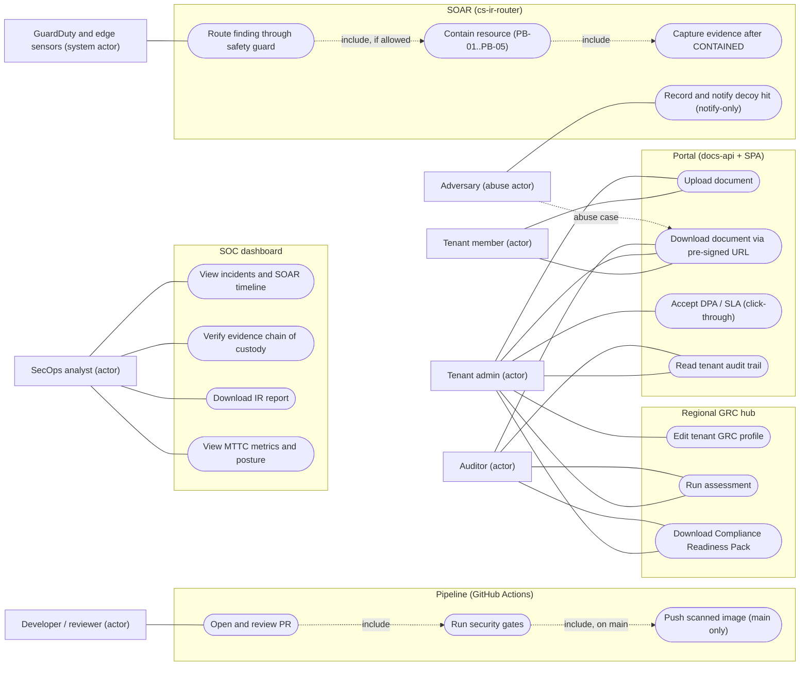
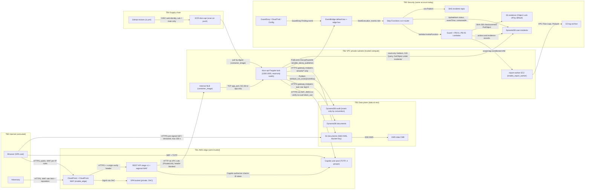
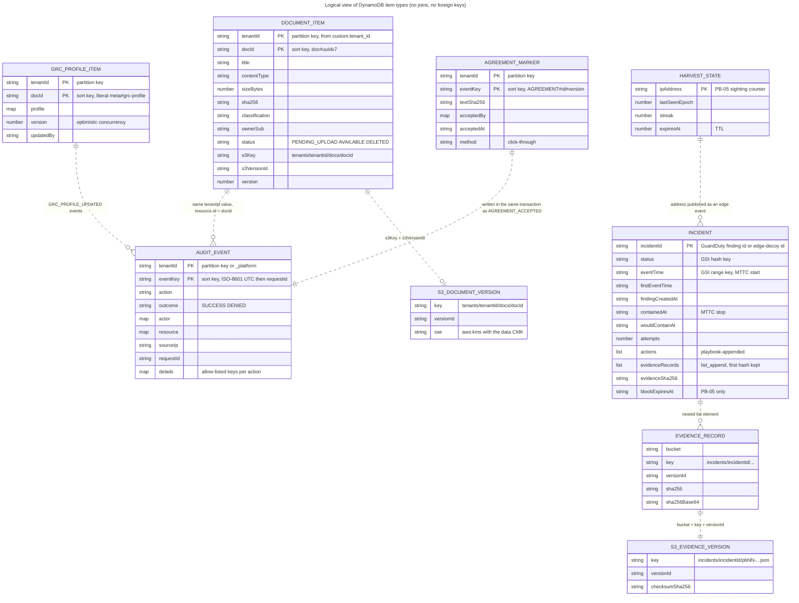
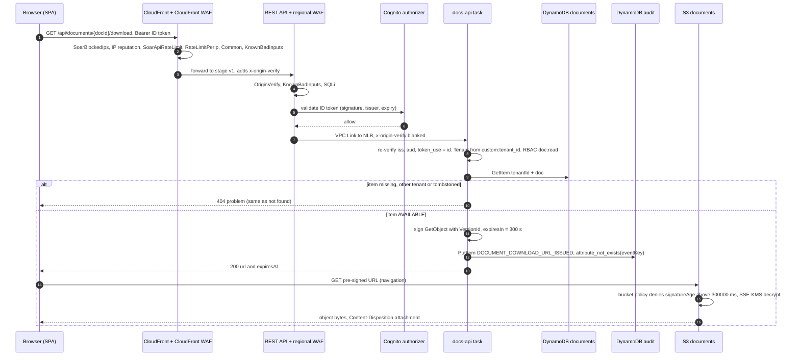
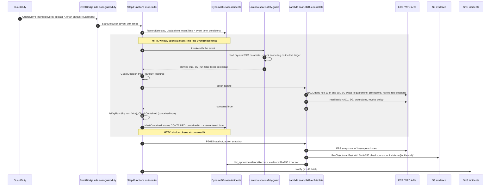
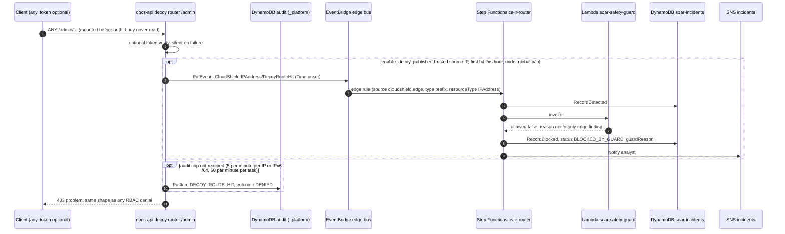
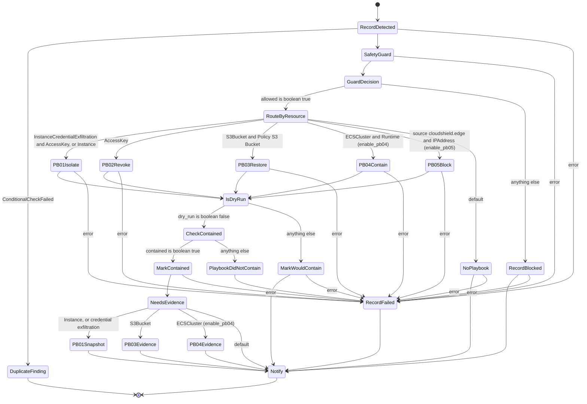

# Chapter 03: System analysis and architecture

| Field | Value |
|---|---|
| Report | CloudShield: Automated DevSecOps and Cloud Incident Response (DEPI AWS Cloud Security capstone, Fall 2026) |
| Chapter | 03 |
| Version | 1.0 |
| Date | 17 Oct 2026 |
| Status | DRAFT |
| Owners | S1 @ELSHAHALY (platform, network, edge), S2 @YasseenAbdelghany (application, identity, data), S3 @ahklsfg (SOAR, detection, forensics). Chapters 01–03 are written by all three [repo: docs/plans/depi-phase-f-capstone-complete.md "Owners"]. |
| Reviewers | The two owners who did not write a given section (ADR-style sign-off, as in earlier phases) [repo: docs/plans/depi-phase-f-capstone-complete.md "Owners"] |

**Sources and marks.** The legend, the numbers policy and the evidence classes are defined once in [docs/reports/README.md](README.md). This chapter uses these marks:

| Mark | Meaning |
|---|---|
| `[repo: path §/line]` | Read from this repository at the Phase F branch. Line numbers refer to the file as read on 17 Oct 2026. |
| `[CI: run <id>, PR #n, <sha>]` | A GitHub Actions run of `.github/workflows/ci.yml`. |
| `[HANDOFF §n]` | A record in `docs/HANDOFF.md`. |
| `[L<n>]` | An external source in §13 References. Every entry is still `[verify]`. |
| `[inferred]` | The authors' best understanding. It has not been verified. |
| `[verify]` | An edition, date, URL or behaviour that must be checked against the official source. |
| `[source: plan PDF, not in repo — team to verify]` | An item from the original plan PDF, the DEPI rubric or the WBS. None of these documents is in the repository, so the content cell is left empty for the team to fill. |

> **What is measured vs pending**
>
> - **Measured (CI, Linux):** the stack's latest four PR runs are green, and in each one the `Report (fail-open)` steps were skipped, so the scans really passed [CI: run 38478422214, PR #1, b28c75d] [CI: run 38486109181, PR #2, 7d6c677] [CI: run 38930049163, PR #3, 247643a] [CI: run 38984704551, PR #4, 9adc96d]. The offline `terraform test` suites and the pytest-under-moto replay tests described here run in all four, and the docs-api/SPA suites from PR #4 on.
> - **Previous local record:** `terraform test` 110/110, `validate` 11/11, Checkov 953 terraform + 202 dockerfile passed and 0 failed [HANDOFF §13]. Chapter 07 re-measures these.
> - **Pending first apply:** every runtime behaviour on AWS that this chapter describes: GuardDuty delivery, the `cs-ir-router` execution, WAF and CloudFront behaviour, KMS and bucket-policy enforcement, Object Lock, and any MTTC figure. **Nothing has been applied to AWS** [HANDOFF §1]. Where this chapter says the system "does" something on AWS, it means the Terraform and code are written to do it. It does not mean the behaviour was observed.

---

## 1. Context, stakeholders and actors

### 1.1 Problem context

CloudShield is a multi-tenant document API on AWS. Two defensive loops surround it. The **shift-left** loop is a GitHub Actions pipeline of security gates (chapter 04). The **shift-right** loop runs GuardDuty → EventBridge → the Step Functions state machine `cs-ir-router` → Lambda playbooks [repo: README.md lines 5–8]. The automation boundary is deliberate. Playbooks stop when the incident is CONTAINED, and eradication and recovery stay with a human analyst. The design is therefore described as **automated containment with human-gated eradication** [HANDOFF §2.1] [repo: infra/terraform/modules/soar/state-machine.tf lines 17–20].

The two loops are not independent. Analysis of the repository finds four concrete links between them, and they are the main argument against a pipeline-only design (chapter 02 §2.5):

1. **Build-time evidence reaches runtime.** The image is built with the real outcomes of the secrets, SAST, SCA and app gates as build arguments. These are written into `build-info.json`, and the SOC posture banner shows them [repo: .github/workflows/ci.yml lines 374–395] [repo: app/docs-api/src/posture/posture.ts lines 1–23].
2. **Only an image that passed every gate is pushed,** even while the gates are fail-open [repo: .github/workflows/ci.yml lines 429–461].
3. **Runtime containment relies on that artefact.** PB-04 redeploys the service by its digest-pinned task definition, so what runs after containment is the image that was scanned, not a newly built one [repo: docs/adr/0002-module-map-and-scaffold-strategy.md §5].
4. **Incident findings feed back into code.** The PB-03 IR report carries a Terraform remediation snippet, which returns the finding to the IaC that the shift-left loop checks [HANDOFF §12].

The system is built for a **single AWS account (ADR-0001); the multi-account design is the target state** [repo: docs/adr/0001-single-account-first.md "Decision"]. It runs in one region, `us-east-1` [repo: README.md line 12]. Section 10 explains what the single account costs in isolation and how the module boundaries keep the later split cheap.

### 1.2 Stakeholders

| Stakeholder | Interest | Where it shows up in the repo |
|---|---|---|
| Tenant organisations (customers) | Their documents stay confidential to their own tenant. Changes are audited. Regional compliance is visible. | `app/docs-api`, `app/spa` portal and GRC hub, `modules/data` |
| Security operations (SOC analysts) | Fast and safe containment, honest evidence, and a single view of incidents | `soar/`, `modules/soar`, `modules/detection`, the SPA SOC dashboard |
| Platform team (S1, S2, S3) | A build that can be reviewed, tested offline and applied safely in a lab | `infra/terraform`, `.github/`, `Makefile`, CODEOWNERS |
| DEPI evaluators | Traceable requirements, honest results and a demonstrable system | `docs/reports/`, `docs/runbooks/` |
| Adversary (abuse case) | Credential theft, port scanning, public bucket exposure, container compromise, edge abuse | `soar/sims/` scenarios A–E, `attack-sim/` |

The team's ownership split comes from CODEOWNERS and the README team table [repo: README.md "Team"] [repo: .github/CODEOWNERS header]. Chapter 01 derives the RACI from these.

### 1.3 Actors

The application authorises from four Cognito groups. `admin`, `member` and `auditor` are tenant roles. `secops-analyst` is a platform role with no access to tenant documents [repo: app/docs-api/src/auth/principal.ts lines 34–38] [repo: docs/adr/0006-app-soc-grc-local.md D5–D7].

| Actor | Kind | Permissions as implemented [repo: app/docs-api/src/auth/principal.ts lines 35–38] |
|---|---|---|
| Tenant admin | Human, `admin` group | `doc:read`, `doc:write`, `doc:delete`, `audit:read`, `agreement:read`, `agreement:accept`, `grc:read`, `grc:assess`, `grc:profile:write` |
| Tenant member | Human, `member` group | `doc:read`, `doc:write`, `doc:delete`, `agreement:read`, `grc:read` |
| Auditor | Human, `auditor` group | `doc:read`, `audit:read`, `agreement:read`, `grc:read`, `grc:assess` |
| SecOps analyst | Human, `secops-analyst` group | `agreement:read`, `grc:read`, `soc:read`, `soc:evidence`, `posture:read` |
| Developer / reviewer | Human, GitHub collaborator | Opens PRs and reviews them under CODEOWNERS and branch protection (chapter 04 §9) |
| GuardDuty, CloudTrail, Config, WAF | AWS service actors | Produce findings, logs and rate-limit keys (`modules/detection`, `modules/edge`) |
| GitHub Actions | Automation actor | Assumes OIDC roles: plan (read-only) and ECR push (`main` only) (chapter 04 §5) |
| Adversary | Abuse actor | Reaches TB0 → TB1 only, unless an earlier control fails |

---

## 2. Requirements

### 2.1 Functional requirements

The plan PDF that defines the functional requirements is not in the repository. The repository refers to FR-2, FR-3, FR-4, FR-5 and FR-8 only. **The FR-2/3/4 numbering is itself marked [inferred] in the repo:** the Phase E plan writes "FR-2/FR-3/FR-4 mapping (document handling, isolation, audit) [inferred: the plan PDF isn't in the repo]" [repo: docs/plans/s2-app-soc-ui-grc.md line 323]. The Phase F plan assigns FR-2 to tenant isolation, FR-3 to encryption with customer-managed keys and FR-4 to the audit trail [repo: docs/plans/depi-phase-f-capstone-complete.md §6.3 "05"]. This chapter follows the Phase F reading. The two readings differ, so the team must confirm the mapping against the PDF. FR-1, FR-6 and FR-7 appear nowhere in the repository [repo: docs/plans/depi-phase-f-capstone-complete.md F22].

| ID | Requirement (as the repo uses it) | Source |
|---|---|---|
| FR-1 | | [source: plan PDF, not in repo — team to verify] |
| FR-2 | Tenant isolation of documents and metadata. Numbering [inferred]. | [repo: docs/plans/depi-phase-f-capstone-complete.md §6.3 "05"; docs/plans/s2-app-soc-ui-grc.md line 323] |
| FR-3 | Encryption at rest under customer-managed KMS keys. **Tenant isolation is enforced in the API, not by IAM or cryptography (the SSE-KMS context is the bucket ARN under S3 Bucket Keys).** Numbering [inferred]. | [repo: docs/adr/0002-module-map-and-scaffold-strategy.md §5; docs/plans/s2-app-soc-ui-grc.md F7] |
| FR-4 | An audit trail of every state change and every download-URL issuance, with actor, action, resource, source IP, request id and UTC time. The audit table is **insert-only by convention**. Numbering [inferred]. | [repo: app/README.md line 18; infra/terraform/modules/data/main.tf lines 6–9] |
| FR-5 | Enforced security gates in CI (`ENFORCE_GATES=true`) | [repo: .github/workflows/ci.yml lines 5–12] |
| FR-6 | | [source: plan PDF, not in repo — team to verify] |
| FR-7 | | [source: plan PDF, not in repo — team to verify] |
| FR-8 | Threat hunting (Athena) and an incident-response report with a chain-of-custody check ("success criterion 06") | [repo: soar/tools/generate_ir_report.py line 1; infra/terraform/modules/detection/athena.tf line 2] |

**How the requirements were analysed.** The team did not have the PDF's requirement text in the repository, so each requirement above was reconstructed from three kinds of evidence:

1. the places where the code or Terraform cites the requirement by id (for example the `FR-4` comments in `modules/data`);
2. the phase plans, which state the mapping and mark it [inferred];
3. the tests that check the behaviour.

A requirement counts as *implemented* when all three agree, and as *verified* only when a test exercises it in CI. Nothing in this chapter counts as *validated in production*, because nothing has been applied. The matrix in §2.3 makes these three levels visible row by row. Its main finding: the security-relevant requirements (FR-2, FR-3, FR-4, FR-8) are verified offline, while every requirement that depends on AWS enforcing a policy (KMS key policies, bucket policies, IAM conditions) is pending the first apply. moto does not enforce IAM, KMS key ids, bucket policies or Object Lock retention reads [HANDOFF §13].

Two further targets are referenced by number: the MTTC KPI (under 60 s per graded run) and KPI §2.4 (a seeded SQL injection caught by SAST) [repo: docs/adr/0002-module-map-and-scaffold-strategy.md §3] [repo: .zap/rules.tsv lines 2–3].

### 2.2 Non-functional requirements

| Category | Requirement or target | Implementation | Status |
|---|---|---|---|
| Responsiveness of IR | MTTC < 60 s per graded scenario run. MTTC runs from the EventBridge `time` to `MarkContained` [repo: docs/adr/0002-module-map-and-scaffold-strategy.md §3]. | `RecordDetected` stores `eventTime`, and `MarkContained` stores `containedAt = $$.State.EnteredTime` [repo: infra/terraform/modules/soar/state-machine.tf lines 171–213, 335–351] | Target only. No M3 or M4 measurement exists (chapter 06 §7). |
| Cost | The NAT gateway is about US$33/month, the 5 default KMS keys about US$5/month, the edge about US$20/month when enabled, and the interface endpoints (about US$100/month) are avoided [repo: README.md "Deploy the dev baseline", "Phase D costs"] [repo: infra/terraform/modules/network/main.tf lines 94–95, 257–260] | Feature flags off by default. Budgets at 50 %, 100 % and forecast 100 % [repo: infra/terraform/bootstrap/main.tf lines 224–253]. | Estimates from the repo, not invoices (chapter 01 §1.8) |
| Availability | Two AZs for the workload tiers [repo: infra/terraform/modules/network/variables.tf lines 16–24] | One NAT gateway, an accepted risk: an AZ-a outage cuts egress for both private tiers [repo: infra/terraform/modules/network/main.tf lines 93–95] | Designed. Not tested. |
| Recoverability | Point-in-time recovery on the documents, audit and incidents tables. Versioned documents and evidence buckets. | [repo: infra/terraform/modules/data/main.tf lines 82–84, 112–114, 136–139] [repo: infra/terraform/modules/soar/main.tf lines 218–220, 254–257] | Built. Not applied. |
| Security | Encryption at rest with customer-managed keys. TLS-only bucket policies. Least-privilege roles. A fail-closed router. | §7, §8, §9. Chapters 05 and 06. | Built. Offline tests pass in CI. |
| Operability | Safe defaults: no Lambda, state machine or service exists by default, and dry-run is on [repo: README.md "Testing"] [repo: infra/terraform/environments/dev/variables.tf `soar_dry_run`] | Feature flags (§6.2) | Asserted by `terraform test` (`defaults_are_safe`) [repo: infra/terraform/modules/soar/tests/soar.tftest.hcl line 101] |
| Testability | Every module except `network` has an offline `terraform test` suite [repo: docs/plans/depi-phase-f-capstone-complete.md F11] | Mocked AWS provider | `network` has no test suite (§12) |
| Region | Single region, `us-east-1` [repo: README.md line 12] | The edge preconditions require `us-east-1` [repo: docs/adr/0004-edge-identity-waf.md "Deviations"] | Built |

### 2.3 Traceability matrix

The matrix links each requirement to the code that implements it, the test suite that checks it and the evidence that the suite ran. "Evidence" means a CI run or a dated record. None of the rows has AWS evidence.

| Req. | Module / code | Test suite | Evidence |
|---|---|---|---|
| FR-1 | [source: plan PDF, not in repo — team to verify] | | |
| FR-2 | `app/docs-api/src/auth/{verifier,principal}.ts` (tenant only from `custom:tenant_id`). `app/docs-api/src/documents/service.ts` `load()` returns 404 for another tenant's item. Keys are `tenantId`-partitioned [repo: infra/terraform/modules/data/main.tf lines 66–80]. | `app/docs-api/test/documents.int.test.ts` "documents: IDOR and ABAC". `rbac.int.test.ts`. `make local-smoke` check 3 [repo: app/local-dev/src/smoke.ts line 43]. | `gate: app` and `app-smoke` green [CI: run 38984704551, PR #4, 9adc96d]. local-smoke 8/8 [HANDOFF §13]. |
| FR-3 | `modules/data`: one CMK, SSE-KMS default with `bucket_key_enabled = true`, and the `DenyForeignKmsKey` and `DenyNonKmsEncryptionHeader` bucket-policy statements [repo: infra/terraform/modules/data/main.tf lines 50–56, 141–150, 198–240] | `infra/terraform/modules/data/tests/{data,policies}.tftest.hcl` (`bucket_policy_statements_unchanged`). `documents.int.test.ts` "documents: upload checks". | `gate: iac` and `gate: app` green [CI: run 38984704551, PR #4, 9adc96d]. KMS enforcement is pending first apply (moto does not enforce it [HANDOFF §13]). |
| FR-4 | `modules/data` audit table (stream `NEW_AND_OLD_IMAGES`, PITR, a PutItem-only write grant) [repo: infra/terraform/modules/data/main.tf lines 94–122, 283–298]. `app/docs-api/src/audit/audit.ts` (`attribute_not_exists(eventKey)`). | `audit.int.test.ts`, `audit-fixes.int.test.ts`. `policies.tftest.hcl` `audit_table_is_put_only_for_writes`. | [CI: run 38984704551, PR #4, 9adc96d]. The stream consumer **is a follow-up** [repo: docs/adr/0006-app-soc-grc-local.md "Follow-ups"]. |
| FR-5 | `.github/workflows/ci.yml` (`continue-on-error: ${{ vars.ENFORCE_GATES != 'true' }}`). `scripts/gate-selftest.sh`. | Gate self-test: secrets and IaC (CKV_AWS_24) proven to trip [HANDOFF §5] | Four green PR runs (front matter). `ENFORCE_GATES=true` is not yet set: it is flipped before the merges (chapter 04 §3, D9). |
| FR-6 | [source: plan PDF, not in repo — team to verify] | | |
| FR-7 | [source: plan PDF, not in repo — team to verify] | | |
| FR-8 | `detection/athena-queries/*.sql`, `modules/detection/athena.tf` (workgroup `<name>-cs-forensics`, 1 GiB scan cap) [HANDOFF §11]. `soar/tools/generate_ir_report.py`. | `soar/tests/test_queries.py` (static only). `test_ir_report.py` (`test_tampered_evidence_fails_and_exits_2`). `test_ir_golden.py`. | `gate: soar` green in all four runs (front matter). No hunt query has ever run against real data [repo: docs/plans/depi-phase-f-capstone-complete.md F19]. |
| MTTC KPI | `state-machine.tf` `RecordDetected` / `MarkContained` | `soar.tftest.hcl` `playbooks_enabled_wires_router`. `soar/tests/test_sims.py` `test_replay_local_scenario_{a,b,c}_contains` (M2, not MTTC). | M3/M4 pending first apply (chapter 06 §7) |
| KPI §2.4 | Semgrep in `gate: sast` | The SAST seed in `scripts/gate-selftest.sh` lines 56–71 | Not yet proven: pack membership is unconfirmed [HANDOFF §5] |

---

## 3. UML use-case model

The use cases fall into five system boundaries: Portal, SOC, GRC, Pipeline and SOAR. The links follow the permission table in §1.3. A link appears only where the actor holds the permission the route requires.

*Figure 3.1. UML use-case notation approximated in Mermaid. Actors are rectangles, use cases are stadium shapes, and each subgraph is a system boundary. Dashed edges stand for UML «include» and abuse relations. The readiness-pack use case is admin/auditor only because the buttons appear only once an assessment is loaded (`grc:assess`) [repo: docs/plans/depi-phase-f-capstone-complete.md D12].*

Four points about the model need stating:

- **The SecOps analyst never reaches tenant documents.** `secops-analyst` has no `doc:*` permission [repo: app/docs-api/src/auth/principal.ts line 38]. The SOC reads only the incidents table and the evidence bucket, through a read-only policy owned by `modules/soar` [repo: infra/terraform/modules/soar/app-integration.tf lines 1–28].
- **The adversary's "download" is an abuse case.** A request for another tenant's document id returns 404, the same answer as for a document that does not exist [repo: app/docs-api/src/documents/service.ts lines 102–106]. `make local-smoke` check 3 tests this [repo: app/local-dev/src/smoke.ts line 43].
- **The decoy is a use case of the adversary, not of the SOC.** The SOC sees its result as a `BLOCKED_BY_GUARD` incident (§8.3).
- **No actor triggers eradication through the system.** Eradication and recovery are runbook steps (`docs/runbooks/pb04-pb05-recovery.md`, ADR-0003 "Recovery is human"), so they are deliberately missing from the SOAR boundary.

---

## 4. Architecture and trust boundaries

### 4.1 Trust boundaries TB0–TB5

The trust boundaries were defined only in Figure 7.1 of the plan PDF. The README table was read from that figure [HANDOFF §2.3], and ADR-0002 §1 places every module inside exactly one boundary [repo: docs/adr/0002-module-map-and-scaffold-strategy.md §1]. The table below is redrawn from the README table. Its fidelity to Figure 7.1 is [source: plan PDF, not in repo — team to verify].

The middle column describes the boundary **as implemented in one account**. The right column gives the **target account** from ADR-0001 and ADR-0002.

| TB | Zone (README) | Implemented in (single account) | How the boundary is enforced today | Target account |
|---|---|---|---|---|
| TB0 | Internet (untrusted): users, adversary | — | — | — |
| TB1 | AWS edge (semi-trusted): WAF + CloudFront / API Gateway, Cognito | `modules/edge` (behind `enable_edge`), `modules/identity` (always on) [repo: README.md "Trust boundaries"] | The CloudFront WAF holds the per-IP controls. The regional WAF requires `x-origin-verify`. The Cognito authorizer checks ID tokens, and the app re-verifies `iss`, `aud` and `token_use` [repo: docs/adr/0004-edge-identity-waf.md D3–D5]. | Workload |
| TB2 | VPC private subnets (trusted compute): docs-api task, report-worker EC2 | `modules/network`, `modules/compute` | Security groups chain NLB → app on `app_port` only. The worker has no inbound rules. The worker tier has its own NACL as PB-01's quarantine switch [repo: infra/terraform/modules/network/security-groups.tf lines 13–101; main.tf lines 199–235]. | Workload |
| TB3 | AWS data plane (data at rest): DynamoDB, S3 docs | `modules/data` | One CMK, SSE-KMS, TLS-only and pre-signed-age bucket-policy denies, and a task-role policy scoped to `tenants/*` [repo: infra/terraform/modules/data/main.tf lines 176–316]. Tenant separation lives in the API (§7.4). | Workload |
| TB4 | Supply chain: npm registry, GitHub repo + Actions, ECR | `.github/`, `modules/compute` (ECR), `bootstrap/` (OIDC) | SHA-pinned actions, OIDC with exact-`sub` push, digest-pinned deploys, and ECR scan on push (chapter 04) | Workload (ECR). GitHub is external. |
| TB5 | Security account (highest trust): SOAR + evidence | `modules/soar`, `modules/log-archive`, `modules/detection`, **in the same account** | Separate CMKs and key policies, resource policies scoped with `aws:SourceArn` / `aws:SourceAccount`, versioning, Object Lock optional and off by default, and a read-only app window [repo: docs/adr/0001-single-account-first.md "Consequences"] [repo: infra/terraform/modules/soar/app-integration.tf] | Security |

The single-account implementation has a structural consequence. **TB5 is a logical boundary, not an account boundary.** An attacker holding administrator rights in the account can cross it [repo: docs/adr/0001-single-account-first.md "Consequences"]. The log archive's own header says it "lives in the workload account" in this model [repo: infra/terraform/modules/log-archive/main.tf lines 3–5]. Section 10 lists what this costs.

### 4.2 Component diagram

Figure 3.2 shows the components with one subgraph per trust boundary. Every edge that crosses a boundary is labelled with its protocol and its authentication. Flags are noted where a component exists only when a flag is set (§6.2).

*Figure 3.2. Components by trust boundary. Sources: [repo: infra/terraform/modules/edge/api.tf lines 1–23] [repo: infra/terraform/modules/network/security-groups.tf] [repo: infra/terraform/modules/data/main.tf] [repo: infra/terraform/modules/compute/ci-push.tf] [repo: infra/terraform/modules/soar/{main,state-machine,edge-bus,app-integration}.tf]. The NLB-to-app hop is plain HTTP inside the VPC: TLS terminates at CloudFront and API Gateway, and the VPC Link reaches the NLB over PrivateLink [repo: infra/terraform/modules/edge/api.tf line 20] [repo: docs/adr/0002-module-map-and-scaffold-strategy.md §4].*

The diagram shows four architectural choices that recur in later chapters:

1. **One origin, two paths.** CloudFront serves `/*` from the private SPA bucket and `/api/*` from the regional REST API, so the browser never makes a cross-origin call and CORS is not needed [repo: docs/adr/0004-edge-identity-waf.md D2].
2. **Per-IP controls sit where the client address is real.** Behind CloudFront, the regional WAF sees CloudFront's address. Reputation, rate limits and the PB-05 IP sets therefore live on the CloudFront ACL. The regional ACL holds `OriginVerify`, KnownBadInputs and SQLi [repo: docs/adr/0004-edge-identity-waf.md D4].
3. **The app is the second verifier.** The REST Cognito authorizer is believed not to check `aud` on ID tokens [inferred] [repo: docs/adr/0004-edge-identity-waf.md "Context"]. docs-api therefore re-verifies signature, `iss`, `aud` and `token_use = id` on every request [repo: app/README.md "Token contract"].
4. **TB5 receives events and is never called by TB2, with two exceptions.** The docs-api task holds a read-only window into TB5 for the SOC dashboard. With the decoy publisher enabled, it may also put one event type on the edge bus [repo: infra/terraform/modules/soar/app-integration.tf lines 1–28]. Both exceptions are recorded as residual risks in ADR-0006.

### 4.3 What each boundary crossing trusts

A trust boundary is only as strong as what the receiving side checks. The table below gives, for each crossing in Figure 3.2, what the receiver accepts and what would be needed to cross it illegitimately. It is the analysis behind the qualitative STRIDE table in chapter 05 §1.

| Crossing | Receiver checks | Crossed illegitimately by | Source |
|---|---|---|---|
| TB0 → TB1 (viewer → CloudFront) | WAF managed rules, IP reputation, two rate rules, the PB-05 block sets | A distributed source below the rate limits, or a shared egress address that is not blocked | [repo: docs/adr/0004-edge-identity-waf.md D4] |
| TB1 internal (CloudFront → REST API) | `x-origin-verify` header (regional rule 0) | Anyone who can read the WAF or CloudFront configuration. It is a deterrent, not authentication. | [repo: docs/adr/0004-edge-identity-waf.md D3] |
| TB1 → TB2 (API Gateway → NLB → task) | The Cognito authorizer, then the app's own JWT re-verification | A valid ID token for the right client and pool, so the residual risk is token theft | [repo: app/README.md "Token contract"] |
| TB2 → TB3 (task → DynamoDB/S3) | IAM on the task role, `tenants/*` prefix, bucket-policy denies | Code in the task: IAM does not separate tenants (FR-3 statement, §7.4) | [repo: infra/terraform/modules/data/main.tf lines 269–316] |
| TB0 → TB3 (browser → S3 pre-signed GET) | The SigV4 query signature, `signatureAge` ≤ 300 s, the pinned version | Possession of the URL during its lifetime | [repo: infra/terraform/modules/data/main.tf lines 242–257] |
| TB4 → AWS (Actions → STS) | OIDC `aud` and an exact `sub` for the push role. Two `sub` values for the plan role. | Any workflow file on `main` can mint the push token (the `job_workflow_ref` follow-up) | [repo: docs/runbooks/repo-admin-setup.md §2b] |
| TB2/TB5 → TB5 (sensors → EventBridge → router) | The rule pattern, then the safety guard's scope-tag and dry-run checks on the live target | A principal allowed `states:StartExecution` on the router can submit any event. The guard and PB-05's own re-checks are the defence. | [repo: docs/adr/0005-pb04-pb05-edge-and-ecs-containment.md "PB-05 Trigger"] |
| TB5 → TB2/TB3 (playbooks → targets) | IAM conditioned on the scope tag. A permissions boundary for IAM writes. Add-only NACL. | A resource wrongly carrying the scope tag. That is why the tag must never go into provider `default_tags`. | [HANDOFF §8] [repo: docs/adr/0003-pb01-nacl-quarantine.md "Decision"] |

The pattern in the table is **defence in two layers at every crossing that leads to data or to an automated action**. The edge authorizer is backed by the app's verifier. The EventBridge rule is backed by the guard, and the guard by IAM conditions. The crossing with only one layer is TB2 → TB3 tenant separation, which rests on application code alone. That is why the IDOR suites and smoke check 3 carry so much weight in the evidence (§2.3), and why `LeadingKeys` is the first stretch goal.

---

## 5. VPC design

### 5.1 Address plan and subnets

| Tier | CIDRs | AZs | Route table | Contents | Source |
|---|---|---|---|---|---|
| VPC | `10.20.0.0/16` | — | — | DNS support and hostnames on | [repo: infra/terraform/modules/network/variables.tf lines 6–8; main.tf lines 39–44] |
| Public | `10.20.0.0/24`, `10.20.1.0/24` | 2 | `rt-public`, default route → IGW | The NAT gateway only. `map_public_ip_on_launch = false`. | [repo: infra/terraform/modules/network/variables.tf lines 26–29; main.tf lines 61–68, 112–127] |
| Private app | `10.20.10.0/24`, `10.20.11.0/24` | 2 | `rt-private`, default route → NAT | Fargate tasks, the internal NLB, and interface endpoints if enabled | [repo: infra/terraform/modules/network/variables.tf lines 31–34; main.tf lines 70–76, 131–146] |
| Private worker | `10.20.20.0/24`, `10.20.21.0/24` | 2 | `rt-private` (shared) | The EC2 report-worker (the IR target). **Dedicated NACL.** | [repo: infra/terraform/modules/network/variables.tf lines 36–39; main.tf lines 78–84, 148–152, 208–235] |
| Forensics | `10.20.99.0/26` | 1 (`azs[0]`) | `rt-forensics`: local route only (no IGW, NAT or endpoints) | Evidence analysis, no internet | [repo: infra/terraform/modules/network/variables.tf lines 41–44; main.tf lines 86–91, 154–164] |

The `azs` variable must contain exactly two AZs [repo: infra/terraform/modules/network/variables.tf lines 16–24]. The dev environment takes the first two names that `aws_availability_zones` returns [repo: infra/terraform/environments/dev/main.tf line 62].

**Rationale for the tiering.** The subnets are split by **response action**, not by application layer. The app tier and the worker tier could share subnets from a routing point of view: both use `rt-private` and the single NAT [repo: infra/terraform/modules/network/main.tf lines 129–152]. They are separated because PB-01's quarantine acts at the subnet NACL. A NACL deny on a shared tier would also cut the docs-api tasks. Keeping the IR target in its own tier bounds the blast radius of an automated action to resources that are expected to be quarantined [repo: docs/adr/0003-pb01-nacl-quarantine.md "Consequences"]. The forensics subnet follows the opposite principle. It is unreachable by routing (a local route only) and by NACL (intra-subnet only), so evidence cannot leave it by any configured path. Placing it in one AZ is a cost and simplicity choice, because forensic analysis is not a high-availability workload.

### 5.2 NACLs

The design uses NACLs in two places.

- **The forensics NACL allows only intra-subnet traffic.** Rule 100 allows all protocols in and out, but only to and from `10.20.99.0/26`. Everything else hits the implicit deny [repo: infra/terraform/modules/network/main.tf lines 174–197]. The plan asked for a literal deny-all. That would also lock out the analyst, so the implemented compromise leaves room for SSM interface endpoints inside the subnet later. How analysts reach evidence is still open (gap 2) [HANDOFF §3].
- **The worker-tier NACL is PB-01's quarantine switch.** It carries allow-all rules at 100 in and out, which reproduces the default NACL, so nothing changes until PB-01 acts [repo: infra/terraform/modules/network/main.tf lines 208–235]. On isolation, PB-01 adds `deny 0.0.0.0/0` at rule 10 in both directions **before** the security-group swap. NACLs are stateless, so this cuts connections that the stateful security groups would leave open [repo: docs/adr/0003-pb01-nacl-quarantine.md "Decision"]. The rule number must lie in 1–99, and the playbook's IAM grants only `ec2:CreateNetworkAclEntry`, so it can add rules but never loosen or remove one. The blast radius is the whole worker tier, which today holds only the report-worker [repo: docs/adr/0003-pb01-nacl-quarantine.md "Consequences"]. The app subnets keep the default NACL.

### 5.3 Security groups

| SG | Inbound | Outbound | Notes | Source |
|---|---|---|---|---|
| `nlb` | TCP `nlb_listener_port` (default 80) from the VPC CIDR | TCP `app_port` (default 3000) to the `app` SG only | PrivateLink traffic carries no source IP the SG could match, so the NLB skips inbound SG evaluation for it | [repo: infra/terraform/modules/network/security-groups.tf lines 13–42; variables.tf lines 62–77] [repo: docs/adr/0002-module-map-and-scaffold-strategy.md §4] |
| `app` | TCP `app_port` from the `nlb` SG only | TCP 443 to `0.0.0.0/0` (ECR, Logs, STS through NAT, Cognito JWKS, S3/DynamoDB through gateway endpoints) | `app_port` is validated to 1024–65535 (non-root container) | [repo: infra/terraform/modules/network/security-groups.tf lines 44–71; variables.tf lines 62–71] |
| `worker` | none (managed through SSM) | TCP 443 to `0.0.0.0/0`. With `allow_worker_lab_scan`, also TCP 1–65535 to the VPC CIDR (lab only, scenario A). | IMDSv2 required on the instance | [repo: infra/terraform/modules/network/security-groups.tf lines 73–101] [repo: README.md "Testing"] |
| `quarantine` | none | none | Attached at incident time by PB-01, never by Terraform | [repo: infra/terraform/modules/network/security-groups.tf lines 103–115] |
| default SG | none | none | All rules stripped so nothing uses it by accident | [repo: infra/terraform/modules/network/main.tf lines 46–51] |
| `vpce` (flag) | TCP 443 from the VPC CIDR | — | Only with `enable_interface_endpoints` | [repo: infra/terraform/modules/network/main.tf lines 262–276] |

### 5.4 Endpoints, NAT and flow logs

- **Gateway endpoints:** S3 and DynamoDB, attached to the private route table only, never to the forensics one. They are free and keep that traffic off the NAT bill [repo: infra/terraform/modules/network/main.tf lines 237–255].
- **Interface endpoints:** seven services (SSM, SSM messages, EC2 messages, ECR API, ECR DKR, Logs, STS) are defined but **off by default**. Seven endpoints in two AZs would cost about US$100/month, more than the whole default budget [repo: infra/terraform/modules/network/main.tf lines 29–33, 257–287; variables.tf lines 56–60].
- **NAT:** one gateway in public subnet 0, an accepted single point of failure. Two gateways would cost about US$33/month more [repo: infra/terraform/modules/network/main.tf lines 93–107].
- **Flow logs:** all traffic, delivered to the log archive in Parquet with Hive-compatible, per-hour partitions, at a 60-second aggregation interval, in a custom v5 format that adds `tcp-flags`, `pkt-srcaddr`, `pkt-dstaddr`, `flow-direction` and `traffic-path` for the hunt queries [repo: infra/terraform/modules/network/main.tf lines 18–27, 292–307]. The Hive layout broke the bucket-policy pattern in the AWS documentation; `log-archive` handles that (gap 3) [HANDOFF §3].

### 5.5 Ingress path

Ingress follows ADR-0002 §4. CloudFront → REST API Gateway (stage `v1`) → VPC Link (v1) → internal NLB → Fargate task [repo: infra/terraform/modules/edge/api.tf lines 1–23]. The REST API type was chosen because it supports a regional WAF web ACL and usage-plan throttling. Its VPC Link targets an NLB. The accepted trade-off is that the NLB has no L7 routing or ALB-style authentication, so all of that lives at API Gateway in TB1 [repo: docs/adr/0002-module-map-and-scaffold-strategy.md §4]. One consequence is recorded in ADR-0004: `execute-api` stays reachable directly on its public endpoint. `OriginVerify` and the Cognito authorizer still apply there, but the per-IP controls apply only through CloudFront [repo: docs/adr/0004-edge-identity-waf.md "Consequences"].

---

## 6. Component and module map

### 6.1 Modules

| Module | TB | Owner | Future account | Status | Source |
|---|---|---|---|---|---|
| `network` | TB2 | S1 | Workload | built | [repo: docs/adr/0002-module-map-and-scaffold-strategy.md §1] |
| `compute`: ECR | TB4 | S1 | Workload | built | same |
| `compute`: ECS, NLB, report-worker | TB2 | S1 (worker: C S3) | Workload | built, flag-gated | same |
| `data` | TB3 | S2 | Workload | built | same |
| `identity` (Cognito) | TB1 | S2 | Workload | built, always on | same |
| `edge` (REST API + VPC Link, WAF ×2, CloudFront) | TB1 | S1 | Workload | built, behind `enable_edge`, `us-east-1` only | same |
| `log-archive` | TB5 | S3 | Security | built | same |
| `detection` (GuardDuty, Security Hub, Config, CloudTrail, Glue/Athena) | TB5 | S3 | Security | built | same |
| `soar` | TB5 | S3 | Security | built; playbooks, PB-04, PB-05 and the notifier flag-gated | same |
| `lab-targets` (honeytoken user, exposure bucket) | lab | S3 | — | built, behind `enable_lab_targets` (off) | [HANDOFF §11] |

The repository also holds the application packages (`app/docs-api`, `app/spa`, `app/grc`, `app/local-dev`), the SOAR code (`soar/core`, `soar/safety_guard`, `soar/playbooks`, `soar/notifier`, `soar/tools`, `soar/sims`) and the hunt queries (`detection/athena-queries`) [repo: README.md "Repository layout"]. Incident and evidence data live in `soar`, not in `data`, so the security domain stays separate from tenant data [repo: docs/adr/0002-module-map-and-scaffold-strategy.md §1].

### 6.2 Feature flags

The repository builds only resources that work without application or Lambda code. Code-dependent resources are written in full but stay off behind input flags [repo: docs/adr/0002-module-map-and-scaffold-strategy.md §2]. With every flag at its default, an apply creates the network, log archive, ECR repository, an empty ECS cluster, the data tables and bucket, and the SOAR baseline. It creates no service, EC2 instance, Lambda or state machine [repo: README.md "Deploy the dev baseline"].

| Variable (`environments/dev`) | Default | Turning it on creates | Source |
|---|---|---|---|
| `container_image` | `null` | Internal NLB, task definition and Fargate service. The image must be `@sha256:`-pinned. | [repo: README.md "Feature flags"] [repo: infra/terraform/modules/compute/variables.tf lines 53–59] |
| `enable_report_worker` | `false` | The EC2 forensic target, carrying the SOAR scope tag | [repo: README.md "Feature flags"] |
| `soar_playbook_package` | `null` | The guard, PB-01/02/03 and `cs-ir-router`. Until then GuardDuty findings go straight to SNS. | [repo: infra/terraform/modules/soar/main.tf lines 362–368] |
| `soar_dry_run` | `true` | `false` makes the playbooks really act | [repo: infra/terraform/environments/dev/variables.tf `soar_dry_run`] |
| `enable_edge` | `false` | CloudFront, both WAFs, the SPA bucket and WAF logs. Also the REST API with `container_image`, and PB-05 with the package. Requires `us-east-1`. | [repo: README.md "Feature flags"] |
| `soar_scope_app_service` | `false` | The scope tag on the ECS service. PB-04 also needs paid Runtime Monitoring. | [repo: docs/adr/0005-pb04-pb05-edge-and-ecs-containment.md "PB-04"] |
| `chatops_webhook_param_name` | `""` | The ChatOps notifier (also needs the package) | [repo: docs/adr/0005-pb04-pb05-edge-and-ecs-containment.md "Deviations"] |
| `allow_worker_lab_scan` | `false` | Worker egress to all VPC ports (scenario A window) | [repo: infra/terraform/modules/network/variables.tf lines 79–83] |
| `enable_decoy_route` | `false` | Unauthenticated `ANY /api/admin` and `/api/admin/{proxy+}` to the decoy | [repo: infra/terraform/modules/edge/api.tf lines 6–9] |
| `enable_decoy_publisher` | `false` | `DecoyRouteHit` events on the edge bus (notify-only) | [repo: README.md "Feature flags"] |
| `enable_lab_targets` | `false` | The honeytoken user and the exposure bucket for scenarios B and C | [HANDOFF §11] |
| `evidence_object_lock_days` | `0` | GOVERNANCE Object Lock on the evidence bucket. Can only be set at bucket creation. | [repo: infra/terraform/environments/dev/variables.tf `evidence_object_lock_days`] |
| `log_archive_object_lock_days` | `0` | Object Lock on the log archive | [repo: infra/terraform/environments/dev/variables.tf `log_archive_object_lock_days`] |

**Object Lock is off by default (`evidence_object_lock_days = 0`).** Before Phase F the `soar` module had the variable but `environments/dev` did not expose it. Phase F adds the dev pass-through (D13), wired as `evidence_object_lock_days = var.evidence_object_lock_days` in `module "soar"` [repo: infra/terraform/environments/dev/main.tf line 182] [repo: docs/plans/depi-phase-f-capstone-complete.md D13].

---

## 7. Data model

### 7.1 Storage technology

The persistence layer is **DynamoDB only; the data model shows a logical view of item types, not relational tables.** There is no RDBMS, no join and no foreign key. Related items are found by key design and by values that the application copies between items [repo: docs/plans/depi-phase-f-capstone-complete.md F25]. Large objects (document bodies, evidence) live in S3, and items refer to them by bucket, key and version id. Figure 3.3 therefore shows **item types**, several of which share one physical table. The dotted relationship lines mean "associated by a shared attribute value, resolved in application code". They are not database-enforced references.

### 7.2 Logical item model

*Figure 3.3. Logical view of DynamoDB item types (no joins, no foreign keys). Sources: [repo: infra/terraform/modules/data/main.tf lines 1–13, 66–122] [repo: app/docs-api/src/documents/service.ts lines 20–41, 120, 160] [repo: app/docs-api/src/audit/audit.ts lines 50–65, 104–105] [repo: app/docs-api/src/agreements/service.ts lines 30, 151–152] [repo: app/docs-api/src/grc/service.ts lines 11, 76–93] [repo: infra/terraform/modules/soar/main.tf lines 192–216] [repo: infra/terraform/modules/soar/state-machine.tf lines 177–199] [repo: soar/core/incidents.py lines 14–27, 51–76] [repo: soar/core/evidence.py lines 23–38] [repo: soar/playbooks/pb05_waf_ip_block.py line 382] [repo: infra/terraform/modules/soar/edge-bus.tf lines 158–185]. Mermaid marks each key component as PK. DynamoDB itself distinguishes partition (hash) and sort (range) keys.*

### 7.3 Physical tables, keys and access patterns

| Physical table | Keys | Item types | Main access patterns | Protection | Source |
|---|---|---|---|---|---|
| `<name>-documents` | hash `tenantId`, range `docId` | `doc#<uuidv7>` documents. `meta#grc-profile` (one per tenant). | GetItem `(tenantId, doc#id)`. Query `tenantId` with `begins_with(doc#)` for the list. Conditional updates on `version`. | PAY_PER_REQUEST, PITR, SSE with the data CMK, deletion protection by variable | [repo: infra/terraform/modules/data/main.tf lines 66–92] [repo: docs/adr/0006-app-soc-grc-local.md D3–D4] |
| `<name>-audit` | hash `tenantId`, range `eventKey` | Audit events (`<ISO-8601 UTC>#<requestId>`). `AGREEMENT#<id>#<version>` acceptance markers. | Query `tenantId` with `eventKey BETWEEN :from AND :to`. Both bounds start with a digit, so markers never appear in audit pages. Consistent GetItem on the marker key. | Stream `NEW_AND_OLD_IMAGES`, PITR, CMK, conditional `PutItem` only | [repo: infra/terraform/modules/data/main.tf lines 94–122] [repo: app/docs-api/src/audit/audit.ts lines 145–162] [repo: app/docs-api/src/agreements/service.ts lines 30, 84] |
| `<name>-soar-incidents` | hash `incidentId`. GSI `status-eventTime` (hash `status`, range `eventTime`, projection ALL). | One row per finding id. Re-deliveries update the same row. | Router UpdateItem with conditions. SOC: one GSI Query per status, never a Scan. | PITR, SOAR CMK | [repo: infra/terraform/modules/soar/main.tf lines 187–227] [repo: docs/adr/0006-app-soc-grc-local.md D16–D19] |
| `<name>-soar-pb05-harvest-state` (PB-05 only) | hash `ipAddress`, TTL `expiresAt` | Per-address sighting streak | Conditional UpdateItem by the harvester only | SOAR CMK. PITR off, with a stated reason (ephemeral counters). | [repo: infra/terraform/modules/soar/edge-bus.tf lines 152–185] |

Three properties of the key design matter for security.

- **Tenant prefix on every key.** Every tenant item's partition key is the `tenantId` taken from the verified token. Every S3 key is built by the server under `tenants/<tenantId>/docs/<docId>`. A missing check therefore shows in code review and in the audit table [repo: infra/terraform/modules/data/main.tf lines 10–20].
- **Router-owned fields.** `status`, `eventTime`, `firstEventTime`, `findingCreatedAt`, `containedAt`, `wouldContainAt`, `sfnStartedAt`, `executionArn` and `attempts` belong to the state machine. `IncidentRepository.set_fields` refuses them, so playbook code cannot forge CONTAINED or an MTTC figure [repo: soar/core/incidents.py lines 1–27, 79–83].
- **Idempotent re-runs.** `RecordDetected` succeeds only if the row is new or its last status was `FAILED` or `WOULD_CONTAIN_DRY_RUN`. Otherwise the run ends in `DuplicateFinding` [repo: infra/terraform/modules/soar/state-machine.tf lines 171–213].

**Access-pattern analysis.** The design starts from the queries and derives the keys from them, which is the usual approach for DynamoDB. Four choices follow.

- **Typed sort keys instead of new tables.** The GRC profile is one item per tenant. Storing it in `documents` under the literal sort key `meta#grc-profile` reuses the tenant partition, the CMK, PITR and the task-role grant without widening IAM to another table [repo: docs/adr/0006-app-soc-grc-local.md D3–D4]. Document listing uses `begins_with(docId, "doc#")`, so the profile item never appears in a document list [repo: app/docs-api/src/documents/service.ts line 120]. The audit table applies the same idea: agreement markers sit in the tenant's audit partition, so the marker and its `AGREEMENT_ACCEPTED` event are written in one transaction [repo: app/docs-api/src/agreements/service.ts lines 144–157]. Audit pages are bounded by timestamps that start with a digit, so markers never appear in them [repo: app/docs-api/src/audit/audit.ts lines 143–147].
- **No Scan on any tenant or SOC path.** The SOC dashboard issues one Query per status on the `status-eventTime` index, and the read-only SOC policy grants Query on the index only, not on the base table [repo: app/docs-api/src/soc/repository.ts line 2] [repo: infra/terraform/modules/soar/app-integration.tf lines 9–11]. The only Scan in the design belongs to the PB-05 sweeper, whose IAM is limited to the incidents table [repo: docs/adr/0005-pb04-pb05-edge-and-ecs-containment.md "Lifetime"].
- **Consistency where it matters.** Document loads and agreement-marker reads use `ConsistentRead`, so a write is visible to the next request on any task [repo: app/docs-api/src/documents/service.ts line 104] [repo: app/docs-api/src/agreements/service.ts line 84]. The GSI is eventually consistent, which is acceptable for a polling dashboard.
- **Concurrency control by condition, not by locks.** Document updates and the GRC profile use a `version` attribute in the condition expression. Audit writes use `attribute_not_exists(eventKey)`. The router uses its status condition [repo: app/docs-api/src/documents/service.ts line 292] [repo: app/docs-api/src/grc/service.ts lines 76–93] [repo: app/docs-api/src/audit/audit.ts lines 121–138].

### 7.4 S3 key layouts, KMS keys and the FR-3 statement

| Bucket | Key layout | Encryption | Notes | Source |
|---|---|---|---|---|
| `<name>-documents-<acct>` | `tenants/<tenantId>/docs/<docId>` | SSE-KMS with the data CMK, Bucket Key on | Versioned. Non-current versions expire after 30 days. The bucket policy denies insecure transport, a foreign KMS key id, the non-KMS encryption header, and `s3:signatureAge` above `presigned_url_max_seconds` (default 300 s, validated to 60–3600 s). | [repo: infra/terraform/modules/data/main.tf lines 127–264; variables.tf lines 23–31] |
| `<name>-soar-evidence-<acct>` | `incidents/<incidentId>/pb01-ebs-manifest-<ts>.json`, `pb03-s3-prestate-<ts>.json`, `pb04-ecs-task-<ts>.json` | SOAR CMK | Versioned. Object Lock only when `evidence_object_lock_days > 0` (GOVERNANCE). | [repo: soar/playbooks/pb01_ec2_isolate.py line 353; pb03_s3_restore_bpa.py line 151; pb04_ecs_task_contain.py line 321] [repo: infra/terraform/modules/soar/main.tf lines 229–257] |
| `<name>-log-archive-<acct>-<region>` | `vpc-flow-logs/`, `cloudtrail/`, `config/`, `guardduty/` | Log-archive CMK | Each delivery is granted only under its own prefix and scoped to this account | [repo: infra/terraform/modules/log-archive/main.tf lines 1–23] |

The KMS keys created by default are 5: compute, data, log-archive, soar and detection (Athena). The edge key exists only with `enable_edge`, and the bootstrap state key exists once per account [repo: docs/plans/depi-phase-f-capstone-complete.md F23] [repo: infra/terraform/modules/{compute/main.tf line 62, data/main.tf line 50, log-archive/main.tf line 147, soar/main.tf line 118, detection/athena.tf line 43, edge/main.tf line 44}] [repo: infra/terraform/bootstrap/main.tf line 29].

**FR-3 statement.** Documents are encrypted under a customer-managed key, but **tenant isolation is enforced in the API, not by IAM or cryptography (the SSE-KMS context is the bucket ARN under S3 Bucket Keys)** [repo: docs/adr/0002-module-map-and-scaffold-strategy.md §5]. One CMK covers every tenant's items and objects. The single task role can reach every tenant's data [repo: infra/terraform/modules/data/main.tf lines 15–20]. Per-request STS session tags with `dynamodb:LeadingKeys` and S3 prefix conditions are the recorded stretch goal [repo: docs/adr/0006-app-soc-grc-local.md "Follow-ups"].

**FR-4 statement.** The audit table is **insert-only by convention**. No IAM condition key can force `attribute_not_exists` on `PutItem`, so `PutItem` could overwrite an event. Four controls compensate: no Update or Delete permission, the app's conditional write, the table stream for tamper evidence, and PITR [repo: infra/terraform/modules/data/main.tf lines 283–293] [repo: docs/adr/0002-module-map-and-scaffold-strategy.md §5]. The stream has no consumer yet. A tamper consumer **is a follow-up** [repo: docs/adr/0006-app-soc-grc-local.md "Follow-ups"].

---

## 8. Sequences

### 8.1 Authenticated document download through the edge

*Figure 3.4. Document download. Sources: [repo: docs/adr/0004-edge-identity-waf.md D3–D5] [repo: infra/terraform/modules/edge/api.tf lines 1–23] [repo: app/docs-api/src/documents/service.ts lines 102–106, 310–336] [repo: infra/terraform/modules/data/main.tf lines 242–257] [repo: app/openapi.yaml lines 153–165]. The URL is signed **before** the audit event is written, so the trail records only a URL that was really issued (audit E1) [repo: app/docs-api/src/documents/service.ts line 315]. Not observed on AWS: the edge is built but never applied.*

The pre-signed URL is a bearer credential for at most 300 s. Every issuance is audited. This is a recorded residual risk [repo: docs/adr/0006-app-soc-grc-local.md "Residual risks"]. Whether a pre-signed SSE-KMS download with `VersionId` succeeds under the cap is on the first-apply verify list [repo: docs/adr/0006-app-soc-grc-local.md "Verify on the first apply"].

### 8.2 Finding → router → guard → playbook → MarkContained → evidence

The sequence below uses PB-01 (scenario A, an EC2 instance) as the example. PB-02 to PB-05 follow the same skeleton with a different containment task (chapter 06 §5).

*Figure 3.5. Containment and evidence. Sources: [repo: infra/terraform/modules/soar/main.tf lines 343–360] [repo: infra/terraform/modules/soar/state-machine.tf lines 1–21, 167–486] [repo: soar/playbooks/pb01_ec2_isolate.py lines 1–17] [repo: soar/core/incidents.py lines 61–76]. Any failure goes to `RecordFailed` and then `Notify`. A guard refusal goes to `RecordBlocked`. A dry run goes to `MarkWouldContain` and is excluded from MTTC. Evidence capture runs after CONTAINED, so it never counts against MTTC [repo: docs/adr/0002-module-map-and-scaffold-strategy.md §3]. The design intent is MTTC < 60 s. No AWS measurement exists: classes M3 (replay-aws) and M4 (live-aws) are both pending first apply (chapter 06 §7).*

**Failure analysis of the containment sequence.** The sequence was analysed for what happens when each step fails. The answer determines whether a status can be trusted.

| Failure | Recorded status | Why this is the safe outcome | Source |
|---|---|---|---|
| The row already exists as CONTAINED, BLOCKED or in progress | none (run ends in `DuplicateFinding`) | GuardDuty re-delivers ongoing findings under the same id. A second run must not act twice. | [repo: infra/terraform/modules/soar/state-machine.tf lines 186–213] |
| The guard Lambda errors or returns a non-boolean | `FAILED` or `BLOCKED_BY_GUARD` | No playbook runs without an explicit `allowed == true` | [repo: infra/terraform/modules/soar/state-machine.tf lines 217–247] |
| The dry-run parameter is unreadable | `BLOCKED_BY_GUARD` (the guard returns `allowed=false`) | Unknown mode is treated as "do not act" | [repo: soar/README.md "Safety guard rules" rule 1] |
| The playbook returns without `contained: true` | `FAILED` (`PlaybookDidNotContain`) | A playbook that did nothing cannot produce CONTAINED or an MTTC | [repo: infra/terraform/modules/soar/state-machine.tf lines 315–333] |
| The evidence step fails after CONTAINED | stays `CONTAINED`, error in `$.evidenceError`, notified | Containment is real, and losing evidence must not reopen the incident. The analyst is told. | [repo: infra/terraform/modules/soar/state-machine.tf lines 353–398] |
| `RecordFailed` itself fails | no status update, notified | Avoids a catch loop. SNS still reaches the analyst. | [repo: infra/terraform/modules/soar/state-machine.tf lines 450–472] |

Every row ends in `Notify`, so the analyst learns of every outcome, including the silent ones. The incidents table never claims more than the playbook proved by reading AWS back.

### 8.3 Decoy hit (notify-only)

*Figure 3.6. Decoy hit. Sources: [repo: app/docs-api/src/decoy/router.ts lines 1–6, 80–167] [repo: infra/terraform/modules/soar/edge-bus.tf lines 129–149] [repo: soar/core/finding.py lines 34–39] [repo: soar/core/guard.py lines 59, 299–300]. The publish is capped at one event per IP (or IPv6 /64) per hour per task and 30 per minute per task [repo: app/docs-api/src/decoy/router.ts lines 82–83, 103–106]. PB-05 independently refuses the type if it is ever reached [repo: docs/adr/0006-app-soc-grc-local.md D13–D15]. `make local-smoke` checks 4a–4c exercise the 403, the audit row and the bus delivery under moto [repo: app/local-dev/src/smoke.ts lines 45–58].*

The decoy never blocks. A caller who has leaked the origin secret can forge the viewer address. The worst outcome of that is false audit IPs and notify-only noise, never a block of a legitimate address [repo: docs/adr/0006-app-soc-grc-local.md "Residual risks"]. A WAF-corroborated decoy block is a recorded follow-up.

---

## 9. State machine `cs-ir-router`

The state machine is named `<name>-cs-ir-router` and exists only when `soar_playbook_package` is set [repo: infra/terraform/modules/soar/state-machine.tf lines 2, 578]. Its definition holds 20 states with PB-04 and PB-05 off, and 23 with both on (`PB04Contain`, `PB04Evidence`, `PB05Block`) [repo: infra/terraform/modules/soar/state-machine.tf lines 115–165, 167–486]. The state names below are copied from the definition.

*Figure 3.7. The `cs-ir-router` state machine. Source: [repo: infra/terraform/modules/soar/state-machine.tf lines 1–21, 41–165, 167–486]. Evidence-state failures (`PB01Snapshot`, `PB03Evidence`, `PB04Evidence`) are caught to `Notify` and do not undo CONTAINED. `RecordFailed` catches its own failure to `Notify`, so it never loops. The written statuses are `DETECTED`, `CONTAINED`, `WOULD_CONTAIN_DRY_RUN`, `BLOCKED_BY_GUARD`, `NO_PLAYBOOK_ANALYST_REVIEW` and `FAILED`.*

The machine fails closed at three choice states. `GuardDecision` proceeds only on a present, boolean `allowed == true`. `IsDryRun` acts only on a present, boolean `dry_run == false`. `CheckContained` records CONTAINED only on a present, boolean `contained == true` [repo: infra/terraform/modules/soar/state-machine.tf lines 231–247, 297–333]. Each choice first tests `IsPresent`, because a Choice on a missing path raises `States.Runtime`, which cannot be caught [repo: infra/terraform/modules/soar/state-machine.tf lines 231–234]. The router's ordered route table is pinned by `tests/route_choices.json`. Both `soar.tftest.hcl` and `soar/tests/test_sims.py` assert it. `test_route_table_is_what_the_state_machine_renders` and `test_local_router_matches_the_route_table_for_every_scenario` tie the rendered definition and the Python local router to that one table [repo: infra/terraform/modules/soar/state-machine.tf lines 41–47] [repo: soar/tests/test_sims.py lines 435–474]. CI's replay evidence for this graph is pytest under moto (`soar/tests/test_sims.py`). `make sim … TARGET=local` is **not** offline: it drives the real handlers with the configured AWS credentials [repo: docs/plans/depi-phase-f-capstone-complete.md F16].

---

## 10. Multi-account target and what one account loses

### 10.1 Target

ADR-0001 keeps the multi-account design. The boundaries that would become separate accounts are kept as separate Terraform modules, so the move is mostly a matter of provider aliases [repo: docs/adr/0001-single-account-first.md "Decision"].

| Future account | Modules (ADR-0001 names, amended by ADR-0002) |
|---|---|
| Security | `log-archive`, `detection` (ADR-0001's `logging` is folded into it), `soar` |
| Workload | `network`, `compute` (ADR-0001's `ecr` and `ecs`), `edge`, `identity` (ADR-0001's `cognito`), `data` |

Three rules keep the split cheap [repo: docs/adr/0001-single-account-first.md "Decision"]:

- No module hard-codes an account id; each uses `aws_caller_identity`.
- Cross-module wiring goes only through outputs and inputs.
- Every resource policy is scoped with `aws:SourceAccount` / `aws:SourceArn`.

The state machine role's trust policy, for instance, already carries an `aws:SourceAccount` condition [repo: infra/terraform/modules/soar/state-machine.tf lines 492–505].

ADR-0001 says when to revisit the decision: when G2 is answered "Organizations available" **and** PB-01 works end to end, and not in the middle of a sprint (risk R6) [repo: docs/adr/0001-single-account-first.md "Revisit when"].

**Migration outline [inferred].** No migration has been designed in detail. The module boundaries suggest this order:

1. Create the Security account and move `log-archive` first, because every delivery policy already names its source with `aws:SourceArn` / `aws:SourceAccount`.
2. Move `detection`. CloudTrail, Config and the GuardDuty export then deliver cross-account into the archive, and GuardDuty gets a delegated administrator.
3. Move `soar`. The router stays next to the incidents table and the evidence bucket. The playbook roles become cross-account roles assumed into the workload account, and the scope-tag conditions stay as they are.
4. Replace the docs-api task role's read-only TB5 window with the separate SOC read service that ADR-0006 lists as a follow-up.

Each step changes provider blocks, trust policies and resource policies. It does not change the module interfaces. That is the property ADR-0001 was written to keep. The step order and the cross-account role design are the authors' reading of the modules, not a decision recorded in an ADR.

### 10.2 What one account loses

| Property | Multi-account target | Single account (as built) | Mitigation today | Source |
|---|---|---|---|---|
| Blast radius of a workload admin | Cannot reach the Security account | **Can** reach the log archive, the evidence bucket and the SOAR roles | SSE-KMS with key policies, versioning, optional Object Lock, least-privilege roles | [repo: docs/adr/0001-single-account-first.md "Consequences"] |
| Organisation guardrails | SCPs | None available | Account settings such as EBS encryption by default (`bootstrap/`) | [repo: docs/adr/0001-single-account-first.md "Consequences"] |
| SOC read path | A separate SOC read service in the Security account | The docs-api task role reads incidents and evidence (read-only) | Prefix scope, no Scan or writes, CloudTrail S3 data events on the evidence bucket | [repo: docs/adr/0002-module-map-and-scaffold-strategy.md §5] [repo: docs/adr/0006-app-soc-grc-local.md "Residual risks"] |
| Edge bus trust | A cross-account bus policy | An account admin can rewrite the bus policy and publish | Explicit Deny for unlisted publishers | [repo: docs/adr/0002-module-map-and-scaffold-strategy.md §5] |
| Evidence permanence | Object Lock in an account the workload cannot administer | Object Lock off by default; GOVERNANCE when enabled | D13 pass-through, to be set before the first apply | [repo: docs/plans/depi-phase-f-capstone-complete.md D13] |
| Delegated GuardDuty / Security Hub admin | Yes | Not applicable | — | [repo: docs/adr/0001-single-account-first.md "Context"] |

The honest position for the viva follows from the table. CloudShield runs in a **single AWS account (ADR-0001); the multi-account design is the target state.** TB5 is "highest trust" by design intent. In the built system it is a set of separately keyed, separately owned modules, not an isolated account.

---

## 11. ADR summary

| ADR | Title (short) | Date, status | Deciders | Decision | Main consequence |
|---|---|---|---|---|---|
| [0001](../adr/0001-single-account-first.md) | Single account first, keep the multi-account design | 8 Oct 2026, Accepted | S1, S2, S3 | One account. Future-account boundaries kept as modules. | Weaker blast-radius isolation and no SCPs. Present multi-account as the target. |
| [0002](../adr/0002-module-map-and-scaffold-strategy.md) | Module map, feature-flagged scaffold, MTTC clock, NLB ingress | 8 Oct 2026, Accepted (amended in Phase E) | S1, S2, S3 | One module per TB. Real resources only, code-dependent ones behind flags. MTTC from the EventBridge `time` to `MarkContained`. REST API + VPC Link + NLB. | The known limits in §12 |
| [0003](../adr/0003-pb01-nacl-quarantine.md) | PB-01 cuts established connections with a worker-tier NACL deny | 14 Oct 2026, Accepted | S3 (owner), S1 | Deny-all at rule 10 on a dedicated worker NACL, before the SG swap. Add-only IAM. | Blast radius is the worker tier. DNS through the Resolver and IMDS are not blocked. Recovery is human. |
| [0004](../adr/0004-edge-identity-waf.md) | Edge, identity and two WAFs (TB1) | 16 Oct 2026, Accepted | S1, S2, S3 | One CloudFront origin. Per-IP controls on the CloudFront ACL. Origin-verify header as a deterrent. The app re-verifies `aud` and `token_use`. ECR push trusts `main` only. | `execute-api` is directly reachable. No provider alias, so `us-east-1` preconditions instead. |
| [0005](../adr/0005-pb04-pb05-edge-and-ecs-containment.md) | PB-04 (ECS task) and PB-05 (WAF IP block) | 16 Oct 2026, Accepted (amended after audit and in Phase E) | S3 (owner), S1 | PB-04 proves membership with `ListTasks`. PB-05 corroborates with WAF's own rate keys, is add-only and expires through a remove-only sweeper. Sims D and E are replay-local and dry-run only. | PB-04 does not eradicate. PB-05 blocks only at CloudFront. Shared egress addresses can be blocked for up to the expiry. |
| [0006](../adr/0006-app-soc-grc-local.md) | docs-api, SPA, GRC hub, local stack | 16 Oct 2026, Accepted (amended 17 Oct) | S2 (owner), S1, S3 | Reuse the tables with typed sort keys. Re-verify tokens. Notify-only decoy. SOC read model. GRC rules as data. moto local stack. | The app role reads TB5. Production image contains a local-mode code path (defended in depth). Click-through is not an e-signature. |

Sources: the status and deciders lines of each ADR [repo: docs/adr/0001…0006].

---

## 12. Known limits

The list below comes from ADR-0002 §5, which the team agreed to state in the viva, plus three limits found while writing this chapter. Each limit is a property of the design as built, not a defect awaiting a quick fix.

| # | Limit | Source | Consequence / follow-up |
|---|---|---|---|
| 1 | Tenant isolation is enforced in the API, not by IAM or cryptography (the SSE-KMS context is the bucket ARN under S3 Bucket Keys). The task role can reach every tenant's items. | [repo: docs/adr/0002-module-map-and-scaffold-strategy.md §5] | Stretch goal: STS session tags with `dynamodb:LeadingKeys` and S3 prefix conditions |
| 2 | The app role reads TB5: GetItem on incidents, Query on the `status-eventTime` index, evidence reads under `incidents/*`, and `kms:Decrypt` through DynamoDB, S3 and SSM | [repo: docs/adr/0002-module-map-and-scaffold-strategy.md §5] [repo: docs/adr/0006-app-soc-grc-local.md E11] | A compromised task can read incidents and evidence. Target: a separate SOC read service. |
| 3 | A security-group swap does not drop tracked connections | [repo: docs/adr/0002-module-map-and-scaffold-strategy.md §5] | Handled by the ADR-0003 NACL deny. DNS through the Resolver, IMDS, Time Sync and intra-subnet traffic remain unfiltered [repo: docs/adr/0003-pb01-nacl-quarantine.md "Consequences"]. Follow-up: DNS Firewall. |
| 4 | PB-03 is bounded by bucket-name prefix (`cloudshield-dev-*`), not by tag | [repo: docs/adr/0002-module-map-and-scaffold-strategy.md §5] | The guard checks the tag in code. The scenario C bucket must use the prefix. |
| 5 | The audit table is insert-only by convention, not enforced by IAM | [repo: docs/adr/0002-module-map-and-scaffold-strategy.md §5] | Conditional write, no Update/Delete grant, stream, PITR. The stream consumer is a follow-up. |
| 6 | SOAR may write inline policies, but only onto principals carrying `soar-target-boundary` | [repo: docs/adr/0002-module-map-and-scaffold-strategy.md §5] | A compromised playbook cannot escalate beyond SSM plus a few reads |
| 7 | Scenario routing: IMDS credential theft arrives as `AccessKey` and is routed to PB-01. Scenario A and C types bypass `min_severity` through `always_route_finding_types`. | [repo: docs/adr/0002-module-map-and-scaffold-strategy.md §5] [repo: infra/terraform/modules/soar/variables.tf lines 56–66] | Routing parity is pinned by `route_choices.json` |
| 8 | The router fails closed | [repo: docs/adr/0002-module-map-and-scaffold-strategy.md §5] | Non-boolean returns are recorded as BLOCKED, WOULD_CONTAIN or FAILED, never CONTAINED |
| 9 | Lambda reserved concurrency defaults to unreserved | [repo: docs/adr/0002-module-map-and-scaffold-strategy.md §5] | New accounts have a limit of 10. Set 5 once the quota allows. |
| 10 | PB-04 does not eradicate: `forceNewDeployment` redeploys the same image digest | [repo: docs/adr/0002-module-map-and-scaffold-strategy.md §5] | ECS Exec capture and a new image are human steps |
| 11 | PB-04 is reachable only with paid Runtime Monitoring, the opt-in scope tag and `>= min_severity` | [repo: docs/adr/0002-module-map-and-scaffold-strategy.md §5] | Off by default |
| 12 | PB-05 blocks only at the CloudFront ACL. "Contained" means the IP set was updated and read back; edge propagation is not observed. | [repo: docs/adr/0002-module-map-and-scaffold-strategy.md §5] | **ADR-0002 §5 still says "Blocks never expire automatically (D15)". That line is stale.** ADR-0005 (amended after audit A2) adds an auto-expiry sweeper with a 24 h default [repo: docs/adr/0005-pb04-pb05-edge-and-ecs-containment.md "Lifetime"] [HANDOFF §12 D15′]. The ADR text should be corrected in a later change. |
| 13 | The PB-05 edge bus trusts its policy, which an account admin can rewrite | [repo: docs/adr/0002-module-map-and-scaffold-strategy.md §5] | A residual risk of ADR-0001 |
| 14 | IMDSv2 is enforced on the report-worker, so scenario A must use the token flow | [repo: docs/adr/0002-module-map-and-scaffold-strategy.md §5] | — |
| 15 | *(this chapter)* `modules/network` has no `terraform test` suite | [repo: docs/plans/depi-phase-f-capstone-complete.md F11] | Its CIDRs, NACL rules and SGs are checked only by `validate`, Checkov and the consumers' tests |
| 16 | *(this chapter)* One NAT gateway and a single-AZ forensics subnet | [repo: infra/terraform/modules/network/main.tf lines 86–107] | An AZ-a outage cuts private egress. Accepted for lab cost. |
| 17 | *(this chapter)* How analysts reach the forensics subnet is undecided (gap 2) | [HANDOFF §3] | SSM endpoints inside the subnet, or offline analysis |

---

## Rubric mapping

The DEPI Fall 2026 rubric is not in the repository. The rows below give the items the team must map. The content cells are left empty on purpose.

| Rubric criterion | Where this chapter addresses it |
|---|---|
| [source: plan PDF, not in repo — team to verify] | |
| [source: plan PDF, not in repo — team to verify] | |
| WBS Chapter 7 structure: [source: plan PDF, not in repo — team to verify] | |

## 13. References

Only sources from the approved list are cited (plan §6.4). Edition, date and URL are given as the authors believe them, and none has been checked yet. Access date: "accessed —, to be filled when verified".

- **[L1]** AWS. *AWS Well-Architected Framework, Security Pillar.* Amazon Web Services, current online edition. https://docs.aws.amazon.com/wellarchitected/latest/security-pillar/welcome.html. Accessed —, to be filled when verified. [verify: edition, date, URL; link not checked]
- **[L2]** AWS. *AWS Security Reference Architecture (AWS SRA).* Amazon Web Services, prescriptive guidance, current online edition. https://docs.aws.amazon.com/prescriptive-guidance/latest/security-reference-architecture/welcome.html. Accessed —, to be filled when verified. [verify: edition, date, URL; link not checked]
- **[L3]** AWS. *AWS Security Incident Response Guide.* Amazon Web Services whitepaper, current online edition. https://docs.aws.amazon.com/whitepapers/latest/aws-security-incident-response-guide/welcome.html. Accessed —, to be filled when verified. [verify: edition, date, URL; link not checked]
- **[L4]** NIST. *SP 800-61 Rev. 2, Computer Security Incident Handling Guide* (2012), and *SP 800-61 Rev. 3* (2025). National Institute of Standards and Technology. https://csrc.nist.gov/pubs/sp/800/61/r3/final. Accessed —, to be filled when verified. [verify: edition, date, URL; link not checked]
- **[L5]** MITRE. *ATT&CK Enterprise Matrix, Cloud (IaaS).* The MITRE Corporation, version to be recorded. https://attack.mitre.org/matrices/enterprise/cloud/iaas/. Accessed —, to be filled when verified. [verify: edition, date, URL; link not checked]

[L1] and [L2] are the published bases for the multi-account target in §10 (a separate security tooling account and a log archive account). [L3] and [L4] give the incident-response lifecycle that the automation boundary in §1.1 follows: containment is automated, while eradication and recovery are human. [L5] names the techniques the scenarios emulate (chapter 06). This chapter uses no statistic from any of these sources.
