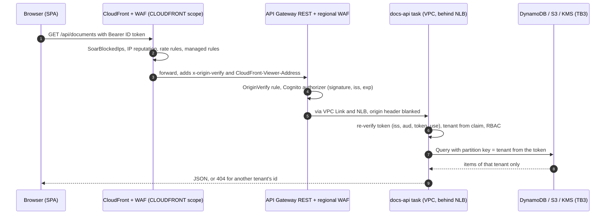

# Chapter 05: Secure cloud application and identity

| Field | Value |
|---|---|
| Chapter | 05 of 07 |
| Title | Secure cloud application and identity |
| Version | 1.0 |
| Date | 17 Oct 2026 |
| Status | DRAFT |
| Owner | S2 @YasseenAbdelghany (App / Identity / Data) |
| Reviewers | S1 @ELSHAHALY (edge, compute, CI); S3 @ahklsfg (SOC read path, decoy publisher, GRC content review) |
| Governing plan | [`docs/plans/depi-phase-f-capstone-complete.md`](../plans/depi-phase-f-capstone-complete.md) §6.3 "05" |

> **Sources and marks.** This chapter uses the legend, numbers policy, fixed wording and evidence classes defined once in [`docs/reports/README.md`](README.md) §2–§4. In short: `[repo: path Lx–y]` is read from this repository; `[CI: run …]` is a GitHub Actions run; `[HANDOFF §n]` is a previous record; `[L<n>]` is an external source listed in §13; `[inferred]` and `[verify]` are unverified and stay marked until checked.

> **What is measured vs pending (this chapter)**
> - **Measured (previous record):** docs-api Jest 290 tests in 17 suites against moto (94.5 % lines, 86.8 % branches), SPA Vitest 50 tests (96.3 % lines), `make local-smoke` 8/8, `terraform test` for identity 8, data 6 and edge 14 [HANDOFF §13]; CI green on PR #4 including `gate: app` and `app-smoke` [CI: run 38984704551, PR #4, 9adc96d]. Chapter 07 §3 holds the Phase F re-measurement.
> - **Not yet counted in any record:** the Phase F Compliance Readiness Pack tests (`app/spa/src/grc/readinessPack.test.ts` and the additions to `grc.test.tsx`), which postdate HANDOFF §13.
> - **Pending first apply:** every AWS behaviour in this chapter (Cognito sign-in, the API Gateway authorizer, WAF, CloudFront headers, KMS, bucket policies, pre-signed downloads, the decoy publish). Nothing has been applied to AWS [repo: docs/HANDOFF.md §1]. moto does not enforce IAM, KMS key ids or bucket policies [repo: docs/runbooks/local-dev.md "Differences from AWS"]. The list of items to check is §12.3.

---

## 1. Overview and threat model per boundary

### 1.1 Scope

This chapter covers the customer-facing half of CloudShield: the multi-tenant document API (`app/docs-api`, Express 5 and TypeScript), the single-page application holding the customer portal, the SecOps SOC dashboard and the Regional GRC hub (`app/spa`, React), the GRC content held as data (`app/grc`), and the three Terraform modules that host them: `identity` (Cognito), `data` (DynamoDB, S3, KMS) and `edge` (CloudFront, two WAF web ACLs, the REST API Gateway) [repo: app/README.md; docs/adr/0002-module-map-and-scaffold-strategy.md §1]. The SOAR engine that the SOC dashboard reads is chapter 06.

The deployment model is a **single AWS account (ADR-0001); the multi-account design is the target state** [repo: docs/adr/0001-single-account-first.md "Decision"]. The persistent store is **DynamoDB only; the data model shows a logical view of item types, not relational tables** (chapter 03 §7). The edge is built but behind `enable_edge`, which defaults to off [repo: docs/adr/0004-edge-identity-waf.md D6].

### 1.2 The request path

The order of the docs-api middleware is part of the security design: request id, security headers, viewer address, access log, the pre-authentication decoy, `/healthz`, authentication, a per-user limit, the body parsers, the OpenAPI validator, the routes, then the 404 and error handlers [repo: app/docs-api/src/app.ts L1–5, L36–66]. Authentication runs **before** any body is parsed, which tightens the order the Phase E plan had proposed [repo: docs/adr/0006-app-soc-grc-local.md "Design changes"].



*Figure 5.1: authenticated request through the edge as designed [repo: infra/terraform/modules/edge/api.tf L1–13; app/README.md "Identity and request contract"]. Not observed on AWS (pending first apply).*

### 1.3 Boundaries in scope

| Boundary | Components in this chapter | Implemented in (single account) | Target account |
|---|---|---|---|
| **TB1** AWS edge | CloudFront, CloudFront-scope web ACL, regional web ACL, REST API Gateway with Cognito authorizer, Cognito user pool | `modules/edge` (flag-gated), `modules/identity` (always on) | Workload |
| **TB2** VPC private subnets | docs-api Fargate task behind an internal NLB and a VPC Link | `modules/compute`, `modules/network` | Workload |
| **TB3** data plane | `documents` and `audit` tables, documents bucket, the data CMK | `modules/data` | Workload |

The module-to-boundary mapping is ADR-0002 §1 [repo: docs/adr/0002-module-map-and-scaffold-strategy.md §1]. TB0, TB4 and TB5 are covered in chapters 03, 04 and 06.

### 1.4 Qualitative STRIDE per boundary

The table is qualitative: it names the threat the design considered, the control that exists in the repository, and the residual risk the repository itself records. It does not rate likelihood or impact; the plan's risk ratings are not in the repository (chapter 01 §7).

| Boundary | STRIDE | Threat | Control in the repository | Residual (as recorded) |
|---|---|---|---|---|
| TB1 | Spoofing | A token minted for another client of the pool, or an access token, is presented | The authorizer checks signature, issuer and expiry; docs-api re-verifies `iss`, `aud` and `token_use = id` [repo: app/docs-api/src/auth/verifier.ts L24–44]; TOTP MFA [repo: infra/terraform/modules/identity/main.tf L46–50] | The authorizer is believed not to check `aud` for ID tokens [inferred] [repo: docs/adr/0004-edge-identity-waf.md "Context"] |
| TB1 | Spoofing | Direct calls to `execute-api` that bypass CloudFront | Regional rule `OriginVerify` blocks requests without the origin header [repo: infra/terraform/modules/edge/waf.tf L257–258]; every `/api/{proxy+}` method needs a Cognito token | The origin header is a deterrent, not authentication; a leaked header removes only that control [repo: docs/adr/0004-edge-identity-waf.md D3, "Consequences"] |
| TB1 | Tampering | A client forges `X-Forwarded-For` to falsify its address | Only `CloudFront-Viewer-Address` is read; `X-Forwarded-For` never is [repo: app/docs-api/src/middleware/source-ip.ts L1–3, L24] | Forwarding of that header is [inferred], verify on first apply (§12.3) |
| TB1 | Repudiation | A user denies an action taken through the edge | Server-generated request id and the viewer address on every audit event (§6) | Address trust depends on the header above |
| TB1 | Information disclosure | ID tokens and the origin secret appear in WAF sampled requests | Sampled requests are off on every rule and both ACLs; WAF logs redact `authorization`, `cookie` and `x-origin-verify` [repo: docs/adr/0004-edge-identity-waf.md D8] | The default CloudFront certificate fixes the minimum viewer TLS version [repo: docs/adr/0004-edge-identity-waf.md D11] |
| TB1 | Denial of service | Request floods against the site or the API | Two rate rules answering 429, API Gateway throttling, a per-IP pre-auth limiter in the app (§7) | Limits in the app are per task [repo: docs/adr/0006-app-soc-grc-local.md "Residual risks"] |
| TB1 | Elevation of privilege | Self sign-up, or a user moving themselves to another tenant | Admin-created users only; `custom:tenant_id` declared `mutable = false` and absent from the client's `write_attributes` [repo: infra/terraform/modules/identity/main.tf L52–54, L72–83, L117] | None recorded |
| TB2 | Spoofing | Tokens from the dev-only local IdP accepted in production | `aws` mode refuses every local-auth and endpoint-override variable at startup [repo: app/docs-api/src/config.ts L145–155]; `modules/compute` filters them out (§11) | The local code path exists in the production image [repo: docs/adr/0006-app-soc-grc-local.md "Residual risks"] |
| TB2 | Tampering | Writes to the container filesystem | Distroless non-root image, 1000:1000, read-only root filesystem, `/tmp` only [repo: docs/adr/0006-app-soc-grc-local.md "Step 0 outcomes" item 3; docs/HANDOFF.md §13] | Runtime user and rootfs behaviour on Fargate is a first-apply item (§12.3) |
| TB2 | Repudiation | Requests that leave no trace | Access log per request with the route template, status, latency, `sub` and tenant; never the URL, query values, bodies or tokens [repo: app/docs-api/src/middleware/http.ts] | — |
| TB2 | Information disclosure | Error responses echo request input | RFC 9457 problem responses with fixed per-keyword messages (audit E9) [repo: docs/adr/0006-app-soc-grc-local.md "Audit amendments"] | — |
| TB2 | Denial of service | Large bodies sent without credentials | Bodies are parsed only after authentication; JSON capped at 64 kb [repo: app/docs-api/src/app.ts L46–51] | — |
| TB2 | Elevation of privilege | A compromised task uses its role directly | Least-privilege data policy (§5.4); read-only SOC policy (§9) | The task role can reach every tenant's items and read every incident and evidence object [repo: docs/adr/0006-app-soc-grc-local.md "Residual risks"] |
| TB3 | Tampering | An audit event is overwritten | Conditional writes, no Update/Delete permission, table stream, PITR (§6) | No IAM condition forces the condition; the stream has no consumer yet [repo: docs/adr/0002-module-map-and-scaffold-strategy.md §5] |
| TB3 | Information disclosure | One tenant reads another tenant's documents | Partition key taken from the verified token; another tenant's id is a 404 (§4) [repo: app/docs-api/src/documents/service.ts L97–108] | Isolation is not IAM-enforced and not cryptographic (§4, §5) |
| TB3 | Information disclosure | Uploads under a foreign key or over plain HTTP | Bucket policy denies insecure transport, a foreign KMS key and the SSE-S3 header [repo: infra/terraform/modules/data/main.tf L176–240] | Bucket-policy behaviour is not enforced by moto; first-apply item |
| TB3 | Denial of service | Table or bucket deleted | PITR on both tables; versioned bucket [repo: infra/terraform/modules/data/main.tf L82–84, L112–114, L136–139] | Table deletion protection defaults to `false` for lab teardown [repo: infra/terraform/modules/data/variables.tf] |

---

## 2. Identity

### 2.1 Cognito configuration

`modules/identity` is always on in dev, because its idle cost is zero on the Essentials tier [repo: infra/terraform/modules/identity/main.tf L10]. The settings below were read from the module source.

| Setting | Value in the repository | Source |
|---|---|---|
| Sign-up | `allow_admin_create_user_only = true` | [repo: infra/terraform/modules/identity/main.tf L52–54] |
| Username | email, case-insensitive, email auto-verified; a changed email stays unverified until confirmed | [repo: infra/terraform/modules/identity/main.tf L33–44] |
| MFA | `mfa_configuration` default `ON`, validation allows only `ON` or `OPTIONAL` (`OFF` rejected); software token (TOTP) enabled; no SMS configuration | [repo: infra/terraform/modules/identity/variables.tf L6–15; main.tf L46–50] |
| Password policy | minimum length 14; lower, upper, digit and symbol required; temporary password valid 1 day | [repo: infra/terraform/modules/identity/main.tf L56–63] |
| Tenant attribute | `custom:tenant_id`, String, 1–64 characters, `mutable = false` | [repo: infra/terraform/modules/identity/main.tf L72–83] |
| Groups | exactly four: `secops-analyst` (precedence 5), `admin` (10), `member` (20), `auditor` (30); no IAM roles | [repo: infra/terraform/modules/identity/main.tf L20–25, L124–130] |
| SPA client | no secret; flows `ALLOW_USER_SRP_AUTH` and `ALLOW_REFRESH_TOKEN_AUTH` only; `prevent_user_existence_errors = "ENABLED"`; token revocation on; no OAuth flows or hosted UI | [repo: infra/terraform/modules/identity/main.tf L92–122] |
| Client attributes | read: `email`, `email_verified`, `custom:tenant_id`; write: `email` only | [repo: infra/terraform/modules/identity/main.tf L114–117] |
| Token lifetime | access and ID tokens `access_token_minutes`, default 60, range 5–60; refresh `refresh_token_days`, default 1, range 1–30 | [repo: infra/terraform/modules/identity/variables.tf L49–68] |
| Feature tier | `ESSENTIALS` by default; threat protection (`AUDIT`/`ENFORCED`) is rejected unless the tier is `PLUS` | [repo: infra/terraform/modules/identity/variables.tf L17–41] |
| Deletion protection | on by default | [repo: infra/terraform/modules/identity/variables.tf L43–47] |

The schema is frozen in the module test, because a schema change replaces the pool and loses every user [repo: infra/terraform/modules/identity/main.tf L11–12]. The module has 8 `terraform test` runs [repo: infra/terraform/modules/identity/tests/identity.tftest.hcl], which pass in the previous record [HANDOFF §13].

Provisioning is a runbook, not self-service. An administrator creates the user with the tenant id fixed at creation, assigns exactly one group, and verifies both; a user cannot be moved to another tenant, only re-created [repo: docs/runbooks/tenant-provisioning.md §1–§3, "Moving a user to another tenant"]. Deprovisioning disables the user and signs them out globally; tokens already issued stay valid until they expire, at most 60 minutes with the defaults [repo: docs/runbooks/tenant-provisioning.md "Deprovision"; infra/terraform/modules/identity/variables.tf L49–52].

### 2.2 Token contract

The SPA sends the Cognito **ID token** as `Authorization: Bearer <jwt>`. The REST API Gateway Cognito authorizer checks signature, issuer and expiry, but is believed **not** to check `aud` for ID tokens [inferred] [repo: app/README.md "Token contract"; docs/adr/0004-edge-identity-waf.md "Context"]. docs-api therefore re-verifies every request itself:

| Check | Production implementation | Local implementation |
|---|---|---|
| Signature (RS256) and expiry | `CognitoJwtVerifier` from `aws-jwt-verify`, JWKS derived from the pool id; never follows `jku`/`x5u` | `jose.jwtVerify` with `algorithms: ["RS256"]`, `exp`, `iat`, `sub` required |
| `aud` | `clientId` of the SPA client | the configured local client id |
| `token_use` | `tokenUse: "id"` | explicit `token_use !== "id"` rejection |
| `iss` | an explicit second comparison against `COGNITO_ISSUER` after the library check | `issuer` option |
| Source | [repo: app/docs-api/src/auth/verifier.ts L1–5, L24–44] | [repo: app/docs-api/src/auth/verifier.ts L46–67] |

Every failure is a 401; there is no fallback to an unverified decode [repo: app/README.md "Token contract"]. The bearer header is accepted only in compact JWS form and only up to 8,192 characters [repo: app/docs-api/src/auth/verifier.ts L80–86]. In `aws` mode the configuration also refuses an issuer that does not equal the one derived from the pool id [repo: app/docs-api/src/config.ts L152–155]. The verifier is unit-tested in `auth.test.ts` (production verifier with explicit `iss`, local verifier, `bearer()`, principal) [repo: app/docs-api/test/auth.test.ts].

### 2.3 SPA session

The SPA signs in with SRP (`authFlowType: "USER_SRP_AUTH"`) and handles the TOTP set-up and code challenges in the same form [repo: app/spa/src/auth/cognito.tsx]. Amplify v6 is configured with `cognitoUserPoolsTokenProvider.setKeyValueStorage(sessionStorage)`, so tokens live in `sessionStorage`, never `localStorage` [repo: app/spa/src/auth/cognito.tsx L1–2, L12–17]. An ESLint rule forbids `localStorage` in the SPA, together with `dangerouslySetInnerHTML`, `style` props and `innerHTML` assignment [repo: docs/adr/0006-app-soc-grc-local.md "Design changes"].

`sessionStorage` limits persistence to the tab, but it is readable by any script running in the origin. The compensating control is the edge CSP (`default-src 'self'`, §7.3) and the absence of inline script and style, which `check-bundle.mjs` asserts on the production build [repo: app/spa/scripts/check-bundle.mjs]. Whether Amplify SRP and TOTP work under that CSP on CloudFront is a first-apply item (§12.3, plan §16 item 12).

---

## 3. Authorisation

### 3.1 RBAC from `principal.ts`

Groups come only from the verified `cognito:groups` claim; unknown group names are dropped [repo: app/docs-api/src/auth/principal.ts L58–70]. The permission set per group is a constant [repo: app/docs-api/src/auth/principal.ts L34–39], and every route names the permission it requires [repo: app/docs-api/src/routes.ts L60–172].

| Permission | Routes (prefix `/api` at the edge) | admin | member | auditor | secops-analyst |
|---|---|:-:|:-:|:-:|:-:|
| `doc:read` | `GET /documents`, `GET /documents/{id}`, `GET /documents/{id}/download` | ✓ | ✓ | ✓ | — |
| `doc:write` | `POST /documents`, `PATCH /documents/{id}`, `PUT /documents/{id}/content` | ✓ | ✓ (own only, §3.2) | — | — |
| `doc:delete` | `DELETE /documents/{id}` | ✓ | ✓ (own only) | — | — |
| `audit:read` | `GET /audit` (own tenant) | ✓ | — | ✓ | — |
| `agreement:read` | `GET /agreements`, `/agreements/status`, `/agreements/{id}/{version}/text` | ✓ | ✓ | ✓ | ✓ |
| `agreement:accept` | `POST /agreements/{id}/accept` | ✓ | — | — | — |
| `grc:read` | `GET /grc/ruleset`, `GET /grc/responsibility-matrix` | ✓ | ✓ | ✓ | ✓ |
| `grc:assess` | `GET /grc/profile`, `GET /grc/assessment` | ✓ | — | ✓ | — |
| `grc:profile:write` | `PUT /grc/profile` | ✓ | — | — | — |
| `soc:read` | `GET /soc/overview`, `/soc/incidents`, `/soc/incidents/{id}`, `/soc/metrics`, `/soc/audit` | — | — | — | ✓ |
| `soc:evidence` | `GET /soc/incidents/{id}/evidence`, `/soc/incidents/{id}/report` | — | — | — | ✓ |
| `posture:read` | `GET /soc/posture` | — | — | — | ✓ |

*Table 5.1: RBAC matrix, read from [repo: app/docs-api/src/auth/principal.ts L17–39] and [repo: app/docs-api/src/routes.ts L60–172]. `GET /me` needs only authentication.*

Two design choices follow from the table. First, `secops-analyst` has no tenant-document permission at all, a separation of duties between the SOC and customer data [repo: app/docs-api/src/auth/principal.ts L33]. Second, `auditor` is read-only, including the tenant audit trail [repo: docs/runbooks/tenant-provisioning.md §2]. The test `rbac.int.test.ts` exercises every route against every group and expects either success or 403, and also asserts that a user with no known group can only call `/me` and that every route except `/healthz` and the decoy needs a token [repo: app/docs-api/test/rbac.int.test.ts L1, L72–78].

### 3.2 ABAC owner checks

A member may change or delete only documents they own; an admin may write any document in the tenant [repo: app/docs-api/src/auth/principal.ts L82–85]. The service checks ownership before acting (`assertWriter`), and every write also carries the owner in the DynamoDB condition (`AND ownerSub = :sub`), so a concurrent change of owner cannot slip between the check and the write [repo: app/docs-api/src/documents/service.ts L110–113, L217–227, L275–292, L347–363]. Because the tenant already matches at this point, the 403 for "not the owner" reveals nothing about other tenants [repo: app/docs-api/src/documents/service.ts L110].

### 3.3 Cross-tenant requests answer 404

`TenantId` is a branded TypeScript type that only `toPrincipal` can construct from a verified claim, so no handler can pass a tenant taken from a path, query, header or body to a repository function [repo: app/docs-api/src/auth/principal.ts L1–7]. Every document key is built as `{tenantId: principal.tenantId, docId: "doc#" + id}` [repo: app/docs-api/src/documents/service.ts L97–100]. A request for another tenant's document is therefore a plain DynamoDB miss, answered 404 like a missing or tombstoned document [repo: app/docs-api/src/documents/service.ts L102–108]. A 404 rather than a 403 avoids confirming that the id exists [repo: app/README.md "Tenant"].

The tenant claim must match `^[a-z0-9](?:[a-z0-9-]{0,62}[a-z0-9])?$`; anything else answers 403 `TENANT_INVALID`, and the `_platform` partition is reserved for platform audit events [repo: app/docs-api/src/auth/principal.ts L10–12, L63–66; docs/runbooks/tenant-provisioning.md "Before you start"].

### 3.4 Limits around authentication

Failed authentications from a trusted viewer address count toward a pre-auth limiter of 60 per minute per IP, after which the API answers 429 before any verification work [repo: app/docs-api/src/app.ts L46–47; app/docs-api/src/middleware/http.ts L71–92]. Callers without a trusted viewer address are deliberately not pooled into one bucket, because a shared bucket would let anyone lock out every such user (audit E3) [repo: docs/adr/0006-app-soc-grc-local.md "Audit amendments"]. Authenticated callers have a per-user limit of 600 requests per minute, with tighter limits on uploads (30), downloads (120) and SOC reads (240) per minute [repo: app/docs-api/src/app.ts L48; app/docs-api/src/routes.ts L52–54]. RBAC and agreement denials are audited as `ACCESS_DENIED`, at most 10 per minute per user [repo: app/docs-api/src/middleware/errors.ts L74, L102–107].

---

## 4. FR-2: tenant isolation

The FR-2/FR-3/FR-4 numbering is itself marked [inferred] in the repository, because the plan PDF that defines it is not in the repository [repo: docs/plans/s2-app-soc-ui-grc.md §5.4; docs/plans/depi-phase-f-capstone-complete.md §6.2]. This chapter uses the mapping of the Phase F plan: FR-2 tenant isolation, FR-3 encryption and document handling, FR-4 the audit trail [repo: docs/plans/depi-phase-f-capstone-complete.md §6.3 "05" items 4–6].

**Statement.** Tenant isolation is enforced in the API, not by IAM or cryptography (the SSE-KMS context is the bucket ARN under S3 Bucket Keys). The tenant comes only from the verified `custom:tenant_id` claim (§3.3). The single task role can technically reach every tenant's items; every key is tenant-prefixed so that a missing check is visible in code review and in the audit table [repo: infra/terraform/modules/data/main.tf L15–20; docs/adr/0002-module-map-and-scaffold-strategy.md §5].

| Layer | What enforces tenant separation | Evidence |
|---|---|---|
| Identity | The tenant attribute cannot be changed by the user (§2.1) | [repo: infra/terraform/modules/identity/main.tf L72–83, L117] |
| API | Partition key from the branded `TenantId`; cross-tenant id = 404 | `documents.int.test.ts` "documents: IDOR and ABAC" [repo: app/docs-api/test/documents.int.test.ts L100] |
| End to end (local stack) | Smoke check 3: user `mallory` of `t-nile-02` gets 404 for an Acme document id | [repo: app/local-dev/src/smoke.ts L43]; `make local-smoke` 8/8 [HANDOFF §13] |
| Injection | Path and query injection cases | `injection.int.test.ts` [repo: app/docs-api/test/injection.int.test.ts L12] |
| S3 keys | Built only by the server as `tenants/<tenantId>/docs/<docId>` | [repo: app/docs-api/src/documents/service.ts L160] |
| IAM | **Not** a tenant control: the data policy covers `tenants/*` and the whole tables | [repo: infra/terraform/modules/data/main.tf L269–316] |
| KMS | **Not** a tenant control: one CMK, Bucket Keys on (§5) | [repo: infra/terraform/modules/data/main.tf L141–150] |

The stronger design, per-request STS session tags with `dynamodb:LeadingKeys` and S3 prefix conditions, is recorded as a stretch goal and a follow-up, not built [repo: docs/adr/0002-module-map-and-scaffold-strategy.md §5; docs/adr/0006-app-soc-grc-local.md "Follow-ups"].

---

## 5. FR-3: encryption and document handling

### 5.1 Keys and encryption at rest

`modules/data` creates one customer-managed KMS key, with rotation enabled, for the `documents` table, the `audit` table and the documents bucket [repo: infra/terraform/modules/data/main.tf L13, L50–61, L86–89, L116–119, L141–150]. The bucket's default encryption is SSE-KMS with that key and `bucket_key_enabled = true` [repo: infra/terraform/modules/data/main.tf L141–150]. With S3 Bucket Keys, the SSE-KMS encryption context is the bucket ARN [repo: docs/plans/s2-app-soc-ui-grc.md F7]. Hence the fixed statement: **tenant isolation is enforced in the API, not by IAM or cryptography (the SSE-KMS context is the bucket ARN under S3 Bucket Keys)**. Encryption protects the data at rest against the storage layer and against principals without `kms:Decrypt` on the key; it does not separate one tenant from another.

### 5.2 Bucket policy

| Statement (sid) | Effect | Condition | Purpose |
|---|---|---|---|
| `DenyInsecureTransport` | Deny `s3:*` | `aws:SecureTransport = false` | TLS only |
| `DenyForeignKmsKey` | Deny `s3:PutObject` | key-id header present **and** not the data CMK | No upload under another key |
| `DenyNonKmsEncryptionHeader` | Deny `s3:PutObject` | encryption header present **and** not `aws:kms` | No SSE-S3 |
| `DenyLongLivedPresignedUrls` | Deny `s3:*` | `s3:signatureAge` > `presigned_url_max_seconds` × 1000 | Server-side cap on pre-signed URL age |

*Table 5.2: documents bucket policy [repo: infra/terraform/modules/data/main.tf L176–258]. Public access is fully blocked and object ownership is `BucketOwnerEnforced` [repo: infra/terraform/modules/data/main.tf L152–163].*

The source comments why `DenyForeignKmsKey` uses `Null` plus `StringNotEquals` rather than `StringNotEqualsIfExists`: the latter evaluates true when the header is absent and would deny every normal upload [repo: infra/terraform/modules/data/main.tf L193–197]. Whether a `PutObject` that names the full key ARN and a `ChecksumSHA256` passes this statement with Bucket Keys on is a first-apply item (§12.3, plan §16 item 7).

### 5.3 Uploads and downloads

**Uploads go through the API.** A client first creates the metadata (`POST /documents`) with the declared type, size and SHA-256, then sends the bytes to `PUT /documents/{id}/content`. The service refuses the upload unless the media type equals the declared type, the body is non-empty and at most `MAX_UPLOAD_BYTES` (default 5 MiB, at most 9 MiB because API Gateway REST payloads stop at 10 MB), the magic bytes match the declared type, and the recomputed SHA-256 and length equal the declared ones [repo: app/docs-api/src/documents/service.ts L184–195; app/docs-api/src/config.ts L183–184]. Five content types are accepted: PDF (`%PDF-`), PNG, JPEG, DOCX (ZIP signature) and UTF-8 text without NUL bytes [repo: app/docs-api/src/documents/magic.ts L1–44]. The object is written with SSE-KMS under the data key ARN and `ChecksumAlgorithm = SHA256`, so S3 is designed to reject a corrupted transfer [repo: app/docs-api/src/documents/service.ts L197–209]. If the metadata transaction then fails, the service deletes the exact object version it wrote, which needs `s3:DeleteObjectVersion` (audit E2) [repo: app/docs-api/src/documents/service.ts L243–249; infra/terraform/modules/data/main.tf L300–309].

**Downloads are version-pinned pre-signed GETs.** The URL names the `VersionId` recorded at upload, sets `ResponseContentDisposition` and `ResponseContentType`, and expires after `PRESIGNED_URL_MAX_SECONDS` (default 300, range 60–3600) [repo: app/docs-api/src/documents/service.ts L310–326; app/docs-api/src/config.ts L182]. The bucket policy caps `signatureAge` independently with the same default of 300 s [repo: infra/terraform/modules/data/variables.tf; main.tf L243–257]. The URL is signed first and the `DOCUMENT_DOWNLOAD_URL_ISSUED` audit event is written only for a URL that was really issued (audit E1) [repo: app/docs-api/src/documents/service.ts L315–334]. A pre-signed URL is a bearer URL for its lifetime; every issuance is audited [repo: docs/adr/0006-app-soc-grc-local.md "Residual risks"].

**Deletion is a tombstone plus a delete marker.** The item is marked `DELETED`, its title, description and tags are removed, the audit event is written in the same transaction, and an S3 delete marker is placed. Non-current versions expire after 30 days by bucket lifecycle, which completes erasure [repo: app/docs-api/src/documents/service.ts L338–380; infra/terraform/modules/data/main.tf L165–174].

### 5.4 The task role's data-plane permissions

| Statement | Actions | Resource |
|---|---|---|
| `DocumentsTableCrud` | `GetItem`, `PutItem`, `UpdateItem`, `DeleteItem`, `Query`, `ConditionCheckItem` | the `documents` table |
| Audit write | `PutItem` only | the `audit` table |
| `AuditRead` | `Query`, `GetItem` | the `audit` table |
| `DocumentObjects` | `GetObject`, `GetObjectVersion`, `PutObject`, `DeleteObject`, `DeleteObjectVersion` | `<bucket>/tenants/*` |
| `UseDataKey` | `kms:Decrypt`, `kms:GenerateDataKey` | the data CMK |

*Table 5.3: [repo: infra/terraform/modules/data/main.tf L269–316]. Rendered and asserted by `tests/policies.tftest.hcl` (4 runs) [repo: infra/terraform/modules/data/tests/policies.tftest.hcl].*

---

## 6. FR-4: the audit trail

### 6.1 Schema

| Field | Content |
|---|---|
| `tenantId` (partition key) | The tenant that owns the resource; platform resources (decoy, incidents, evidence) use `_platform` |
| `eventKey` (sort key) | `<ISO-8601 UTC with ms>#<requestId>`, sortable and unique per request |
| `schemaVersion`, `eventId` | `"1"`; a random UUID |
| `at`, `action`, `outcome` | UTC time; one of eleven actions; `SUCCESS` or `DENIED` |
| `actor` | `{type: user, sub, tenantId, groups}` or `{type: anonymous, tokenPresent}` |
| `resource` | `{type, id}` |
| `sourceIp`, `sourceIpTrusted` | From `CloudFront-Viewer-Address` only, or `null` and `false` |
| `userAgent`, `requestId` | Cleaned user agent; the server-generated request id |
| `details` | Only the keys allow-listed for the action; strings cut to 512 characters |

*Table 5.4: audit event [repo: app/docs-api/src/audit/audit.ts L12–65, L84–119]. The eleven actions are `DOCUMENT_CREATED`, `DOCUMENT_UPLOADED`, `DOCUMENT_UPDATED`, `DOCUMENT_DELETED`, `DOCUMENT_DOWNLOAD_URL_ISSUED`, `AGREEMENT_ACCEPTED`, `GRC_PROFILE_UPDATED`, `ACCESS_DENIED`, `DECOY_ROUTE_HIT`, `SOC_EVIDENCE_VERIFIED` and `SOC_REPORT_EXPORTED` [repo: app/docs-api/src/audit/audit.ts L12–23].*

The request id is generated by the server with `randomUUID()`; any inbound `X-Request-Id` is ignored [repo: app/docs-api/src/middleware/http.ts L10–15]. The viewer address parser accepts only a valid `<ip>:<port>` form and normalises IPv4-mapped IPv6 [repo: app/docs-api/src/middleware/source-ip.ts L7–21].

### 6.2 Write discipline: insert-only by convention

The audit table is **insert-only by convention**, which the repository states precisely: no IAM condition key can force `attribute_not_exists` on `PutItem`, so `PutItem` *can* overwrite an existing event [repo: infra/terraform/modules/data/main.tf L283–293; docs/adr/0002-module-map-and-scaffold-strategy.md §5]. The controls are layered around that fact:

1. **Conditional writes.** Every audit write, standalone or inside a transaction, carries `ConditionExpression: "attribute_not_exists(eventKey)"`; a failed condition is surfaced, never swallowed [repo: app/docs-api/src/audit/audit.ts L121–141].
2. **No Update or Delete permission.** The task role holds `PutItem`, `Query` and `GetItem` on the audit table and nothing else [repo: infra/terraform/modules/data/main.tf L289–298].
3. **One transaction for the change and its event.** Document create, upload, patch and delete, and the GRC profile update, write the state change and the audit event in one `TransactWriteItems` call, so neither can exist without the other [repo: app/docs-api/src/documents/service.ts L168–176, L218–242, L283–300, L354–371; app/docs-api/src/grc/service.ts L84–99]. Cross-table transactions with the existing IAM are a first-apply item (§12.3, plan §16 item 11).
4. **Stream.** The table stream is on with `NEW_AND_OLD_IMAGES`, so the old image survives an overwrite as tamper evidence [repo: infra/terraform/modules/data/main.tf L94–97].
5. **PITR.** Point-in-time recovery is enabled for recovery after tampering [repo: infra/terraform/modules/data/main.tf L112–114].

The stream has no consumer: the audit stream consumer **is a follow-up**. Until it exists, a `MODIFY` or `REMOVE` record on the stream raises no alarm [repo: infra/terraform/modules/data/main.tf L8–9; docs/adr/0006-app-soc-grc-local.md "Follow-ups"]. The code's own header comment rules out any WORM claim: the guarantee is by convention [repo: app/docs-api/src/audit/audit.ts L1–3].

### 6.3 Reading the trail

`GET /audit` returns the caller's tenant only, newest first, for a window that defaults to the last 30 days; the key-condition bounds start with a digit, so the `AGREEMENT#…` acceptance markers that share the table are never returned [repo: app/docs-api/src/audit/audit.ts L143–168, L228–242]. A cursor outside the window answers 400 instead of a DynamoDB validation error (audit E10) [repo: app/docs-api/src/audit/audit.ts L150–154]. Rows are projected to the schema fields only [repo: app/docs-api/src/audit/audit.ts L196–226]. The suites `audit.int.test.ts` and `audit-fixes.int.test.ts` cover the trail and the audit regressions [repo: app/docs-api/test/].

---

## 7. Edge (built, not applied)

The edge is TB1 in Terraform: one CloudFront distribution with `/*` going to a private SPA bucket through Origin Access Control and `/api/*` going to a REGIONAL REST API, which reaches the task over a VPC Link and the internal NLB [repo: docs/adr/0004-edge-identity-waf.md D2]. It sits behind `enable_edge`, default **off**, and the repository estimates its cost at about US$20 per month for the two web ACLs and their rules [repo: docs/adr/0004-edge-identity-waf.md D6]. It is us-east-1 only, enforced by `precondition`s instead of a provider alias [repo: docs/adr/0004-edge-identity-waf.md "Deviations"]. Nothing in this section has run on AWS.

### 7.1 Web ACL rules

| ACL | Priority | Rule | Action | Source |
|---|---|---|---|---|
| CloudFront | 0 | `SoarBlockedIps` (the PB-05 IPv4 and IPv6 IP sets) | block 403 | [repo: infra/terraform/modules/edge/waf.tf L75–76] |
| CloudFront | 1 | `AWSManagedRulesAmazonIpReputationList` | managed | [repo: infra/terraform/modules/edge/waf.tf L102–103] |
| CloudFront | 2 | `SoarApiRateLimit`: URI path starts with `/api/`, `waf_api_rate_limit` default 200 per 300 s per IP; the only PB-05 feed | block 429 | [repo: infra/terraform/modules/edge/waf.tf L120–160; variables.tf L96–99] |
| CloudFront | 3 | `RateLimitPerIp`: site-wide, `waf_rate_limit` default 300 per 300 s; never harvested | block 429 | [repo: infra/terraform/modules/edge/waf.tf L162–185; variables.tf L85–88] |
| CloudFront | 4 | `AWSManagedRulesCommonRuleSet` | managed | [repo: infra/terraform/modules/edge/waf.tf L188–189] |
| CloudFront | 5 | `AWSManagedRulesKnownBadInputsRuleSet` | managed | [repo: infra/terraform/modules/edge/waf.tf L207–208] |
| Regional | 0 | `OriginVerify`: block any request without the origin header | block | [repo: infra/terraform/modules/edge/waf.tf L257–258] |
| Regional | 1 | `AWSManagedRulesKnownBadInputsRuleSet` | managed | [repo: infra/terraform/modules/edge/waf.tf L289–290] |
| Regional | 2 | `AWSManagedRulesSQLiRuleSet` | managed | [repo: infra/terraform/modules/edge/waf.tf L308–309] |

Per-IP controls live on the CloudFront ACL, because only there is the client address real; behind CloudFront the regional ACL sees CloudFront's address [repo: docs/adr/0004-edge-identity-waf.md "Context", D4]. API Gateway stage throttling defaults to a rate of 20 and a burst of 50 [repo: infra/terraform/modules/edge/variables.tf L58–66]. Sampled requests are off on every rule and ACL, so ID tokens cannot leak through the WAF console (audit A7) [repo: docs/adr/0004-edge-identity-waf.md D8].

### 7.2 The origin-verify header is a deterrent

CloudFront adds a random 48-character `x-origin-verify` header held only in Terraform state; the regional rule 0 blocks requests without it, and API Gateway overwrites it with an empty value before the backend [repo: docs/adr/0004-edge-identity-waf.md D3; infra/terraform/modules/edge/api.tf L21–23]. Anyone who can read the WAF or CloudFront configuration can see it, so it is a bypass deterrent, not authentication. `execute-api` remains reachable directly; a caller with the header still needs a valid Cognito ID token, but escapes the per-IP controls [repo: docs/adr/0004-edge-identity-waf.md "Consequences"]. docs-api never logs or echoes the header [repo: app/README.md "Origin header"].

### 7.3 Response headers and errors

A CloudFront response-headers policy sets HSTS (one year, subdomains, preload), `nosniff`, `X-Frame-Options: DENY`, `Referrer-Policy: strict-origin-when-cross-origin` and the CSP `default-src 'self'; connect-src 'self' https://cognito-idp.<region>.amazonaws.com; img-src 'self' data:; object-src 'none'; frame-ancestors 'none'; base-uri 'self'` [repo: infra/terraform/modules/edge/cdn.tf L26–65]. These cover the four headers the ZAP gate fails on (rules 10020, 10021, 10035, 10038) [repo: infra/terraform/modules/edge/cdn.tf L35–36]. docs-api adds its own headers with Helmet (`default-src 'none'`, no referrer, frame deny, same-origin resource and opener policy) and `Cache-Control: no-store` [repo: app/docs-api/src/middleware/http.ts L17–30].

There is deliberately **no** `custom_error_response`: it would also rewrite WAF and API errors into `200 index.html`. SPA deep links are instead rewritten to `/index.html` by a CloudFront Function for URIs without an extension, and a test asserts the absence [repo: docs/adr/0004-edge-identity-waf.md D10; infra/terraform/modules/edge/cdn.tf L139]. The edge module has 14 `terraform test` runs across two files [repo: infra/terraform/modules/edge/tests/], passing in the previous record [HANDOFF §13].

---

## 8. Decoy route (notify-only) and its residual risks

`ANY /admin*` in the container, exposed at the edge as `/api/admin*` only with `enable_decoy_route`, is a route no real client calls [repo: app/README.md "Phase E: decoy route"; infra/terraform/modules/edge/api.tf L6–9]. It is mounted before authentication and before any body parser, never reads a body, and always answers the same 403 problem response as any RBAC denial [repo: app/docs-api/src/decoy/router.ts L1–6, L155; app/docs-api/src/app.ts L41]. A token, if present, is verified silently so the actor can be recorded, without revealing whether it was valid [repo: app/docs-api/src/decoy/router.ts L91–100].

| Control | Value | Source |
|---|---|---|
| Audit | `DECOY_ROUTE_HIT` in the `_platform` partition, outcome `DENIED` | [repo: app/docs-api/src/decoy/router.ts L126–151] |
| Audit caps | 5 per minute per IPv4 address or IPv6 /64; 60 per minute per task overall (audit E7) | [repo: app/docs-api/src/decoy/router.ts L84–85, L126] |
| Publish | one `CloudShield:IPAddress/DecoyRouteHit` per IP (or /64) per hour per task; 30 per minute per task; only for a trusted viewer IP; `Time` never set | [repo: app/docs-api/src/decoy/router.ts L63, L83, L103–124] |
| SOAR outcome | the guard returns `notify-only edge finding (decoy route hit): analyst review`; the router records `BLOCKED_BY_GUARD` and notifies; PB-05 refuses the type independently | [repo: soar/core/guard.py L59, L298–300; docs/adr/0005-pb04-pb05-edge-and-ecs-containment.md "Phase E amendment"] |
| Publisher IAM | `events:PutEvents` on the edge bus only, conditioned on `events:source` and `events:detail-type`; derived, not hand-wired | [repo: infra/terraform/modules/soar/app-integration.tf L92–104; app/README.md] |

**Nothing is blocked automatically.** Blocking a decoy caller is an analyst decision, and the runbook warns never to add `DecoyRouteHit` to `EDGE_FINDING_TYPES`, because anyone who can produce a hit could then trigger a block [repo: docs/runbooks/decoy-route.md "Blocking (human decision)"]. The recorded residual risk is that a caller holding the leaked origin secret can reach `execute-api` directly and forge `CloudFront-Viewer-Address`; this yields false audit addresses and notify-only noise, never a block [repo: docs/adr/0006-app-soc-grc-local.md "Residual risks"]. A hit is therefore never proof of the address [repo: docs/runbooks/decoy-route.md "Triage"]. A WAF-corroborated decoy block is a recorded follow-up [repo: docs/adr/0006-app-soc-grc-local.md "Follow-ups"]. The decoy suite `decoy.int.test.ts` and smoke checks 4a–4c (403 without a token, the `_platform` audit row, the event on the local edge bus) cover the path locally [repo: app/docs-api/test/decoy.int.test.ts L28, L125; app/local-dev/src/smoke.ts L49–58].

---

## 9. SOC read model and posture honesty

The SOC dashboard is served by docs-api, which reads TB5 directly with a read-only policy owned by `modules/soar`: `GetItem` on the incidents table, `Query` on the `status-eventTime` index only, evidence reads under `incidents/*`, `kms:Decrypt` restricted by `kms:ViaService` to DynamoDB, S3 and SSM, and the dry-run parameter [repo: infra/terraform/modules/soar/app-integration.tf L46–89; docs/adr/0002-module-map-and-scaffold-strategy.md §5]. There is no Scan, no write and no `GenerateDataKey` [repo: docs/adr/0006-app-soc-grc-local.md "Residual risks"].

- **Queries.** The repository runs one GSI `Query` per status, never a Scan; metrics read each of the six statuses since the window start, at most five pages of 1,000 items each, and report `truncated` when that bound is hit [repo: app/docs-api/src/soc/repository.ts L1–2, L6, L51–74].
- **Projection.** Only allow-listed attributes leave the API, and strings are cut to 2 KiB [repo: app/docs-api/src/soc/projection.ts L1–8, L37–145].
- **Evidence.** The live verification refuses any record whose bucket is not `EVIDENCE_BUCKET` or whose key is outside `incidents/`, hashes at most 20 records of at most 5 MiB each, and never reports an intact chain when it could not check everything [repo: app/docs-api/src/soc/evidence.ts L1–5, L17–18, L59–66, L120–130]. Retention is reported as found, or `null` when unreadable, never assumed [repo: app/docs-api/src/soc/evidence.ts L88–101]. Chapter 06 §8 describes the chain-of-custody method and its parity with the Python tool.
- **Posture.** `/soc/posture` combines three sources, each worded precisely: the real gate outcomes baked into the image at build time (`secrets`, `sast`, `sca`, `app`), a static statement of the image push policy, and a live ECR basic scan of the running digest. Off-enum build data becomes `unknown`; scan counts are `null` unless the scan is `COMPLETE` (audit E5); the text never claims "no vulnerabilities" [repo: app/docs-api/src/posture/posture.ts L1–51, L71–101]. The banner says "Local build: CI gate outcomes are not available for this image" for a local build, and states whether gates were enforced or fail-open at build time [repo: app/spa/src/soc/PostureBanner.tsx L17–35].

The recorded residual risk is that a compromised docs-api task can read every incident row and every evidence object under `incidents/`; the target design is a separate SOC read service in the Security account [repo: docs/adr/0006-app-soc-grc-local.md "Residual risks"].

---

## 10. Regional GRC hub

### 10.1 Rules as data, with a safe DSL

The GRC rules are versioned JSON, validated against JSON Schema 2020-12 at startup; if any file fails, only the GRC routes answer 503 and the rest of the API keeps working (fail closed) [repo: app/grc/README.md; app/docs-api/src/grc/content.ts L1–2; app/docs-api/src/grc/service.ts L29–32]. A revision is a new file, never an edit, and every assessment returns the ruleset version and the SHA-256 of the file [repo: app/grc/README.md "Rules are data"; app/docs-api/src/grc/content.ts L76–80].

The condition language has `all`, `any`, `not` and leaves `{fact, op, value}` with eight operators over an allow-listed enumeration of 24 fact paths, at most 8 levels deep; facts live in a `Map` keyed by those names, so there is no `eval`, no regular expression from data and no dynamic property path [repo: app/docs-api/src/grc/engine.ts L1–35, L54–107]. `checkRuleset` additionally refuses duplicate rule ids and unknown frameworks [repo: app/docs-api/src/grc/engine.ts L164–176].

### 10.2 Statuses and residency

Each rule yields one of `MET`, `PARTIAL`, `GAP`, `CUSTOMER_ACTION`, `NOT_APPLICABLE` or `INFO` [repo: app/docs-api/src/grc/engine.ts L109, L229–259]. Platform facts are static data reviewed against the Terraform defaults, plus three runtime facts: the region, whether incident automation is enabled, and the dry-run switch [repo: app/docs-api/src/grc/service.ts L107–115]. Residency and transfer rules report **GAP** for EG, SA and EU tenants **by construction**, because everything is deployed in `us-east-1` and multi-region deployment is out of scope; the repository calls that "the honest output, not a bug" [repo: app/grc/README.md "Condition DSL"].

### 10.3 Verify badges and click-through agreements

Every citation carries `doc` or `verify`; a finding is `verify` if any of its citations is [repo: app/docs-api/src/grc/engine.ts L250]. The SPA renders a `VerifyBadge` on every such finding and always shows the disclaimer [repo: app/spa/src/grc/GrcHub.tsx L1–2, L28, L158]. A content test fails if a non-GDPR citation is marked `doc` without being on its reviewed allow-list [repo: app/grc/README.md "Sources and marks"].

The DPA and SLA are templates that no counsel has reviewed. Acceptance is **click-through logging bound to an MFA-authenticated Cognito identity**: who, when, the text SHA-256, the source IP and the request id; it is **not** a qualified or advanced electronic signature [repo: app/grc/README.md "Agreements"; app/docs-api/src/agreements/service.ts L1–3]. Until every required agreement is accepted, document writes answer 403 `AGREEMENT_REQUIRED` for the whole tenant; reads still work [repo: docs/runbooks/tenant-provisioning.md §4]. The gate caches per tenant for 60 s, so another task may keep blocking writes for up to a minute after acceptance, which fails closed [repo: app/docs-api/src/agreements/service.ts L61; docs/adr/0006-app-soc-grc-local.md "Residual risks"].

### 10.4 The Compliance Readiness Pack

Phase F adds an export of the assessment the hub has already fetched, named the **Compliance Readiness Pack**: **a self-assessment, not an audit** [repo: docs/plans/depi-phase-f-capstone-complete.md D12]. It is generated client-side, **not audited and not signed**, and it says so in every export [repo: app/spa/src/grc/readinessPack.ts L1–3, L61, L119].

| Aspect | Implementation | Source |
|---|---|---|
| Where | Two buttons in the `GrcHub` summary card, "Download readiness pack (Markdown)" and "(JSON)", rendered only when both the assessment and the ruleset are loaded; the assessment loads only for `grc:assess` (admin, auditor) | [repo: app/spa/src/grc/GrcHub.tsx L138–147, L183–205] |
| API | None: built from the already-fetched `GET /grc/assessment` and `GET /grc/ruleset`; no audit event (an API route with an audit event is a follow-up) | [repo: app/spa/src/grc/readinessPack.ts L1–3; docs/plans/depi-phase-f-capstone-complete.md D12] |
| Banner | "Not legal advice. Not an audit or certification." plus "A self-assessment generated in the browser … It is not audited and not signed." | [repo: app/spa/src/grc/readinessPack.ts L7, L60–61] |
| Disclaimer | The server's ruleset disclaimer, verbatim | [repo: app/spa/src/grc/readinessPack.ts L62] |
| Provenance | Tenant, ruleset version, ruleset SHA-256, ruleset `lastReviewed`, profile version, server `generatedAt`, client `exportedAt`, format, platform facts; a warning if the served ruleset hash differs from the assessed one | [repo: app/spa/src/grc/readinessPack.ts L64–79] |
| Content | Summary counts for all six statuses; per-framework tables of applicable findings (`NOT_APPLICABLE` counted but not listed); "⚠ VERIFY against the official text" on every `citationStatus = verify` row; a customer-actions list; the residency-GAP-by-construction note | [repo: app/spa/src/grc/readinessPack.ts L8, L81–105] |
| Escaping | `mdCell` folds line breaks, caps length at 2,000 characters, entity-encodes `&`, `<`, `>` and escapes `\`, `|`, `[`, `]` and backticks, so ruleset text can break neither the table nor become HTML, a link or code | [repo: app/spa/src/grc/readinessPack.ts L10, L15–28] |
| JSON | The assessment verbatim plus `exportMeta {format: "cloudshield.grc.readiness-pack/1", exportedAt, tenantId, rulesetVersion, rulesetSha256, rulesetLastReviewed, notice, disclaimer}` | [repo: app/spa/src/grc/readinessPack.ts L6, L110–125] |
| File | `cloudshield-grc-readiness-<tenant>-<rulesetVersion>.<md\|json>`, sanitised to `[A-Za-z0-9._-]`; Blob → object URL → `<a download>` → revoke, the `EvidencePanel` pattern | [repo: app/spa/src/grc/readinessPack.ts L30–33, L127–137] |
| Tests | Banner, disclaimer and provenance always present; every verify finding marked and no doc finding; NOT_APPLICABLE counted not listed; hostile text escaped; ruleset-mismatch warning; JSON round trip; filename sanitised; object URL revoked; buttons absent before the assessment loads and without `grc:assess` | [repo: app/spa/src/grc/readinessPack.test.ts L39–112; app/spa/src/grc/grc.test.tsx L70–118] |

Because the pack is produced in the browser from data the user could alter before saving, its provenance block is informative, not a proof of origin. An auditor who needs assurance re-runs `GET /grc/assessment` and compares the ruleset SHA-256.

### 10.5 Open legal verify list

The ruleset `2026.10.0` holds 32 rules: EU-GDPR 12, EG-PDPL 9, EG-CBE 4, SA-PDPL 4, SA-NCA 3 [repo: app/grc/rules/2026.10.0.json]. Counting the rules whose `citationStatus` is `verify` (any citation marked `verify`, the engine's rule [repo: app/docs-api/src/grc/engine.ts L250]) gives **21 of 32**. The count was made with this script on 17 Oct 2026 against [repo: app/grc/rules/2026.10.0.json]:

```bash
python3 -c 'import json,collections as c
r=json.load(open("app/grc/rules/2026.10.0.json"))
v=[x for x in r["rules"] if any(ci["status"]=="verify" for ci in x["citations"])]
print(len(r["rules"]), len(v), dict(c.Counter(x["framework"] for x in v)))'
# 32 21 {'EG-PDPL': 9, 'EG-CBE': 4, 'EU-GDPR': 1, 'SA-PDPL': 4, 'SA-NCA': 3}
```

| Framework | Rules marked verify | Rule ids | What must be checked |
|---|---|---|---|
| EG-PDPL (Law No. 151 of 2020) | 9 of 9 | `EG-PDPL-SCOPE-CBE`, `EG-PDPL-LAWFUL-BASIS-CONSENT`, `EG-PDPL-BREACH-NOTICE`, `EG-PDPL-DPO`, `EG-PDPL-CROSS-BORDER`, `EG-PDPL-LICENSING`, `EG-PDPL-SENSITIVE-DATA`, `EG-PDPL-EXEC-REGS`, `EG-PDPL-RETENTION` | All article-level content; the status of the Executive Regulations |
| EG-CBE | 4 of 4 | `EG-CBE-CLOUD-OUTSOURCING-APPROVAL`, `EG-CBE-DATA-LOCATION-ACCESS`, `EG-CBE-CYBER-FRAMEWORK-INCIDENT`, `EG-CBE-BANKING-SECRECY` | Instrument names and dates, still to be identified from CBE publications |
| EU-GDPR (Regulation (EU) 2016/679) | 1 of 12 | `EU-GDPR-ART44-46-TRANSFERS` | Whether AWS participates in the EU–US Data Privacy Framework (the article numbers are `doc`) |
| SA-PDPL (Royal Decree M/19, 1443H) | 4 of 4 | `SA-PDPL-AMENDMENTS-EFFECTIVE`, `SA-PDPL-BREACH-72H`, `SA-PDPL-CROSS-BORDER`, `SA-PDPL-DPO` | Amendments, dates, transfer and breach rules |
| SA-NCA | 3 of 3 | `SA-NCA-ECC`, `SA-NCA-CCC-DATA-HOSTING`, `SA-NCA-GOV-DATA-RESIDENCY` | ECC-2:2024, CCC, NDMO standards and the Cloud First Policy |

*Table 5.5: open legal verify items in the ruleset [repo: app/grc/rules/2026.10.0.json; app/grc/README.md "Sources and marks"]. Outside the ruleset, the agreements README marks Egypt's E-Signature Law No. 15 of 2004 as [verify] [repo: app/grc/README.md "Agreements"].*

HANDOFF asks that every `verify` item be checked against the official text before the demo, or presented explicitly as unverified [repo: docs/HANDOFF.md §13 "Next" item 4]. None has been checked at the time of writing; the demo wording follows the second option.

---

## 11. Local-mode safety

The local stack (`docker-compose.local.yml`) runs moto, a dev-only local IdP, an idempotent seed, the **production** docs-api image with `CLOUDSHIELD_ENV=local`, and a local-auth SPA build on nginx bound to `127.0.0.1:3000` [repo: docs/runbooks/local-dev.md]. Because the production image contains the local code path, four independent controls keep local authentication coupled to a fake data plane:

| Control | Mechanism | Source |
|---|---|---|
| Config validator, local mode | `local` is accepted only with `AWS_ENDPOINT_URL` (and every `AWS_ENDPOINT_URL_<SERVICE>`) on `moto`, `localhost`, `127.0.0.1` or `::1`; the local issuer must be a local IdP URL and must not look like a Cognito issuer | [repo: app/docs-api/src/config.ts L70–74, L157–176] |
| Config validator, `aws` mode | Any of `AUTH_LOCAL_ISSUER`, `AUTH_LOCAL_JWKS_URI`, `S3_PUBLIC_ENDPOINT` or `AWS_ENDPOINT_URL[_*]` stops the process at startup | [repo: app/docs-api/src/config.ts L76, L145–148] |
| Terraform | `modules/compute` filters those keys out of the task definition and fails a precondition if any is passed (audit E8 added the per-service form) | [repo: app/README.md "Local mode"; docs/adr/0006-app-soc-grc-local.md "Audit amendments"] |
| Edge | The local IdP issuer `http://local-idp:9000` is neither https nor Cognito, so the API Gateway Cognito authorizer and the production verifier reject its tokens | [repo: docs/runbooks/local-dev.md "Why local auth cannot leak into production"] |
| SPA build | `VITE_AUTH_MODE` is replaced with a literal at build time, so the local branch is dead code in a cognito build; `check-bundle.mjs` fails if `local-idp` or the local token key appears in the bundle | [repo: app/spa/src/auth/backend.ts; app/spa/scripts/check-bundle.mjs] |
| Seed | Refuses any endpoint that is not a local emulator (exit 2) | [repo: docs/runbooks/local-dev.md] |

The `config.test.ts` suite covers both modes ("aws mode (default, strict)" and "local mode is coupled to a fake data plane") [repo: app/docs-api/test/config.test.ts L37, L101]. The local stack demonstrates behaviour, not security controls that only AWS enforces: moto does not enforce IAM, KMS key ids, bucket policies or Object Lock retention reads [repo: docs/runbooks/local-dev.md "Differences from AWS"].

---

## 12. Verification evidence and the verify-on-first-apply list

### 12.1 What the test suites prove

| Suite | What it proves | Class |
|---|---|---|
| `app/docs-api/test/auth.test.ts` | Token verification in both modes; principal construction | local-measured / CI |
| `rbac.int.test.ts` | Every route × every group → allowed or 403; tokens required everywhere except `/healthz` and the decoy | local-measured / CI (moto) |
| `documents.int.test.ts` | Happy path, IDOR and ABAC, upload checks, agreement gate | local-measured / CI (moto) |
| `injection.int.test.ts` | Query and path injection | local-measured / CI (moto) |
| `audit.int.test.ts`, `audit-fixes.int.test.ts` | Audit trail; regressions for audit E1, E3, E4, E5, E9, E10 | local-measured / CI (moto) |
| `decoy.int.test.ts` | Decoy route and viewer-address parsing | local-measured / CI (moto) |
| `soc.int.test.ts`, `soc-evidence.test.ts` | SOC read model with golden parity to the Python IR tool; evidence hardening with a mocked S3 | local-measured / CI (moto, mock); golden values are synthetic oracle (M0) |
| `grc.test.ts`, `grc-content.test.ts` | Engine and content gate | local-measured / CI |
| `config.test.ts`, `http.int.test.ts`, `posture.test.ts`, `server.test.ts`, `lib.test.ts`, `agreements.int.test.ts` | Mode coupling, headers and error model, posture, server, helpers, agreements | local-measured / CI |
| `app/spa/src/**/*.test.ts(x)` | Auth, API client, portal, SOC, GRC hub, readiness pack | local-measured / CI |
| `make local-smoke` | 8 end-to-end checks on the compose stack (1, 2, 3, 4a–4c, 5a, 5b) | local-measured / CI `app-smoke` |
| `modules/{identity,data,edge}/tests` | Offline Terraform tests with mocked providers | local-measured / CI |

*Table 5.6: suites [repo: app/docs-api/test/; app/spa/src/; app/local-dev/src/smoke.ts L36–64; infra/terraform/modules/*/tests/].*

Previous record: docs-api Jest 290 tests in 17 suites (94.5 % lines, 86.8 % branches, against gates of 90 and 85); SPA Vitest 50 tests (96.3 % lines); local-dev Jest 5; local smoke 8/8; Terraform tests identity 8, data 6, edge 14 [HANDOFF §13]. CI ran `gate: app (lint + typecheck + test + build)` and `app-smoke` green on PR #4 with the scan steps really passing [CI: run 38984704551, PR #4, 9adc96d]. The Phase F figures, including the readiness-pack tests, are in chapter 07 §3.

### 12.2 What the evidence does not cover

The local and CI evidence runs against moto, an in-memory emulator. It proves the application's logic (tenant scoping, RBAC, conditional writes, transactions, the decoy flow, the GRC engine, the pack), not AWS enforcement. In particular, bucket policies, KMS key-id checks, IAM denials, Cognito SRP and TOTP, the API Gateway authorizer and the WAF rules are untested at runtime [repo: docs/HANDOFF.md §13 "Not proven"]. They are listed below.

### 12.3 Verify on the first apply

| # | Item | Source | Status |
|---|---|---|---|
| 1 | `CloudFront-Viewer-Address` reaches the container through the HTTP_PROXY integration; its IPv6 form; a viewer-supplied header of that name is overwritten by CloudFront | plan §16 item 1; ADR-0004 verify item 2 | PENDING (first lab apply) |
| 2 | With `enable_decoy_route`, `/api/admin/x` without a token reaches the app while `/api/documents` without a token is still 401 | plan §16 item 2 | PENDING (first lab apply) |
| 3 | The task role publishes the decoy event under the `events:source`/`events:detail-type` conditions, the bus Deny does not catch it, the router records `BLOCKED_BY_GUARD`, SNS and ChatOps arrive | plan §16 item 3 | PENDING (first lab apply) |
| 4 | GSI `Query` and `GetItem` on the SOAR-key incidents table with only `kms:Decrypt` | plan §16 item 4 | PENDING (first lab apply) |
| 5 | Evidence `GetObject` with `VersionId`; `GetObjectRetention`/`GetObjectLegalHold` error codes with Object Lock off and on; `GetBucketObjectLockConfiguration` when off | plan §16 item 5 | PENDING (first lab apply) |
| 6 | A pre-signed GET with SSE-KMS, `VersionId` and `ResponseContentDisposition` downloads in a browser under the 300 s `signatureAge` cap and the role-session expiry | plan §16 item 6 | PENDING (first lab apply) |
| 7 | `PutObject` with the full key ARN and `ChecksumSHA256` passes `DenyForeignKmsKey` with Bucket Keys on | plan §16 item 7 | PENDING (first lab apply) |
| 8 | ECR `DescribeImageScanFindings` on the KMS-encrypted repository works with no KMS grant | plan §16 item 8 | PENDING (first lab apply) |
| 9 | The distroless image runs as 1000:1000 with a read-only rootfs and `/tmp`; the NLB health check is green; SIGTERM exit under 2 s | plan §16 item 9 | PENDING (first lab apply) |
| 10 | First-request JWKS fetch to `cognito-idp` through the NAT; latency acceptable | plan §16 item 10 | PENDING (first lab apply) |
| 11 | `TransactWriteItems` across the documents and audit tables with the existing IAM | plan §16 item 11 | PENDING (first lab apply) |
| 12 | Amplify SRP + TOTP under the CloudFront CSP; `sessionStorage`; blob download of the IR report | plan §16 item 12; `spa-deploy.md` §3 | PENDING (first lab apply) |
| 13 | ZAP baseline still passes on `STAGING_URL` | plan §16 item 13 | PENDING (first lab apply) |
| 14 | CloudTrail data events show the task role's evidence `GetObject` calls | plan §16 item 14 | PENDING (first lab apply) |
| 15 | `GET /soc/posture` shows the deployed commit's gates and an ECR scan result for the running digest | plan §16 item 15 | PENDING (first lab apply) |
| 16 | ECR push: whether the push role needs a KMS grant | ADR-0004 verify item 1 | PENDING (first lab apply) |
| 17 | WAF S3 delivery works under the archive key's `aws:SourceArn` condition, and a `waf_logs` smoke query returns rows | ADR-0004 verify item 3 | PENDING (first lab apply) |
| 18 | The API Gateway CloudWatch role trust works without conditions | ADR-0004 verify item 4 | PENDING (first lab apply) |
| 19 | A SPA deep link returns 200, while an unauthenticated `/api/x` returns 401, not a rewritten 200 | ADR-0004 verify item 5 | PENDING (first lab apply) |
| 20 | Each `verify` legal item (§10.5) checked against the official text, or presented as unverified | HANDOFF §13 "Next" item 4 | Open (not an AWS item) |

*Table 5.7: sources [repo: docs/plans/s2-app-soc-ui-grc.md §16 items 1–15; docs/adr/0004-edge-identity-waf.md "Verify on the first apply" items 1–5; docs/HANDOFF.md §13]. The decoy flags stay off until items 1–3 pass [repo: docs/HANDOFF.md §13 "Next" item 3]. Chapter 07 §9 consolidates this list with the other chapters'.*

### 12.4 Rubric mapping

The DEPI rubric is not in the repository; no criterion is stated here [repo: docs/plans/depi-phase-f-capstone-complete.md F22].

| Rubric criterion | Section of this chapter |
|---|---|
| [source: plan PDF, not in repo — team to verify] | |
| [source: plan PDF, not in repo — team to verify] | |

| Requirement from the plan PDF | Content |
|---|---|
| FR-1 [source: plan PDF, not in repo — team to verify] | |
| FR-2/FR-3/FR-4 wording as in the plan PDF (the mapping used here is [inferred], §4) [source: plan PDF, not in repo — team to verify] | |

---

## 13. References

External sources are drawn only from the approved list [repo: docs/plans/depi-phase-f-capstone-complete.md §6.4]. No statistic is quoted from any of them.

- **[L1]** OWASP Foundation, *Application Security Verification Standard (ASVS)*, version 4.0.3 (2021); a later major version may be current. https://owasp.org/www-project-application-security-verification-standard/ [verify: edition, date, URL; link not checked]. Accessed —, to be filled when verified.
- **[L2]** OWASP Foundation, *OWASP Top 10*, 2021 edition; check whether a newer edition is final. https://owasp.org/Top10/ [verify: edition, date, URL; link not checked]. Accessed —, to be filled when verified.
- **[L3]** NIST, *SP 800-190, Application Container Security Guide* (2017). https://csrc.nist.gov/pubs/sp/800/190/final [verify: edition, date, URL; link not checked]. Accessed —, to be filled when verified.
- **[L4]** Amazon Web Services, *AWS Well-Architected Framework, Security Pillar* (living document). https://docs.aws.amazon.com/wellarchitected/latest/security-pillar/welcome.html [verify: edition, date, URL; link not checked]. Accessed —, to be filled when verified.
- **[L5]** NIST, *The NIST Cybersecurity Framework (CSF) 2.0* (2024). https://www.nist.gov/cyberframework [verify: edition, date, URL; link not checked]. Accessed —, to be filled when verified.

How the chapter relates to them, qualitatively: the token re-verification (§2.2), the per-route authorisation (§3) and the error model (§1.4) are the areas ASVS [L1] and the Top 10 categories on broken access control and identification failures [L2] address; the container rules (§1.4 TB2) follow the concerns of SP 800-190 [L3]; the layered controls at the edge, data and audit layers follow the Security Pillar's defence-in-depth guidance [L4]; the GRC hub's self-assessment framing is a "Govern"-style activity in CSF 2.0 terms [L5] [verify]. No conformance with any of them is claimed.
