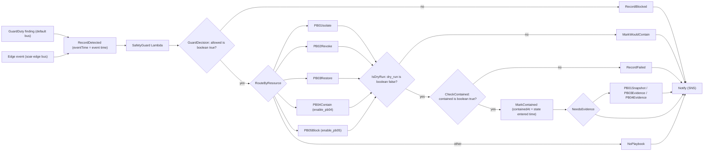

# Chapter 06: Detection telemetry and SOAR engine

| Field | Value |
|---|---|
| Chapter | 06 of 07 |
| Title | Detection telemetry and SOAR engine |
| Version | 1.0 |
| Date | 17 Oct 2026 |
| Status | DRAFT |
| Owner | S3 @ahklsfg (SecOps / SOAR / Forensics) |
| Reviewers | S1 @ELSHAHALY (network, compute, edge IP sets); S2 @YasseenAbdelghany (SOC read model, decoy publisher) |
| Governing plan | [`docs/plans/depi-phase-f-capstone-complete.md`](../plans/depi-phase-f-capstone-complete.md) §6.3 "06", §7.2 |

> **Sources and marks.** This chapter uses the legend, numbers policy, fixed wording, evidence classes and MTTC classes defined once in [`docs/reports/README.md`](README.md) §2–§5. `[repo: path Lx–y]` is read from this repository; `[CI: run …]` is a GitHub Actions run; `[HANDOFF §n]` is a previous record; `[local: …]` is a dated local observation; `[L<n>]` is an external source listed in §12; `[inferred]` and `[verify]` stay marked until checked.

> **What is measured vs pending (this chapter)**
> - **Measured (previous record):** SOAR pytest with 97.6 % coverage against a gate of 95 % [HANDOFF §13; repo: soar/pyproject.toml]; 622 pytest tests at the end of Phase D [HANDOFF §12]; `terraform test` soar 42, detection 14, log-archive 3 [HANDOFF §13]; CI green on PRs #1 and #2, which introduced the SOAR engine and the detection layer [CI: run 38478422214, PR #1, b28c75d] [CI: run 38486109181, PR #2, 7d6c677]. Chapter 07 §3 holds the Phase F re-measurement.
> - **Exists but is not a result:** the synthetic golden fixture (MTTC class M0) and the seeded local incidents (class M1). The replay-local runs under moto (class M2) prove routing and containment logic, not MTTC.
> - **Pending first apply:** GuardDuty findings, Step Functions executions, Lambda behaviour under real IAM, Athena queries against data, Object Lock retention, WAF blocks, and every MTTC figure on AWS (classes M3 and M4). Nothing has been applied to AWS [repo: docs/HANDOFF.md §1].

---

## 1. Telemetry sources and the log archive

### 1.1 Sources

The detection layer is `modules/detection`; its archive is `modules/log-archive`. Both sit in TB5, the security boundary that would move to a separate Security account in the target design [repo: docs/adr/0002-module-map-and-scaffold-strategy.md §1]. The build is a **single AWS account (ADR-0001); the multi-account design is the target state** [repo: docs/adr/0001-single-account-first.md "Decision"]. In one account an attacker holding workload admin can reach the archive and the SOAR roles; ADR-0001 lists KMS key policies, versioning, optional Object Lock and least-privilege roles as the mitigations [repo: docs/adr/0001-single-account-first.md "Consequences"].

| Source | Default | What it delivers | Source |
|---|---|---|---|
| GuardDuty detector | on | Findings to EventBridge (the SOAR trigger) and, exported, to `guardduty/` in the archive; S3, Runtime and Malware protections off (paid) | [repo: detection/README.md; infra/terraform/modules/detection/main.tf L30–73] |
| CloudTrail | on | Multi-region trail with log-file validation; management events plus S3 data events on exactly the evidence and documents buckets (and the SPA and lab buckets when enabled) | [repo: infra/terraform/modules/detection/cloudtrail.tf L11–54; detection/README.md] |
| VPC Flow Logs | on (network module) | Parquet, Hive-compatible partitions, per-hour partitions, to `vpc-flow-logs/` | [repo: infra/terraform/modules/network/main.tf L292–303] |
| AWS Config | on | Recorder scoped to `AWS::S3::Bucket`; rules `S3_BUCKET_PUBLIC_READ_PROHIBITED` and `S3_BUCKET_PUBLIC_WRITE_PROHIBITED`; NON_COMPLIANT notifies the analyst via the SOAR topic, never a playbook | [repo: infra/terraform/modules/detection/main.tf L157–247; detection/README.md "Scenario C"] |
| WAF logs | with `enable_edge` | Both web ACLs to a dedicated `aws-waf-logs-<name>-<acct>` bucket under the archive key, with `authorization`, `cookie` and `x-origin-verify` redacted | [repo: infra/terraform/modules/log-archive/waf-logs.tf; docs/adr/0004-edge-identity-waf.md D8] |
| Security Hub | off | CIS v3.0.0 and PCI DSS v3.2.1 behind flags | [repo: infra/terraform/modules/detection/main.tf L78–92; docs/HANDOFF.md §11] |

CloudTrail S3 data events are the compensating control for the S3 server access logs that cannot target the SSE-KMS archive (HANDOFF gap 16) [repo: detection/README.md; docs/HANDOFF.md §3 gap 16]. They also record every `GetObject` the SOC read path makes on evidence, which is the access trail for the chain of custody (§8) [repo: docs/adr/0006-app-soc-grc-local.md "Residual risks"].

### 1.2 Delivery policies

The archive bucket grants each service write access only under its own prefix, only for this account, and only from its own source ARN where the service supports it [repo: infra/terraform/modules/log-archive/main.tf L9–12, L236–431]:

| Writer | Prefix | Conditions | Lines |
|---|---|---|---|
| VPC Flow Logs (log delivery) | `vpc-flow-logs/AWSLogs/*` | `aws:SourceAccount`, `aws:SourceArn` | [repo: infra/terraform/modules/log-archive/main.tf L255–301] |
| CloudTrail | `cloudtrail/AWSLogs/<account>/*` | `aws:SourceArn` of the trail | [repo: infra/terraform/modules/log-archive/main.tf L312–345] |
| AWS Config | `config/AWSLogs/<account>/Config/*` | `aws:SourceAccount` | [repo: infra/terraform/modules/log-archive/main.tf L351–385] |
| GuardDuty export | `guardduty/*` | `aws:SourceAccount`, `aws:SourceArn` | [repo: infra/terraform/modules/log-archive/main.tf L390–429] |

The KMS key policy repeats the per-service scoping [repo: infra/terraform/modules/log-archive/main.tf L39–145]. The module's outputs depend on the policies, so a first-apply delivery cannot race them; the Phase C audit confirmed these policies as least-privilege and SourceArn-scoped [repo: docs/HANDOFF.md §11 "What was built", "Audit"]. A bucket policy also denies non-TLS access [repo: infra/terraform/modules/log-archive/main.tf L238].

### 1.3 Retention and Object Lock

The archive transitions objects to Glacier after 90 days and expires them after 365, with non-current versions expiring after 30 days [repo: infra/terraform/modules/log-archive/variables.tf L23–35; main.tf L218–233]. **Object Lock is optional and off by default** on both the archive (`log_archive_object_lock_days`, default 0) and the SOAR evidence bucket (§8.6), because a GOVERNANCE lock blocks `terraform destroy` for the retention period [repo: infra/terraform/environments/dev/variables.tf L109–112; infra/terraform/modules/log-archive/main.tf L173–187; docs/HANDOFF.md §8].

---

## 2. Hunting with Athena

### 2.1 Catalogue and workgroup

The Glue database `<name>_forensics` declares four tables over the archive, `cloudtrail`, `vpc_flow_logs`, `guardduty_findings` and `waf_logs`, all with **partition projection**, so there are no crawlers and no `MSCK REPAIR` [repo: infra/terraform/modules/detection/athena.tf L5, L153–480]. The workgroup is `${var.name}-cs-forensics` with `enforce_workgroup_configuration = true`, a per-query scan cap `athena_bytes_scanned_cutoff` of 1 GiB by default (allowed range 10 MiB to 10 GiB), and KMS-encrypted results under a dedicated key [repo: infra/terraform/modules/detection/athena.tf L43–52, L128–137; variables.tf L113–122]. Each query file becomes an `aws_athena_named_query`, so the repository file and the saved query are the same text [repo: infra/terraform/modules/detection/athena.tf L483; detection/README.md]. The detection README and `edge-waf-demo.md` call the workgroup `cs-forensics`; the deployed name carries the environment prefix, so operators should read it from `terraform output -raw athena_workgroup` [repo: docs/plans/depi-phase-f-capstone-complete.md F19].

### 2.2 The four hunt queries

| File | ATT&CK | Scenario | Tables | Parameters | Answers |
|---|---|---|---|---|---|
| `01_attacker_timeline_by_principal.sql` | T1078, T1552.001, T1552.005 | A, B | `cloudtrail` | 7 | Every API call by an access key, principal or source IP, oldest first; after PB-01/PB-02 the same key shows `AccessDenied` |
| `02_imds_and_recon_flow.sql` | T1046, T1552.005 | A | `vpc_flow_logs`, `cloudtrail` | 7 | Per-minute scan shape next to the worker role's API calls from an IP that is not the NAT egress; threshold 20 distinct ports per minute, to be tuned |
| `03_s3_public_exposure_audit.sql` | T1530 | C | `cloudtrail` | 5 | Who turned Block Public Access off, PB-03 turning it back on, and every object read in between, with external access flagged |
| `04_waf_blocked_requests_by_client.sql` | T1190, T1595, T1499 | QA, E | `waf_logs` | 2 | Every request not simply allowed, per client IP, ACL, terminating rule and action; rate-limited keys; `SoarBlockedIps` hits |

*Table 6.1: hunt queries [repo: detection/athena-queries/01–04 headers; detection/README.md "Hunt queries"].*

The queries use Athena `?` placeholders and run with `PREPARE … EXECUTE … USING`; each filters on a partition column so that a run stays under the scan cap [repo: detection/README.md "Hunt queries"]. They are **tested statically only**: `soar/tests/test_queries.py` asserts that each file is a single read-only statement (no `INSERT`, `DROP`, `MSCK`, `UNLOAD` and similar), that the placeholder count matches the header, that the header names an ATT&CK technique and a scenario, that only catalogued tables are used, and that each query filters on partition columns [repo: soar/tests/test_queries.py L1–75]. None has ever run against data [repo: docs/plans/depi-phase-f-capstone-complete.md F19]. One header comment is stale: query 04 still describes `RateLimitPerIp` rows as "what the PB-05 harvester publishes", while after audit A2 the harvester reads only `SoarApiRateLimit` [repo: detection/athena-queries/04_waf_blocked_requests_by_client.sql L11–13; docs/adr/0005-pb04-pb05-edge-and-ecs-containment.md D13]. The SQL aggregates the keys of every rate-based rule, so the result is unaffected.

---

## 3. SOAR architecture

### 3.1 Event sources

| Path | Rule | Target | Source |
|---|---|---|---|
| GuardDuty on the default bus | `source = aws.guardduty`, `detail-type = GuardDuty Finding`, and **either** `severity >= min_severity` (default 7) **or** a type in `always_route_finding_types` (`Recon:EC2/Portscan`, prefix `UnauthorizedAccess:IAMUser/InstanceCredentialExfiltration`, prefix `Policy:S3/`) | `cs-ir-router` when the playbook package is set; otherwise the SNS topic directly | [repo: infra/terraform/modules/soar/main.tf L343–368; variables.tf L45–66; state-machine.tf L654] |
| Dedicated edge bus `<name>-soar-edge` | `source = cloudshield.edge`, `detail.type` prefix `CloudShield:IPAddress/`, `resourceType = IPAddress` | `cs-ir-router` (PB-05 enabled) | [repo: infra/terraform/modules/soar/edge-bus.tf L54–150] |

The always-route list exists because the findings that scenarios A and C produce are Medium or Low (`Recon:EC2/Portscan` is Medium, `Policy:S3/*` are Low) and would otherwise never reach the router; ECS Runtime findings deliberately get no always-route entry, because auto-stopping production tasks on Medium findings is too aggressive [repo: infra/terraform/modules/soar/main.tf L346–348; docs/adr/0005-pb04-pb05-edge-and-ecs-containment.md D19]. The edge bus policy allows `events:PutEvents` only to named publishers and has an explicit Deny for every other `aws:PrincipalArn` [repo: infra/terraform/modules/soar/edge-bus.tf L71–95]. While playbooks are off, every routed GuardDuty finding still reaches the analyst by email, an honest baseline [repo: infra/terraform/modules/soar/main.tf L1–8, L362–368].

### 3.2 The router

*Figure 6.1: `cs-ir-router`, simplified from [repo: infra/terraform/modules/soar/state-machine.tf L1–21, L167–505]. Any task error is caught into `RecordFailed`. The full `stateDiagram-v2` is chapter 03 §9.*

The state machine is created only when `soar_playbook_package` is set; PB-04 and PB-05 states exist only with their flags, and the route table is built with `concat()` of conditional lists so the graph stays valid with them off [repo: infra/terraform/modules/soar/state-machine.tf L41–96, L115–165]. Every type-based choice also requires the matching `resourceType` (audit A5), so the router can never act on a target the guard did not vet [repo: infra/terraform/modules/soar/state-machine.tf L41–46]. The ordered choice table is pinned in a shared fixture, `infra/terraform/modules/soar/tests/route_choices.json`, which both `soar.tftest.hcl` and `soar/tests/test_sims.py` assert, so the Terraform router and the in-process router used by the sims cannot drift apart (audit A6) [repo: infra/terraform/modules/soar/tests/route_choices.json; soar/tests/test_sims.py L435–495; docs/HANDOFF.md §12 "Audit" A6].

### 3.3 Dedupe and re-runs

The incident key is the finding id, `$.detail.id` [repo: infra/terraform/modules/soar/state-machine.tf L39]. `RecordDetected` writes the row under the condition `attribute_not_exists(incidentId) OR status IN (FAILED, WOULD_CONTAIN_DRY_RUN)`. A run on a new finding, or on one whose previous run failed or was a dry run, proceeds; anything already `CONTAINED`, `BLOCKED_BY_GUARD` or in progress fails the condition and ends in `DuplicateFinding` (a Succeed state) without notifying [repo: infra/terraform/modules/soar/state-machine.tf L171–215]. Allowing re-runs from `FAILED` and dry-run fixed audit M9: GuardDuty re-delivers ongoing attacks under the same id, so turning dry-run off must take effect on a live incident [repo: docs/HANDOFF.md §2.5 M9; infra/terraform/modules/soar/state-machine.tf L185–189]. Each run overwrites `eventTime` with its own EventBridge time, while `firstEventTime` and `findingCreatedAt` keep the first sighting and `attempts` counts the runs [repo: infra/terraform/modules/soar/state-machine.tf L177–184]. Edge events use hourly ids (`edge-waf-rate-<ip>-<yyyyMMddHH>`, `edge-decoy-<ip>-<yyyyMMddHH>`), so repeats within the hour are router-level duplicates [repo: soar/playbooks/pb05_waf_ip_block.py L450; app/README.md "Phase E: decoy route"].

### 3.4 The fail-closed contract

The router fails closed at three points, the fix for audit M1 and M5 [repo: docs/HANDOFF.md §2.5 M1, M5]:

| Point | Proceeds only when | Anything else | Source |
|---|---|---|---|
| `GuardDecision` | `$.guard.decision.allowed` is present, is a boolean and equals `true` | `RecordBlocked` (`BLOCKED_BY_GUARD`) | [repo: infra/terraform/modules/soar/state-machine.tf L232–247] |
| `IsDryRun` | `$.guard.decision.dry_run` is present, is a boolean and equals `false` | `MarkWouldContain` (`WOULD_CONTAIN_DRY_RUN`) | [repo: infra/terraform/modules/soar/state-machine.tf L297–313] |
| `CheckContained` | `$.containment.result.contained` is present, is a boolean and equals `true` | `PlaybookDidNotContain` → `RecordFailed` (`FAILED`) | [repo: infra/terraform/modules/soar/state-machine.tf L312–333] |

### 3.5 Worked example: scenario C through the router (design intent)

Scenario C disables Block Public Access on the tagged lab bucket `<name>-lab-exposure` [repo: soar/sims/README.md "Scenarios"; docs/HANDOFF.md §11]. GuardDuty is designed to raise `Policy:S3/BucketBlockPublicAccessDisabled`, a Low-severity type that reaches the router only because `Policy:S3/` is on the always-route list (§3.1). `RecordDetected` creates the row with status `DETECTED` and stamps `eventTime` from the event, which starts the MTTC clock. The guard reads the dry-run switch, finds the target to be an S3 bucket, checks the project prefix and then the live bucket tags, and returns `allowed: true` with the current `dry_run` value. `RouteByResource` matches `S3Bucket` together with `Policy:S3/Bucket*` and invokes PB-03 `restore`. PB-03 re-checks prefix and tag itself, captures the pre-state, enables the four BPA flags and reads them back. With dry-run on, the playbook makes no change and returns `contained: false, would: restore`, and `IsDryRun` sends the run to `MarkWouldContain`: no MTTC is produced. With dry-run off, `CheckContained` sees `contained: true`, `MarkContained` stamps `containedAt`, and only then does `PB03Evidence` write the pre-state as hashed evidence. `Notify` publishes to SNS in every branch. Config's `S3_BUCKET_PUBLIC_READ_PROHIBITED` may also fire, but it only notifies [repo: detection/README.md "Scenario C"]. The same path runs offline in `test_replay_local_scenario_c_contains` under moto, as class M2 evidence [repo: soar/tests/test_sims.py L98–126]; on AWS it is pending.

### 3.6 Notes on the fail-closed contract

`IsPresent` comes first in each choice because a Choice on a missing path raises `States.Runtime`, which cannot be caught [repo: infra/terraform/modules/soar/state-machine.tf L232–234]. The Python side cooperates: the guard handler turns any exception into `allowed: false, dry_run: true` [repo: soar/safety_guard/handler.py L20–38], `Decision.to_dict` emits real booleans only [repo: soar/core/guard.py L62–74], and the playbook base acts only when the guard said `dry_run` is boolean `false` **and** a fresh read of the SSM switch says `false` [repo: soar/core/playbook.py L135–140]. Playbooks cannot forge a status or an MTTC: the repository refuses any playbook write to router-owned fields such as `status`, `eventTime` and `containedAt` [repo: soar/core/incidents.py L1–27, L80–83].

---

## 4. Safety guard (risk R2)

The guard is the R2 control ("a finding storm must not become an automation storm") in front of every playbook [repo: soar/core/guard.py L1–6; infra/terraform/modules/soar/variables.tf L112–113]. Its rules are evaluated in order and the first match decides [repo: soar/README.md "Safety guard rules"; soar/core/guard.py L224–263]:

| Rule | Check | Result on failure | Source |
|---|---|---|---|
| 1 | Read the dry-run SSM parameter on **every** call, never cached; `"true"`/`"false"` only | Unreadable → `allowed: false`, `dry_run: true` | [repo: soar/core/guard.py L96–104, L225–228] |
| — | Parse the finding | Malformed → `allowed: false` | [repo: soar/core/guard.py L230–233] |
| 2 | Sample finding (`additionalInfo.sample == true`) | dry-run → allowed (skips rule 3); live → refused "sample finding" | [repo: soar/core/guard.py L235–240] |
| 3 | The target carries the scope tag `cloudshield:soar-scope = in-scope`; buckets also need the `BUCKET_NAME_PREFIX` | Refused: "target lacks the SOAR scope tag", "bucket outside the project name prefix", "target not found" | [repo: soar/core/guard.py L245–263; infra/terraform/modules/soar/variables.tf L68–71] |
| 4 | Unknown resource type | Refused | [repo: soar/core/guard.py L247–248] |
| 5 | Always return `dry_run` as a boolean | — | [repo: soar/core/guard.py L62–74] |

**Rule 3 for ECS tasks (PB-04).** The guard refuses unless PB-04 is configured, the task was launched by a service, the finding's cluster equals `ECS_CLUSTER_ARN` and the service is allow-listed; it then calls `DescribeTasks` on the **live** task in that cluster, whose live `group` and live tags must match. Tags embedded in the finding are never trusted [repo: soar/core/guard.py L266–288].

**Rule 3 for IP addresses (PB-05).** An IP has no tags, so four checks replace the tag: the event comes from `cloudshield.edge`; its type is on the edge allow-list (today only `CloudShield:IPAddress/WafRateLimitExceeded`), and notify-only types (`DecoyRouteHit`) are refused with an explicit analyst-review reason; the event `time` lies within [now − 15 min, now + 60 s]; exactly one global-unicast address; and the address is not inside the never-block list, read on every call, where an unset, unreadable, empty or partly invalid list refuses every block [repo: soar/core/guard.py L55–59, L107–128, L291–322; soar/core/finding.py L32, L39, L102–140].

**The IAM double bound.** The guard is code and can have bugs, so IAM enforces the same scope independently [repo: soar/README.md "Safety guard rules"]:

| Bound | IAM mechanism | Source |
|---|---|---|
| EC2 isolation, snapshots, IAM user key changes | Conditioned on `aws:ResourceTag/cloudshield:soar-scope` (statements `IsolateInScopeInstance`, `SnapshotInScopeVolume`, `DeactivateKeyOfInScopeUser`, …) | [repo: infra/terraform/modules/soar/playbooks.tf L75, L150–300] |
| SG swap | Only onto the quarantine security group (`OnlyOntoQuarantineSg`) | [repo: infra/terraform/modules/soar/playbooks.tf L150–300] |
| NACL | `ec2:CreateNetworkAclEntry` only, only on the quarantine NACL ARNs; no Replace or Delete | [repo: infra/terraform/modules/soar/playbooks.tf L181–183; docs/adr/0003-pb01-nacl-quarantine.md "Decision"] |
| Inline policies (session revoke) | `iam:PutRolePolicy` / `PutUserPolicy` only on principals whose `iam:PermissionsBoundary` is the `soar-target-boundary` (audit M10), so a compromised playbook cannot grant them more than SSM plus a few reads | [repo: infra/terraform/modules/soar/playbooks.tf L250–258, L282–293; main.tf L420–435; docs/adr/0002-module-map-and-scaffold-strategy.md §5] |
| ECS | `StopTask` / `UpdateService` conditioned on `ecs:cluster` and the scope tag; never `RunTask`, `DeleteService`, `ExecuteCommand`, `PassRole` | [repo: docs/adr/0005-pb04-pb05-edge-and-ecs-containment.md "Consequences"] |
| S3 | Bounded by bucket-name prefix, not tag (gap 12): S3 tag-based ABAC would need `PutBucketAbac` on each bucket | [repo: docs/adr/0002-module-map-and-scaffold-strategy.md §5] |
| Evidence | `s3:PutObject` only under `incidents/*` | [repo: infra/terraform/modules/soar/playbooks.tf L232–234] |

The order of the rules is deliberate. Reading the dry-run switch first means that every later answer carries a trustworthy `dry_run` value, and that an unreadable switch is never mistaken for "live". The sample-finding rule comes before the scope rule because GuardDuty sample findings name fake resources that can never carry the tag; letting them through in dry-run is what makes a pre-production replay possible at all, and refusing them live is what stops a sample from ever acting [repo: soar/core/guard.py L235–240; docs/adr/0002-module-map-and-scaffold-strategy.md §3]. The scope rule then reads the target's tags live from AWS rather than from the event, because an event is caller-controlled text; the same principle drives the ECS and IP variants. Finally, the guard is a single function with no memory between calls: no cache of the switch, the tags or the never-block list survives an invocation, so changing any of them takes effect on the next finding [repo: soar/core/guard.py L96–128; soar/README.md "Safety guard rules" rule 1].

Two residual IAM risks are accepted and recorded: `ec2:CreateNetworkAclEntry` has no condition key for the rule action or number, so PB-01 refuses to report CONTAINED while any entry precedes its deny (`noPreemptingNaclEntries`); and `ec2:ModifyInstanceAttribute` cannot be limited per attribute [repo: docs/adr/0003-pb01-nacl-quarantine.md "Accepted IAM risks"]. The scope tag must never be placed in provider `default_tags`, which would make every resource fair game [repo: docs/HANDOFF.md §8].

---

## 5. Playbooks PB-01 to PB-05

Every playbook stops at CONTAINED. Containment runs before `MarkContained` and must verify itself by reading AWS back; evidence, where there is any, runs after `MarkContained` and outside the MTTC window. The table is read from the playbook code and the router.

| | Trigger (router choice) | Containment actions | "Contained" means (read back) | Evidence step (after CONTAINED) | Not covered |
|---|---|---|---|---|---|
| **PB-01** EC2 isolate (scenario A) | `resourceType = Instance`, or `InstanceCredentialExfiltration*` with `resourceType = AccessKey` (instance from `principalId`) | Deny-all NACL entries at rule 10 ingress and egress on the worker-tier NACL; SG swap onto the quarantine SG; termination and stop protection; inline deny on `aws:TokenIssueTime` < now for the instance role; ASG membership recorded only | `onlyQuarantineGroup`, `naclIngressDeny`, `naclEgressDeny`, `noPreemptingNaclEntries`, `terminationProtection`, `stopProtection`, plus `roleSessionsRevoked` when a role exists; up to 3 reads 1 s apart | `PB01Snapshot`: EBS snapshot of each in-scope volume, tagged at creation and reused on retry; manifest `incidents/<id>/pb01-ebs-manifest-<ts>.json` with SHA-256 | DNS via the Route 53 Resolver, IMDS, Time Sync, intra-subnet traffic; credentials re-issued by IMDS after rotation; multi-ENI instances; ASG detach; blast radius = whole worker tier |
| **PB-02** IAM key revoke (scenario B) | `resourceType = AccessKey` (not credential exfiltration) | Inline deny on `aws:TokenIssueTime` < now for the user (session revoke attempted first); deactivate the named key, or all active long-term keys for an `ASIA` key | `keysInactive` and `sessionsRevoked`; a refused session revoke means **not** contained | None in S3 (no `NeedsEvidence` branch); the steps are on the row's `actions` | Sessions of roles the user assumed; users without the SOAR target boundary cannot be contained |
| **PB-03** S3 restore BPA (scenario C) | `resourceType = S3Bucket` **and** type `Policy:S3/Bucket*` | Re-check prefix and tag; capture the pre-state (BPA, policy, policy status, ACL) with single-attempt short reads; enable all four BPA flags | All four flags read back `true`; up to 3 reads | `PB03Evidence`: the pre-state as `incidents/<id>/pb03-s3-prestate-<ts>.json` | `Exfiltration:S3/*`, `Impact:S3/*` (go to `NoPlaybook`); the public bucket policy itself (recovery is human); account-level BPA (not set by design, gap 6) |
| **PB-04** ECS task contain (scenario D) | `resourceType = ECSCluster` **and** type `*:Runtime/*`, only with `enable_pb04`, Runtime Monitoring and `soar_scope_app_service`; `>= min_severity` only | Prove membership with `ListTasks(cluster, serviceName)`; capture task and task definition in memory; `StopTask`; `UpdateService(forceNewDeployment)` | `taskStopped` (desired STOPPED, every container STOPPED, lastStatus DEPROVISIONING or STOPPED), `newDeploymentPrimary` (the specific new deployment id), `serviceInScope`; polled every 2 s for about 45 s, Lambda timeout 55 s | `PB04Evidence`: `incidents/<id>/pb04-ecs-task-<ts>.json` | **No eradication**: the same task definition and image digest are redeployed; ECS Exec volatile capture is human |
| **PB-05** WAF IP block (scenario E) | `source = cloudshield.edge` **and** `resourceType = IPAddress`, only with `enable_pb05` | Re-check source, type and address rules; re-read the never-block list; corroborate with `GetRateBasedStatementManagedKeys` on `SoarApiRateLimit`; cap check (default 1,000); write `blockState = pending` before acting; add-only `UpdateIPSet` with `LockToken`, at most 3 attempts | `cidrInIpSet` read back (up to 3 reads), then `blockState = active` | None in S3: the block fields and an action with `entriesBefore` and `corroboratedBy` on the row | Edge propagation not observed; `execute-api` direct calls; collateral behind shared egress; IP-set recreation drops blocks; decoy hits (refused) |

*Table 6.2: sources [repo: infra/terraform/modules/soar/state-machine.tf L47–113; soar/playbooks/pb01_ec2_isolate.py L1–18, L242–262, L294–361; soar/playbooks/pb02_iam_key_revoke.py L1–15, L60–101; soar/playbooks/pb03_s3_restore_bpa.py L1–19, L66–98, L136–156; soar/playbooks/pb04_ecs_task_contain.py L1–30, L95–172, L306–326; soar/playbooks/pb05_waf_ip_block.py L1–37, L170–255; soar/core/playbook.py L151–162; docs/adr/0003-pb01-nacl-quarantine.md "Consequences"; docs/adr/0005-pb04-pb05-edge-and-ecs-containment.md; soar/README.md "PB-02 and PB-03 notes"]. Rule 10 is `quarantine_nacl_rule_number`, validated to 1–99 [repo: infra/terraform/modules/soar/variables.tf L17–20; docs/adr/0003-pb01-nacl-quarantine.md "Decision"]; the PB-05 cap is `BLOCK_IP_SET_MAX` [repo: soar/README.md "Environment variables"].*

Four details deserve emphasis. First, PB-01's NACL deny is the fix for HANDOFF gap 10: security groups are stateful, so an SG swap alone would leave the attacker's tracked connections open while the playbook reported CONTAINED; a stateless NACL re-evaluates every packet [repo: docs/adr/0003-pb01-nacl-quarantine.md "Context", "Decision"]. Second, for credential exfiltration the role must exist and its `RoleId` must equal the role id in the finding's `principalId`, or PB-01 refuses before any change (audit A3) [repo: soar/README.md "PB-01 notes"; docs/HANDOFF.md §10 A3]. Third, PB-02's session revoke is part of containment because deactivating a key does not kill session credentials already minted from it (audit A2) [repo: soar/playbooks/pb02_iam_key_revoke.py L1–15]. Fourth, PB-05 trusts nothing the caller wrote: a principal allowed to start the router can hand it a forged "fresh edge event", so the WAF corroboration, read from a source the caller cannot write, is what prevents an arbitrary public IP from being blocked (audit A1) [repo: soar/playbooks/pb05_waf_ip_block.py L1–17; docs/adr/0005-pb04-pb05-edge-and-ecs-containment.md "Abuse analysis"].

The harvester that feeds PB-05 publishes an address only after it was a managed key of `SoarApiRateLimit` in at least two consecutive harvests (sightings under 60 s apart count as one, over 660 s apart restart the count), on the rate alarm and on a schedule of every 5 minutes by default, at most 50 events per run [repo: docs/adr/0005-pb04-pb05-edge-and-ecs-containment.md D13; soar/README.md "PB-05 notes"; infra/terraform/modules/soar/variables.tf L279–282].

---

## 6. The automation boundary

CloudShield implements **automated containment with human-gated eradication**. The state machine's own comment is "automation stops at CONTAINED"; there is no eradication or recovery state [repo: infra/terraform/modules/soar/state-machine.tf L18–20, L168; soar/README.md "Non-negotiables"].

| Phase | Who | Where it is written down |
|---|---|---|
| Detection | GuardDuty, WAF via the harvester, the decoy (notify-only) | §1, §3.1 |
| Triage and routing | `cs-ir-router` and the guard | §3, §4 |
| Containment and its verification | Playbooks | §5 |
| Evidence capture | Router evidence steps after CONTAINED | §8 |
| Eradication | Human | ADR-0003 "Consequences" (PB-01 NACL and SG recovery, revoke policy removal); `docs/runbooks/pb04-pb05-recovery.md` Part A (A1 preserve, A2 eradicate, A3 recover) and Part B (B1–B3a) |
| Recovery | Human | Same runbooks; the IR report's recovery checklist (§9) |

Two mechanisms look like automation past CONTAINED and are not. The **PB-05 sweeper** lifts a block only when it is row-tracked, expired (`blockExpiresAt`, default 24 h, `pb05_block_ttl_hours`) and not covered by a newer unexpired row for the same address; it is remove-only, uses the `LockToken`, reads back, and never touches an entry no row explains [repo: docs/adr/0005-pb04-pb05-edge-and-ecs-containment.md D15; soar/playbooks/pb05_unblock_sweeper.py L23, L150–163; infra/terraform/modules/soar/variables.tf L257–260, L312–315]. It ends a containment whose time is up; it does not recover the workload [repo: docs/adr/0005-pb04-pb05-edge-and-ecs-containment.md D15]. ADR-0002 §5 still says PB-05 blocks never expire automatically; that sentence predates audit A2, which changed D15 to "removal is automatic on expiry" [repo: docs/adr/0002-module-map-and-scaffold-strategy.md §5; docs/adr/0005-pb04-pb05-edge-and-ecs-containment.md "Audit amendments" A2]. This chapter follows ADR-0005. Second, **Terraform never lifts a containment**: the NACL deny entries are not in state, and the IP sets have `ignore_changes = [addresses]` [repo: docs/adr/0003-pb01-nacl-quarantine.md "Consequences"; docs/adr/0004-edge-identity-waf.md "Consequences"].

The global switch defaults to dry-run (`soar_dry_run = true`); going live is a deliberate sequence: upload the package, set it with dry-run on, replay sample findings that must end `WOULD_CONTAIN_DRY_RUN`, and only then flip the switch [repo: infra/terraform/modules/soar/variables.tf L39–43; soar/README.md "To go live"]. GuardDuty sample findings can only ever run in dry-run (guard rule 2) [repo: docs/adr/0002-module-map-and-scaffold-strategy.md §3].

---

## 7. Mean time to contain (MTTC)

### 7.1 Definition

The definition is plan §7.2, implemented in the router and in both report tools [repo: docs/plans/depi-phase-f-capstone-complete.md §7.2; docs/reports/README.md §5].

- For a run *r*: **MTTC(r) = containedAt(r) − eventTime(r)**, in seconds, defined **only** when *r* ends `CONTAINED`.
- `eventTime(r)` is the `time` of the EventBridge event that started *r*, written by `RecordDetected` (`":et" = $.time`); `firstEventTime` and `findingCreatedAt` keep the first sighting [repo: infra/terraform/modules/soar/state-machine.tf L177–184, L199].
- `containedAt(r)` is `$$.State.EnteredTime` of `MarkContained`, which the router enters only after `CheckContained` has seen a boolean `contained: true` from a read-back verification [repo: infra/terraform/modules/soar/state-machine.tf L312–351, L345].
- **Excluded by design:** the attacker action to GuardDuty detection; GuardDuty `createdAt` to EventBridge delivery, which is stored and reported separately as detection latency; evidence capture after CONTAINED; dry-run runs (`WOULD_CONTAIN_DRY_RUN`) [repo: docs/adr/0002-module-map-and-scaffold-strategy.md §3; soar/tools/generate_ir_report.py L285–325]. `BLOCKED_BY_GUARD`, `FAILED` and `NO_PLAYBOOK_ANALYST_REVIEW` have no MTTC; they are reported as counts and as a containment rate.

The rationale is ADR-0002 §3: the clock separates SOAR latency, which the project controls and targets at under 60 s, from GuardDuty's detection and delivery delay, which it does not [repo: docs/adr/0002-module-map-and-scaffold-strategy.md §3]. The same arithmetic is coded twice: `mttcOf` in docs-api (CONTAINED rows only, timezone-aware ISO-8601 only, rounded to milliseconds) and `build_report` in the Python tool [repo: app/docs-api/src/soc/time.ts L1–23; soar/tools/generate_ir_report.py L285–296]. The golden fixture pins both to the same answers (§8.5).

### 7.2 KPI and statistics

- **KPI.** Each graded scenario run must have MTTC below the 60 s target. `sims.runner` asserts it for `replay --target aws`, and since audit A3 a CONTAINED row without a computable MTTC does **not** pass [repo: soar/sims/runner.py L37, L135–137; docs/HANDOFF.md §11 A3].
- **Over a window**, report n, the median (p50), p90 and the maximum, with the nearest-rank percentile `sorted[max(0, ceil(p/100 · n) − 1)]` that `metrics.ts` uses; never a mean alone [repo: app/docs-api/src/soc/metrics.ts L9–13, L30–42]. The SOC dashboard shows last, p50, p90, max and the sample count against the 60 s target line [repo: app/spa/src/soc/MttcMeter.tsx L17–39; app/docs-api/src/soc/time.ts L17].
- Windows are 24 h, 7 d or 30 d; metrics are flagged `truncated` when the bounded GSI queries hit their page limit [repo: app/docs-api/src/soc/metrics.ts L6–7, L52–60].

### 7.3 Measurement classes

| Class | What it measures | Exists? | How it may be quoted |
|---|---|---|---|
| **M0** synthetic oracle | Golden fixture, e.g. `mttc_seconds: 18.0` in the `intact` case [repo: soar/tests/fixtures/coc_golden.json] | Yes | As a test oracle only, **never** as a result |
| **M1** seeded | Hand-authored local demo incidents, 9 s to 40 s across seven CONTAINED incidents [repo: app/local-dev/src/seed.ts L214–225] | Yes | **Always** labelled "seeded" |
| **M2** replay-local | In-process router and real playbook code under moto (`soar/tests/test_sims.py`); yields test durations, **not MTTC** | Yes (CI) | As routing/containment logic evidence only |
| **M3** replay-aws | Real router, Lambdas and AWS APIs, synthetic detection (decision D4) | **No: PENDING (first lab apply)** | — |
| **M4** live-aws | End to end, including GuardDuty | **No: PENDING (first lab apply)** | — |

### 7.4 Validity threats

| Threat | Effect | Mitigation or reporting rule |
|---|---|---|
| Whole-second resolution of the EventBridge `time` [inferred] | About ±1 s on each figure [inferred] | Report to whole seconds; never claim sub-second precision |
| `replay-aws` stamps `time` on the operator's clock and calls `StartExecution` directly, skipping the EventBridge hop [repo: docs/plans/depi-phase-f-capstone-complete.md F17] | Clock skew enters the figure; delivery latency is absent | NTP-synchronised operator clock; label the result "router MTTC, synthetic detection" |
| Cold starts after a deploy | The first run is slower | Report the first run after a deploy separately |
| Small n | Percentiles of a handful of runs are fragile | Always give n; nearest-rank only; no mean alone |
| Seeded data on the dashboard | The SOC view does not display a measurement class, so seeded local numbers look like results [repo: app/spa/src/soc/MttcMeter.tsx L17–39] | Speakers and reports call every local figure "seeded" (M1) |
| Router-owned clock fields | A playbook could otherwise shorten its own MTTC | Playbooks cannot write `eventTime` or `containedAt` [repo: soar/core/incidents.py L14–27, L80–83] |

### 7.5 Status

| Class | Scenario | n | p50 (s) | p90 (s) | max (s) | < 60 s? | Command that fills the row |
|---|---|---|---|---|---|---|---|
| M3 replay-aws | C (PB-03) | PENDING (first lab apply) | PENDING (first lab apply) | PENDING (first lab apply) | PENDING (first lab apply) | PENDING (first lab apply) | `make sim SCENARIO=c MODE=replay TARGET=aws ACCOUNT=<id> NAME=<name> SIM_ARGS="--state-machine-arn $(terraform output -raw soar_state_machine_arn) --bucket-name <lab bucket>"` with dry-run off, then `GET /soc/metrics?window=7d` |
| M3 replay-aws | A (PB-01) | PENDING (first lab apply) | PENDING (first lab apply) | PENDING (first lab apply) | PENDING (first lab apply) | PENDING (first lab apply) | `make sim SCENARIO=a MODE=replay TARGET=aws ACCOUNT=<id> NAME=<name> SIM_ARGS="--state-machine-arn … --instance-id <worker> --role-id <role id>"` (needs `enable_report_worker = true`) |
| M3 replay-aws | B (PB-02) | PENDING (first lab apply) | PENDING (first lab apply) | PENDING (first lab apply) | PENDING (first lab apply) | PENDING (first lab apply) | `make sim SCENARIO=b MODE=replay TARGET=aws ACCOUNT=<id> NAME=<name> SIM_ARGS="--state-machine-arn … --user-name <honeytoken> --access-key-id <runtime key>"` (needs `enable_lab_targets = true`) |
| M4 live-aws | A, B, C | PENDING (first lab apply) | PENDING (first lab apply) | PENDING (first lab apply) | PENDING (first lab apply) | PENDING (first lab apply) | Operator-run per `soar/sims/README.md` (the runner refuses to automate `live-aws`); per incident `python -m tools.generate_ir_report <id> --table <name>-soar-incidents --format json` |

*Table 6.3: no MTTC measured on AWS exists yet, for either M3 or M4 [repo: docs/HANDOFF.md §1; soar/sims/runner.py L223]. Scenarios D and E are replay-local only and dry-run forced, by design, so they can never produce an MTTC [repo: docs/adr/0005-pb04-pb05-edge-and-ecs-containment.md D20]. Chapter 07 §5–§6 holds the full lab placeholder table.*

### 7.6 What MTTC does not say

MTTC measures the part of the response that the automation owns, so it can look excellent while the overall response is poor. A finding the guard refuses, a playbook that fails verification, or a finding type with no playbook produces no MTTC at all; reporting only the MTTC distribution would silently drop exactly the incidents that went wrong. For that reason the outcome counts per status (`byStatus` in `/soc/metrics`) and the containment rate belong next to every MTTC figure [repo: app/docs-api/src/soc/metrics.ts L15–49]. Detection latency, the time from GuardDuty's `createdAt` to the EventBridge event, is reported separately in the IR report and is outside the project's control [repo: soar/tools/generate_ir_report.py L315]. The time from the attacker's action to GuardDuty's finding is not measured anywhere in the repository. A complete account of a lab run therefore has three numbers with their classes: detection latency, MTTC, and the outcome counts.

Two clarifications on the offline evidence. `make sim … TARGET=local` is **not** offline: it drives the real handlers through the default boto3 chain with the configured AWS credentials [repo: soar/sims/README.md "`--target local` still calls AWS"; Makefile L85–87]. CI's replay evidence is pytest under moto, in `soar/tests/test_sims.py`: `test_replay_local_scenario_{a,b,c}_contains` reach `CONTAINED`, and the D/E tests reach `WOULD_CONTAIN_DRY_RUN`, including when the SSM switch flips mid-run [repo: soar/tests/test_sims.py L98–176, L736–833].

---

## 8. Evidence and chain of custody

### 8.1 Writing evidence

| Step | Mechanism | Source |
|---|---|---|
| Canonical form | `json.dumps(document, sort_keys=True, separators=(",", ":"), default=str)`, UTF-8 | [repo: soar/core/evidence.py L41–42] |
| Local hash | SHA-256 of those bytes, hex and base64 | [repo: soar/core/evidence.py L50–53] |
| S3 checksum | `PutObject` with `ChecksumAlgorithm = SHA256` and `ChecksumSHA256 = <base64>`, so S3 is designed to reject a corrupted upload; the response checksum must equal the local one or `EvidenceIntegrityError` is raised | [repo: soar/core/evidence.py L54–64] |
| Key layout | `incidents/<id>/pb0N-…-<UTC timestamp>.json`; timestamped, so a re-run never overwrites earlier evidence | [repo: soar/playbooks/pb01_ec2_isolate.py L353; pb03_s3_restore_bpa.py L150–151; pb04_ecs_task_contain.py L321] |
| Hash on the row | The record `{bucket, key, versionId, sha256, sha256Base64}` is appended to `evidenceRecords` with `list_append`; `evidenceSha256 = if_not_exists(…)` keeps the **first** hash (audit A8) | [repo: soar/core/incidents.py L61–78; soar/core/evidence.py L23–38] |
| Provenance in the document | Incident id, finding type, event time, the actor (the Step Functions execution ARN) and `collectedAt` | [repo: soar/playbooks/pb01_ec2_isolate.py L341–352; pb03_s3_restore_bpa.py L141–149] |

A file cannot contain its own hash, which is why the hash lives on the incident row and the manifest plus the row together form the chain-of-custody record [repo: soar/README.md "PB-01 notes"]. `evidenceRecords` only ever grows by `list_append`, so a re-run after `FAILED`, which captures an already-remediated state, cannot displace the original exposure evidence [repo: soar/core/incidents.py L61–64].

### 8.2 Version pinning

The evidence bucket is versioned, KMS-encrypted with the SOAR key and fully public-access-blocked [repo: infra/terraform/modules/soar/main.tf L233–290]. Each record keeps the `VersionId` that `PutObject` returned, and both verifiers fetch exactly that version [repo: soar/core/evidence.py L64; soar/tools/generate_ir_report.py L265–271; app/docs-api/src/soc/evidence.ts L67]. Overwriting the key afterwards therefore creates a new version that the check ignores. Because an S3 object version is not modified in place [verify], what breaks a pinned record is deleting that version or editing the row; a record without a version id (as in the seeded scenario C pre-state) is broken by any later overwrite [repo: app/local-dev/src/seed.ts L217].

### 8.3 Recompute, never repeat

`python -m tools.generate_ir_report <incident-id>` downloads every object listed on the row, **recomputes** its SHA-256 and compares it with the recorded hex and base64 forms; it does not repeat what the row claims [repo: soar/tools/generate_ir_report.py L1–8, L265–283]. Its exit codes are 0 (report written), 1 (incident not found or bad input) and **2 (report written, but an evidence hash did not match: chain of custody broken)**; the optional AI summary never changes the exit code [repo: soar/tools/generate_ir_report.py L19–21, L383]. Its IAM need is read-only: `dynamodb:GetItem`, `s3:GetObject` and `kms:Decrypt` [repo: soar/tools/generate_ir_report.py L3–6].

On the seeded compose stack, Phase F step 0 ran the tool directly against moto: it exited **2** for `local-c-public-bucket`, whose seeded pre-state object is tampered after its hash was recorded ("Chain of custody: **BROKEN**"), and **0** for `local-a-cred-exfil` [local: Phase F step 0, 2026-10-17, 319d916, sandbox, seeded compose moto] [repo: app/local-dev/src/seed.ts L214, L217]. This is seeded data (class M1 for the times it prints), not a forensic result. Two practical notes from that run: boto3 needs `AWS_DEFAULT_REGION` (`AWS_REGION` alone fails with `NoRegionError`), and `make ir-report` reports any tool failure as make's own exit status 2, so the demo calls Python directly to show the real code [local: Phase F step 0, 2026-10-17, 319d916, sandbox, seeded compose moto].

### 8.4 The live view in docs-api

The SOC dashboard verifies evidence with the same primitive (version-pinned `GetObject`, SHA-256 hex compare, base64 cross-check) and reports `SOC_EVIDENCE_VERIFIED` in the audit trail [repo: app/docs-api/src/soc/evidence.ts L1–5; app/docs-api/src/audit/audit.ts L22, L36]. It is stricter in three ways and weaker in one:

| Aspect | Python IR tool | docs-api live view |
|---|---|---|
| Bucket and prefix | Uses the bucket in the record | Refuses any record whose bucket is not `EVIDENCE_BUCKET` or whose key is outside `incidents/`, before any `GetObject` |
| Coverage | Every record | At most 20 records, each at most 5 MiB |
| Incomplete check | n/a | Truncated or over-size → `null` ("not fully verified"), never intact and never BROKEN (audit E6) |
| Object Lock | Not read | Bucket lock configuration and per-object retention and legal hold, reported as found or `null`, never assumed |

*Table 6.4: [repo: soar/tools/generate_ir_report.py L265–283; app/docs-api/src/soc/evidence.ts L17–18, L59–130, L88–101, L107–118; docs/adr/0006-app-soc-grc-local.md "Design changes", E6].*

### 8.5 Python/TypeScript parity

`soar/tests/fixtures/coc_golden.json` holds seven cases: `intact`, `tampered`, `missing-object`, `base64-mismatch`, `versioned`, `not-contained` and `no-evidence-dry-run`. Each gives the row, the objects and the expected `evidence[]`, `chain_of_custody_ok` and `mttc_seconds` [repo: soar/tests/fixtures/coc_golden.json]. pytest asserts the Python tool against it (`test_ir_golden.py`, which keeps the Python tool authoritative), and Jest asserts the docs-api view against the same file (`soc.int.test.ts`) [repo: soar/tests/test_ir_golden.py L1–7; app/docs-api/test/soc.int.test.ts L1–2, L16]. The expected verdicts include `false` for the tampered, missing and base64-mismatch cases, `true` for intact, versioned and not-contained, and `null` when there is no evidence [repo: soar/tests/fixtures/coc_golden.json]. The fixture's MTTC values are class M0 and are never results.

### 8.6 Retention: Object Lock off by default

**Object Lock is off by default (`evidence_object_lock_days = 0`)** [repo: infra/terraform/modules/soar/variables.tf L101–110]. With a positive value, the bucket is created with Object Lock enabled and a GOVERNANCE default retention of that many days, which every evidence object receives on write without needing `s3:PutObjectRetention` [repo: infra/terraform/modules/soar/main.tf L239–252; soar/core/evidence.py L1–7]. The setting is only possible at bucket creation and blocks teardown for the retention period [repo: infra/terraform/modules/soar/variables.tf L102].

Phase F adds the **dev pass-through** (plan D13): `environments/dev` now declares `evidence_object_lock_days` (number, default 0, whole days ≥ 0, "Set it BEFORE the first apply") and passes it to `module.soar`, with a commented line in `terraform.tfvars.example` [repo: infra/terraform/environments/dev/variables.tf L115–124; main.tf L182; terraform.tfvars.example L26; docs/plans/depi-phase-f-capstone-complete.md D13]. Without it, a lab could not have locked evidence at all [repo: docs/plans/depi-phase-f-capstone-complete.md F18]. Whether a locked version refuses deletion, and which error codes the retention reads return with the lock off and on, are first-apply items; moto does not support the retention read through the JS SDK, so those cases are unit-tested against a mocked client [repo: docs/adr/0006-app-soc-grc-local.md "Step 0 outcomes" item 1; docs/plans/s2-app-soc-ui-grc.md §16 item 5].

### 8.7 What the chain of custody does and does not prove

The mechanism is tamper **evidence**, not tamper **prevention**. It detects three kinds of change: bytes that no longer match the recorded hash (an overwrite of an unpinned key, or a row that points at other content), a deleted object or version (the fetch fails, reported as an error, and the chain is not intact), and an edited base64 field on the row that no longer agrees with the hex hash (the `base64-mismatch` golden case) [repo: soar/tools/generate_ir_report.py L265–283; soar/tests/fixtures/coc_golden.json]. CloudTrail S3 data events on the evidence bucket add a record of who read or wrote which object, which is the access half of a custody record [repo: detection/README.md; infra/terraform/modules/detection/cloudtrail.tf L25–54].

It does not, on its own, defeat a principal who can write both the evidence object and the incident row: such a principal could store a new object and a matching hash and version id. In the single account that is an account administrator or a compromised SOAR role with both permissions; the playbook roles can write evidence only under `incidents/*` and cannot write router-owned row fields, but they can append evidence records [repo: infra/terraform/modules/soar/playbooks.tf L232–234; soar/core/incidents.py L61–83]. Three controls narrow this. With Object Lock on, a locked version cannot be overwritten or deleted during the retention period; in GOVERNANCE mode, a principal holding the bypass permission can still remove the lock [verify]. The `evidenceSha256` field keeps the first hash ever written, so a later forged record does not displace it [repo: soar/core/incidents.py L61–64]. And the multi-account target moves the evidence bucket and the incidents table into a Security account that workload administrators cannot reach [repo: docs/adr/0001-single-account-first.md "Consequences"]. The report therefore states the chain of custody as "hashes recomputed and matched against the row", not as proof against an insider with write access to TB5.

---

## 9. IR report, ChatOps and the LLM hook

**IR report.** Beyond the chain-of-custody check, the report gives an incident record (status, finding, severity, EventBridge time as the MTTC start, `containedAt` as the stop, MTTC against the 60 s target, detection latency from `createdAt` to the event, the execution ARN), the containment actions in time order, and an executive summary with ATT&CK technique and tactic, impact, and eradication and recovery checklists taken deterministically from `core/attack.py` [repo: soar/tools/generate_ir_report.py L9–17, L285–330; soar/README.md "IR report enhancements"]. For a PB-03 incident with exactly one valid bucket name it adds a ready-to-apply `aws_s3_bucket_public_access_block` block and the `terraform import` line, so the remediation can be codified back into Terraform; otherwise no snippet [repo: soar/tools/generate_ir_report.py L54–99; soar/README.md "IR report enhancements"]. The docs-api SOC route `GET /soc/incidents/{id}/report` serves a Markdown or JSON report from the same model and audits the export as `SOC_REPORT_EXPORTED` [repo: app/docs-api/src/routes.ts L150–160; app/docs-api/src/audit/audit.ts L23, L37].

**ChatOps notifier.** Subscribed to the incidents topic only when `chatops_webhook_param_name` is set and the package exists. The webhook URL is a credential: it lives only in an SSM SecureString under the SOAR key, created out of band, so it is never in Terraform state, a plan or the repository; it is cached 5 minutes per container and logged as host only [repo: docs/adr/0005-pb04-pb05-edge-and-ecs-containment.md D16; soar/README.md "ChatOps notifier"; docs/runbooks/chatops-setup.md]. All outbound HTTPS goes through one call site, `core/http.post_json`: https only, exact host allow-list, port 443, no userinfo, no redirects, no proxies, a 3 s timeout, an 8 KiB request body cap and a 4 KiB response read cap [repo: soar/README.md "ChatOps notifier"]. The notifier never raises into SNS, because asynchronous retries would re-post [repo: soar/README.md "ChatOps notifier"].

**LLM hook (off by default).** `--ai-summary` adds an advisory summary only when `CLOUDSHIELD_LLM_PROVIDER=anthropic` and `ANTHROPIC_API_KEY` are also set. It sends a redacted projection (finding type, resource type, status, MTTC, step names; ARNs, account ids, IPs, emails, key ids and bucket names replaced) to `https://api.anthropic.com/v1/messages` through the same `core/http.py`, labels the output "AI-generated, advisory", and degrades to "AI summary unavailable" on any error [repo: soar/README.md "IR report enhancements"; docs/adr/0005-pb04-pb05-edge-and-ecs-containment.md D17]. It lives in `soar/tools/`, which the Lambda zip does not contain, so no Lambda can call it [repo: soar/README.md "Layout"; docs/HANDOFF.md §12]. Its request against the real API is a first-apply item [repo: docs/HANDOFF.md §12 "Not proven"].

---

## 10. Limits and follow-ups

| # | Limit | Consequence | Follow-up or mitigation | Source |
|---|---|---|---|---|
| 1 | **DNS channel after PB-01 quarantine** | The Route 53 Resolver, IMDS, Time Sync and intra-subnet traffic are not filtered by NACLs or SGs, so DNS-tunnelled C2 survives isolation; IMDS can hand out fresh role credentials after rotation, which code on the host could leak over DNS | Treat the role as still at risk and revoke it again after eradication. Follow-up: a Route 53 Resolver DNS Firewall rule group that blocks all domains, attached as part of quarantine | [repo: docs/adr/0003-pb01-nacl-quarantine.md "Consequences"; docs/HANDOFF.md §3 gap 10, §10 "Next for S3"] |
| 2 | **PB-04 does not eradicate** | `forceNewDeployment` redeploys the same task definition and image digest; a compromised image is redeployed too | Eradication (a new scanned image deployed by digest) and ECS Exec capture are human steps | [repo: docs/adr/0005-pb04-pb05-edge-and-ecs-containment.md "Consequences"; docs/runbooks/pb04-pb05-recovery.md Part A] |
| 3 | **Shared egress (PB-05)** | A block is per address; behind a NAT, carrier-grade gateway, proxy or VPN exit, one abusive client blocks everyone behind it, site-wide | `/api/*`-only feed, two-harvest persistence, 24 h default expiry (lowerable to 1 h), never-block list, manual early lift | [repo: docs/adr/0005-pb04-pb05-edge-and-ecs-containment.md "Consequences"; docs/runbooks/pb04-pb05-recovery.md B3] |
| 4 | **Bus-policy trust** | The edge bus Deny holds against named principals, but an account admin can rewrite the bus policy and publish; and any principal with `states:StartExecution` on the router can bypass the bus | PB-05 corroborates with WAF itself; keep `StartExecution` and `InvokeFunction` to SOAR roles and admins; the multi-account target removes workload admins from the Security account | [repo: docs/adr/0002-module-map-and-scaffold-strategy.md §5; docs/adr/0005-pb04-pb05-edge-and-ecs-containment.md "Abuse analysis"] |
| 5 | **Decoy corroboration** | Decoy hits are notify-only; there is no corroboration source PB-05 can read, so they can never block | Follow-up: a WAF rate rule `SoarDecoyRateLimit` on `/api/admin` (limit 10 per 60 s) that PB-05 could corroborate against; needs S1 + S3 review | [repo: docs/adr/0006-app-soc-grc-local.md "Follow-ups"; docs/runbooks/decoy-route.md] |
| 6 | **Audit-stream consumer** | The application audit table has a `NEW_AND_OLD_IMAGES` stream, but nothing alarms on `MODIFY` or `REMOVE`; the audit table is insert-only by convention | The audit stream consumer **is a follow-up** | [repo: infra/terraform/modules/data/main.tf L8–9, L94–97; docs/adr/0006-app-soc-grc-local.md "Follow-ups"] |
| 7 | PB-05 "contained" is a read-back of the IP set | Propagation to every CloudFront edge is not observed [inferred: seconds to a minute]; `execute-api` direct calls are not covered | First-apply measurement of propagation time | [repo: docs/adr/0005-pb04-pb05-edge-and-ecs-containment.md "Consequences", "Verify on the first apply"] |
| 8 | IP-set recreation drops every block | Rows still say `active`; `make expired-blocks` reports them as lost | Accepted for the lab; re-block by hand | [repo: docs/adr/0005-pb04-pb05-edge-and-ecs-containment.md "Consequences" A11] |
| 9 | PB-02 cannot revoke sessions of roles the user assumed | Those sessions remain valid | Documented, not handled | [repo: soar/playbooks/pb02_iam_key_revoke.py L13–14] |
| 10 | Lambda reserved concurrency is unreserved by default | No per-playbook concurrency cap on a new account | Set 5 once the account quota allows | [repo: infra/terraform/modules/soar/variables.tf L112–115; docs/adr/0002-module-map-and-scaffold-strategy.md §5] |
| 11 | No case management or enrichment | Analysts work from the incident row, SNS/ChatOps and the IR report | Out of scope (chapter 02 §5) | [repo: docs/plans/depi-phase-f-capstone-complete.md §6.3 "02" item 5c] |
| 12 | Nothing applied to AWS | Every runtime claim above is design intent | The verify-on-first-apply lists in ADR-0004 §9, ADR-0005 and ADR-0006, consolidated in chapter 07 §9 | [repo: docs/HANDOFF.md §1, §12, §13] |

### 10.1 Rubric mapping

The DEPI rubric is not in the repository; no criterion is stated here [repo: docs/plans/depi-phase-f-capstone-complete.md F22].

| Rubric criterion | Section of this chapter |
|---|---|
| [source: plan PDF, not in repo — team to verify] | |
| [source: plan PDF, not in repo — team to verify] | |

| Item from the plan PDF | Content |
|---|---|
| Ratings of risks R2 and R4 (only R1 = H×H is in the repository) [source: plan PDF, not in repo — team to verify] | |
| Plan §6.2–6.5 / Figure 6.5 as drawn in the PDF (this chapter follows `soar/README.md` and ADR-0003) [source: plan PDF, not in repo — team to verify] | |

---

## 11. Summary

The detection layer is built as Terraform with least-privilege, per-prefix delivery into a KMS-encrypted archive and a scan-capped Athena workgroup over projected tables; its four hunt queries are statically checked and have never run against data. The SOAR engine is a Step Functions router that fails closed at three explicit points, a safety guard whose scope rule is enforced a second time by IAM, and five playbooks that each report CONTAINED only after reading AWS back. Evidence is canonical JSON with S3-verified SHA-256 checksums, its hash on the incident row, version-pinned and recomputed by two independent implementations held to one golden fixture. MTTC is defined precisely and has exactly one honest status on AWS: pending the first lab apply.

---

## 12. References

External sources are drawn only from the approved list [repo: docs/plans/depi-phase-f-capstone-complete.md §6.4]. No statistic is quoted from any of them.

- **[L1]** NIST, *SP 800-61 Rev. 2, Computer Security Incident Handling Guide* (2012). https://csrc.nist.gov/pubs/sp/800/61/r2/final [verify: edition, date, URL; link not checked]. Accessed —, to be filled when verified.
- **[L2]** NIST, *SP 800-61 Rev. 3, Incident Response Recommendations and Considerations for Cybersecurity Risk Management: A CSF 2.0 Community Profile* (2025). https://csrc.nist.gov/pubs/sp/800/61/r3/final [verify: edition, date, URL; link not checked]. Accessed —, to be filled when verified.
- **[L3]** NIST, *SP 800-86, Guide to Integrating Forensic Techniques into Incident Response* (2006). https://csrc.nist.gov/pubs/sp/800/86/final [verify: edition, date, URL; link not checked]. Accessed —, to be filled when verified.
- **[L4]** Amazon Web Services, *AWS Security Incident Response Guide* (whitepaper, living document). https://docs.aws.amazon.com/whitepapers/latest/aws-security-incident-response-guide/welcome.html [verify: edition, date, URL; link not checked]. Accessed —, to be filled when verified.
- **[L5]** The MITRE Corporation, *ATT&CK Enterprise Matrix, Cloud / IaaS*; record the version used. https://attack.mitre.org/matrices/enterprise/cloud/iaas/ [verify: edition, date, URL; link not checked]. Accessed —, to be filled when verified.
- **[L6]** ISO/IEC 27037, *Guidelines for identification, collection, acquisition and preservation of digital evidence* (2012). https://www.iso.org/standard/44381.html [verify: edition, date, URL; link not checked]. Accessed —, to be filled when verified.
- **[L7]** ISO/IEC 27035 (series), *Information security incident management*. https://www.iso.org/search.html?q=27035 [verify: edition, date, URL; link not checked]. Accessed —, to be filled when verified.
- **[L8]** Amazon Web Services, *AWS Well-Architected Framework, Security Pillar* (living document). https://docs.aws.amazon.com/wellarchitected/latest/security-pillar/welcome.html [verify: edition, date, URL; link not checked]. Accessed —, to be filled when verified.

How the chapter relates to them, qualitatively: the router covers the detection, analysis and containment activities of the SP 800-61 lifecycle [L1] and stops before eradication and recovery, which stay with people; Rev. 3 reframes the same activities as a CSF 2.0 profile [L2] [verify]. Evidence capture after containment, hashing, version pinning and an access trail follow the collection-and-preservation concerns of SP 800-86 [L3] and ISO/IEC 27037 [L6]. Pre-provisioned, tag-scoped automation with a dry-run switch reflects the preparation themes of the AWS guide [L4] and the Security Pillar [L8]. Technique ids are MITRE ATT&CK [L5]. No conformance with any of them is claimed.
