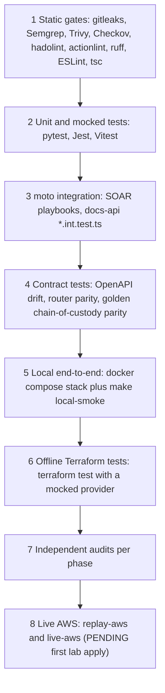

# Chapter 07: Verification, attack simulations and quality assurance

| Field | Value |
|---|---|
| Chapter | 07 |
| Version | 1.0 |
| Date | 17 Oct 2026 |
| Status | DRAFT (section 3 and Appendix A are completed by the Validator after the final `make verify-all` run) |
| Owners | All three: S1 @ELSHAHALY (pipeline, Terraform and verify-all evidence), S2 @YasseenAbdelghany (application QA), S3 @ahklsfg (attack simulations, MTTC, chain of custody) |
| Reviewers | The two owners who did not write a section review it; the Independent Auditor reviews the whole chapter |

**Sources and marks.** The legend, the numbers policy and the evidence classes are defined once in [docs/reports/README.md](README.md). Citation forms used here: `[repo: path §/line]` (a file in this repository), `[CI: run <id>, PR #n, <sha>]` (a GitHub Actions run), `[local: verify-all 2026-10-17, <sha>, sandbox]` (the Phase F local run), `[HANDOFF §n]` (a record in `docs/HANDOFF.md`) and `[L<n>]` (an external source from the References list in section 12). `[inferred]` marks our understanding that has not been verified. `[verify]` marks an edition, date or behaviour that must be checked against the official source.

> **What is measured vs pending**
>
> - **Measured, locally and in CI:** static gates, unit and mocked tests, moto integration tests, contract tests, the local end-to-end smoke run, offline Terraform tests, and the replay of attack scenarios A–E through an in-process copy of the router under moto. Each figure in this chapter names its run.
> - **Synthetic or seeded (never a result):** the golden chain-of-custody fixture (class M0) and the seeded SOC incidents of the local stack (class M1).
> - **Pending the first lab apply:** everything that needs AWS. That covers GuardDuty, Step Functions, Lambda, Athena, Object Lock, WAF, and any MTTC measured on AWS (classes M3 and M4). Nothing has ever been applied to AWS [HANDOFF §1]. Every such cell in this chapter reads `PENDING (first lab apply)` and names the command that fills it.

---

## 1. Verification strategy

CloudShield is verified in layers. Each layer catches a class of defect that the layer below it cannot see, and each layer has a stated limit. The aim of this chapter is to say, for every claim the project makes, which layer supports it and which layer is still missing.



*Figure 7.1: The verification layers, from the cheapest and fastest at the top to the most expensive at the bottom. Layer 8 does not exist yet.*

**Layer 1: static gates.** These are the CI security gates and the linters. Secrets scanning runs over the full git history. SAST, dependency scanning, IaC scanning, image scanning and Dockerfile linting run on every pull request [repo: .github/workflows/ci.yml]. The gates prove the absence of known patterns, not the absence of defects. Section 7.2 records which gates have been shown to trip on a planted finding and which have not.

**Layer 2: unit and mocked tests.** The SOAR code is tested with pytest under moto and has a coverage floor of 95 % in branch mode [repo: soar/pyproject.toml L27–L31]. The API is tested with Jest, with global thresholds of 90 % for lines, statements and functions and 85 % for branches [repo: app/docs-api/jest.config.js L7]. The SPA is tested with Vitest, with thresholds of 80 / 80 / 80 / 75 [repo: app/spa/vitest.config.ts L15]. These tests show that the code does what its authors meant it to do. They cannot show that the authors' model of AWS is right.

**Layer 3: moto integration.** The playbooks run against an in-process moto account. The docs-api `*.int.test.ts` suites run against a moto server on `MOTO_ENDPOINT` [repo: Makefile `app-test` comment]. moto gives realistic API shapes and state. It does **not** enforce IAM, KMS key ids, bucket policies or Object Lock retention reads [HANDOFF §13; repo: docs/runbooks/local-dev.md "Differences from AWS"], so this layer proves behaviour and never proves a security control.

**Layer 4: contract tests.** Three contracts are pinned in both directions:
- the OpenAPI document against the generated types of both packages (`openapi:check`) [repo: app/docs-api/package.json L19];
- the router's ordered choice table, which `soar.tftest.hcl` asserts against the rendered state machine and pytest asserts against the in-process router [repo: soar/tests/test_sims.py, router parity block];
- the golden chain-of-custody cases, which pytest and Jest both evaluate against the same fixture [repo: soar/tests/fixtures/coc_golden.json].

**Layer 5: local end-to-end.** `docker-compose.local.yml` runs moto, a dev-only identity provider, an idempotent seed, the **production** docs-api image in local mode, and the SPA on nginx. `make local-smoke` then drives it through nginx the way a browser would [repo: docs/runbooks/local-dev.md]. This layer exercises the real container, the real HTTP stack and the real security headers. The data is seeded and the AWS services are emulated.

**Layer 6: offline Terraform tests.** `terraform test` runs against a mocked AWS provider with pinned mock values in every module that has a `tests/` directory [HANDOFF §10]. The tests assert flag defaults, IAM policy content (rendered and mutation-checked), and the router choice table [HANDOFF §10, §12]. They show that the configuration renders as designed. They cannot show that AWS accepts it.

**Layer 7: independent audits.** After each phase, an agent that had not seen the build reviewed it. The findings were fixed before the phase closed (section 4).

**Layer 8: live AWS.** Replay against the real `cs-ir-router` (`replay --target aws`) and operator-run live scenarios would test real IAM, real KMS, real event delivery and real MTTC. They are designed and gated (section 5), and none has run.

`make verify-all` (Phase F) runs layers 1 to 6 locally, in one sequence that stops at the first failure: `preflight → terraform → soar → docs-api → spa → checkov → gitleaks → actionlint → local-smoke` [repo: scripts/verify-all.sh; Makefile `verify-all`]. Its exit codes are 0 (pass), 1 (a check failed), 2 (a prerequisite is missing) and 3 (the working tree changed). With `VERIFY_ALLOW_SKIP=1`, a missing tool becomes SKIP and the run reports `RESULT: INCOMPLETE`; this chapter never cites an INCOMPLETE run as a full verification. Semgrep, Trivy and ZAP are not covered locally, because they need registry or database downloads, and CI is the authority for them.

---

## 2. Evidence-class legend

Every result in this chapter belongs to one of the evidence classes below [repo: docs/plans/depi-phase-f-capstone-complete.md §7.1].

| Evidence | Class | Where it lives |
|---|---|---|
| CI runs on PRs #1–#4 and the Phase F PR, where the scan steps really passed (the `Report (fail-open)` steps were skipped) | CI | Appendix B |
| pytest with coverage, Jest, Vitest, local-dev Jest, `terraform fmt`/`validate`/`test`, Checkov, Gitleaks, actionlint, hadolint | local-measured and CI | Section 3; [HANDOFF §13] as the previous record |
| `make local-smoke` | local-measured; CI `app-smoke` | Section 7.1 |
| Replay-local A/B/C reaching CONTAINED; D/E reaching WOULD_CONTAIN_DRY_RUN; safety-gate refusals | CI (pytest under moto) | Section 5.3 |
| Golden chain-of-custody cases with Python/TypeScript parity | synthetic oracle | Section 8.2 |
| Seeded SOC incidents, including scenario C with a BROKEN chain | seeded demo data | Section 6.3 |
| Gate self-test | local | Section 7.2 |
| Anything on AWS | **pending first apply** | Sections 5.4, 6.4, 8.5, 9 |

MTTC has its own classes, defined in section 6.1: M0 synthetic oracle, M1 seeded, M2 replay-local, M3 replay-aws and M4 live-aws. Every MTTC figure in this chapter states its class.

---

## 3. Results, measured

This section is filled by the Validator from the final Phase F `make verify-all` run and from the CI run on the Phase F PR. Until then, every result and number cell holds the marker below. The "previous record" column repeats the last recorded figures from HANDOFF §13. Those were taken on local Linux after the Phase E audit fixes, with CI on PR #4 green [HANDOFF §13]. They are context only and are never a Phase F result.

**Run metadata**

<!-- VALIDATOR-FILL -->
| Item | Value |
|---|---|
| Commit SHA (and dirty flag) | <!-- VALIDATOR-FILL --> |
| Date and time (UTC) | <!-- VALIDATOR-FILL --> |
| Environment (`uname -sm`, sandbox or laptop) | <!-- VALIDATOR-FILL --> |
| Tool versions vs CI pins, including any WARN (for example ruff vs the 0.17.0 pin [repo: soar/requirements-dev.txt L6]) | <!-- VALIDATOR-FILL --> |
| verify-all exit code and RESULT line | <!-- VALIDATOR-FILL --> |
| Log directory | <!-- VALIDATOR-FILL --> |
| Phase F PR CI run | <!-- VALIDATOR-FILL: run id, PR number, head SHA --> |

### 3.1 Terraform

<!-- VALIDATOR-FILL -->
| Check | Result | Numbers | Source | Previous record |
|---|---|---|---|---|
| `terraform fmt -check -recursive -diff infra/terraform` | <!-- VALIDATOR-FILL --> | <!-- VALIDATOR-FILL --> | <!-- VALIDATOR-FILL: [local: verify-all 2026-10-17, <sha>, sandbox] --> | fmt clean [HANDOFF §13] |
| `terraform validate` on the bootstrap, `environments/dev` and 9 modules | <!-- VALIDATOR-FILL --> | <!-- VALIDATOR-FILL --> | <!-- VALIDATOR-FILL --> | 11/11 [HANDOFF §13] |
| `terraform test`, all module directories with `tests/` | <!-- VALIDATOR-FILL --> | <!-- VALIDATOR-FILL --> | <!-- VALIDATOR-FILL --> | 110/110 [HANDOFF §13] |
| `terraform test` per module | <!-- VALIDATOR-FILL --> | <!-- VALIDATOR-FILL --> | <!-- VALIDATOR-FILL --> | compute 22, data 6, detection 14, edge 14, identity 8, lab-targets 1, log-archive 3, soar 42 [HANDOFF §13] |

### 3.2 SOAR (Python)

<!-- VALIDATOR-FILL -->
| Check | Result | Numbers | Source | Previous record |
|---|---|---|---|---|
| `ruff check . ../scripts/package_soar.py` | <!-- VALIDATOR-FILL --> | <!-- VALIDATOR-FILL --> | <!-- VALIDATOR-FILL --> | clean [HANDOFF §13] |
| `ruff format --check . ../scripts/package_soar.py` | <!-- VALIDATOR-FILL --> | <!-- VALIDATOR-FILL --> | <!-- VALIDATOR-FILL --> | clean [HANDOFF §13] |
| `python -m pytest --cov` (gate `fail_under = 95` [repo: soar/pyproject.toml L31]) | <!-- VALIDATOR-FILL --> | <!-- VALIDATOR-FILL: tests passed, TOTAL coverage % --> | <!-- VALIDATOR-FILL --> | coverage 97.6 %; the test count is not recorded in §13 [HANDOFF §13]; 622 tests at 97.45 % after Phase D [HANDOFF §12] |
| Package determinism: `scripts/package_soar.py` built twice, SHA-256 compared | <!-- VALIDATOR-FILL --> | <!-- VALIDATOR-FILL: both digests --> | <!-- VALIDATOR-FILL --> | byte-identical [HANDOFF §10, §12] |
| ATT&CK export: `python -m tools.export_attack_table --check ../app/docs-api/src/soc/attack-table.generated.json` | <!-- VALIDATOR-FILL --> | <!-- VALIDATOR-FILL --> | <!-- VALIDATOR-FILL --> | in sync (CI step, [CI: run 38984704551, PR #4, 9adc96d]) |

### 3.3 docs-api (TypeScript API)

<!-- VALIDATOR-FILL -->
| Check | Result | Numbers | Source | Previous record |
|---|---|---|---|---|
| `npm run lint -- --max-warnings 0` | <!-- VALIDATOR-FILL --> | <!-- VALIDATOR-FILL --> | <!-- VALIDATOR-FILL --> | clean [HANDOFF §13] |
| `npm run typecheck` | <!-- VALIDATOR-FILL --> | <!-- VALIDATOR-FILL --> | <!-- VALIDATOR-FILL --> | clean [HANDOFF §13] |
| `npm run openapi:check` (contract drift) | <!-- VALIDATOR-FILL --> | <!-- VALIDATOR-FILL --> | <!-- VALIDATOR-FILL --> | in sync [HANDOFF §13] |
| Jest with coverage against moto (gates 90 / 90 / 90 / 85 [repo: app/docs-api/jest.config.js L7]) | <!-- VALIDATOR-FILL --> | <!-- VALIDATOR-FILL: tests, suites, % lines, % branches --> | <!-- VALIDATOR-FILL --> | 290 tests / 17 suites; 94.5 % lines, 86.8 % branches [HANDOFF §13] |

### 3.4 SPA (React)

<!-- VALIDATOR-FILL -->
| Check | Result | Numbers | Source | Previous record |
|---|---|---|---|---|
| `npm run lint` | <!-- VALIDATOR-FILL --> | <!-- VALIDATOR-FILL --> | <!-- VALIDATOR-FILL --> | clean [HANDOFF §13] |
| `npm run typecheck` | <!-- VALIDATOR-FILL --> | <!-- VALIDATOR-FILL --> | <!-- VALIDATOR-FILL --> | clean [HANDOFF §13] |
| `npm run test:coverage` (Vitest; gates 80 / 80 / 80 / 75 [repo: app/spa/vitest.config.ts L15]) | <!-- VALIDATOR-FILL --> | <!-- VALIDATOR-FILL: tests, % lines --> | <!-- VALIDATOR-FILL --> | 50 tests; 96.3 % lines [HANDOFF §13]. Phase F adds the readiness-pack tests, so the count is expected to change |
| Production build with `VITE_AUTH_MODE=cognito`, `check-bundle.mjs`, and no `local-idp` in `dist/` | <!-- VALIDATOR-FILL --> | <!-- VALIDATOR-FILL --> | <!-- VALIDATOR-FILL --> | green in CI `gate: app` [CI: run 38984704551, PR #4, 9adc96d] |

### 3.5 local-dev tooling

<!-- VALIDATOR-FILL -->
| Check | Result | Numbers | Source | Previous record |
|---|---|---|---|---|
| lint, typecheck | <!-- VALIDATOR-FILL --> | <!-- VALIDATOR-FILL --> | <!-- VALIDATOR-FILL --> | clean [HANDOFF §13] |
| `npx jest --ci` | <!-- VALIDATOR-FILL --> | <!-- VALIDATOR-FILL --> | <!-- VALIDATOR-FILL --> | 5 tests [HANDOFF §13] |

### 3.6 Checkov and hadolint

<!-- VALIDATOR-FILL -->
| Check | Result | Numbers | Source | Previous record |
|---|---|---|---|---|
| `checkov -d infra/terraform --framework terraform --quiet --compact --download-external-modules false` | <!-- VALIDATOR-FILL --> | <!-- VALIDATOR-FILL: passed / failed / skipped --> | <!-- VALIDATOR-FILL --> | 953 passed, 0 failed [HANDOFF §13] |
| `checkov -d app --framework dockerfile --quiet --compact` | <!-- VALIDATOR-FILL --> | <!-- VALIDATOR-FILL: passed / failed --> | <!-- VALIDATOR-FILL --> | 202 passed, 0 failed [HANDOFF §13] |
| hadolint on the 3 Dockerfiles (`app/docs-api`, `app/spa`, `app/local-dev`) | <!-- VALIDATOR-FILL --> | <!-- VALIDATOR-FILL --> | <!-- VALIDATOR-FILL --> | clean [HANDOFF §13] |

### 3.7 Gitleaks and actionlint

<!-- VALIDATOR-FILL -->
| Check | Result | Numbers | Source | Previous record |
|---|---|---|---|---|
| `gitleaks git . --redact --verbose --exit-code 1` (full history) | <!-- VALIDATOR-FILL --> | <!-- VALIDATOR-FILL: commits scanned, leaks --> | <!-- VALIDATOR-FILL --> | no leaks [HANDOFF §13] |
| `actionlint .github/workflows/*.yml` | <!-- VALIDATOR-FILL --> | <!-- VALIDATOR-FILL --> | <!-- VALIDATOR-FILL --> | clean [HANDOFF §13] |

### 3.8 Local end-to-end

<!-- VALIDATOR-FILL -->
| Check | Result | Numbers | Source | Previous record |
|---|---|---|---|---|
| `docker compose -f docker-compose.local.yml config -q` | <!-- VALIDATOR-FILL --> | <!-- VALIDATOR-FILL --> | <!-- VALIDATOR-FILL --> | valid (CI `gate: app` step) [CI: run 38984704551, PR #4, 9adc96d] |
| `make local-up` then `make local-smoke` (8 checks [repo: app/local-dev/src/smoke.ts L36–L64]) | <!-- VALIDATOR-FILL --> | <!-- VALIDATOR-FILL: n/8 --> | <!-- VALIDATOR-FILL: verify-all, or "sandbox-blocked; CI app-smoke run <id> is the authority" --> | 8/8 [HANDOFF §13]; CI `app-smoke` green [CI: run 38984704551, PR #4, 9adc96d] |

### 3.9 Gates covered only by CI

`make verify-all` does not run Semgrep, Trivy fs, Trivy image or ZAP. The evidence for these is the CI run on each pull request, in which the scan step succeeded and the `Report (fail-open)` step was skipped [repo: docs/plans/depi-phase-f-capstone-complete.md F2].

<!-- VALIDATOR-FILL -->
| Gate | PR #1 | PR #2 | PR #3 | PR #4 | Phase F PR |
|---|---|---|---|---|---|
| `gate: sast (semgrep)` | pass [CI: run 38478422214, PR #1, b28c75d] | pass [CI: run 38486109181, PR #2, 7d6c677] | pass [CI: run 38930049163, PR #3, 247643a] | pass [CI: run 38984704551, PR #4, 9adc96d] | <!-- VALIDATOR-FILL --> |
| `gate: sca (trivy fs)` | pass [CI: run 38478422214, PR #1, b28c75d] | pass [CI: run 38486109181, PR #2, 7d6c677] | pass [CI: run 38930049163, PR #3, 247643a] | pass [CI: run 38984704551, PR #4, 9adc96d] | <!-- VALIDATOR-FILL --> |
| `gate: image (trivy image + sbom)` | job pass, Trivy step skipped (no Dockerfile yet) [CI: run 38478422214, PR #1, b28c75d] | as #1 [CI: run 38486109181, PR #2, 7d6c677] | as #1 [CI: run 38930049163, PR #3, 247643a] | pass; 0 fixable CRITICAL/HIGH [CI: run 38984704551, PR #4, 9adc96d; HANDOFF §13] | <!-- VALIDATOR-FILL --> |
| `gate: dast (zap baseline)` | skipped on PRs (by design) | skipped | skipped | skipped | <!-- VALIDATOR-FILL --> |

The Semgrep run on PR #4 reported 95 rules and 0 findings. That was the first run of the `p/typescript` and `p/react` packs [HANDOFF §13].

---

## 4. Independent audits summary

Each phase was closed by the same pipeline: Planner → Builder → Independent Auditor → fixes → Validator [HANDOFF §10]. The auditor was a separate agent that had not seen the build. The outcomes:

| Phase | Branch / PR | Verdict | Findings | Source |
|---|---|---|---|---|
| Scaffold | `main` (`67e414c`) | PASS WITH FIXES | 10 major, 10 minor; all major fixed | [HANDOFF §2.5] |
| SOAR engine | `feat/s3-soar-playbooks` / #1 | PASS WITH FIXES | 3 major, 9 minor; all addressed | [HANDOFF §10] |
| Phase C (detection, hunting, sims) | `feat/s3-detection-athena-sims` / #2 | PASS WITH FIXES | 1 major, 5 minor; all fixed | [HANDOFF §11] |
| Phase D (edge, identity, WAF, PB-04/05) | `feat/s1-s2-edge-identity-waf` / #3 | FAIL → fixed | 2 major, 9 minor | [HANDOFF §12] |
| Phase E (app, SOC, GRC, local stack) | `feat/s2-app-soc-ui-grc` / #4 | PASS WITH FIXES | 0 critical, 0 high, 2 medium, 8 low, 2 info; all fixed in `b1d4543` | [HANDOFF §13] |
| Phase F (this phase) | `feat/depi-phase-f-capstone-complete` / the Phase F PR | <!-- VALIDATOR-FILL --> | <!-- VALIDATOR-FILL --> | <!-- VALIDATOR-FILL --> |

The audits matter to this chapter because several of their findings were **verification defects**: tests or gates that passed for the wrong reason. These are the lessons that shaped the tests described in section 5:

- **Scaffold M8.** The gate self-test counted any non-zero exit as a trip. It now requires the seeded finding to appear in the tool output [HANDOFF §2.5]. `expect_trip` reports a bare non-zero exit without the signature as a failure [repo: scripts/gate-selftest.sh L26–L42].
- **Scaffold M5.** CONTAINED could be recorded when a playbook did nothing. The `CheckContained` state now requires a boolean `contained: true` [HANDOFF §2.5].
- **Scaffold M1.** The safety guard failed open on a `"false"` string or `null`. The router now fails closed at three points [HANDOFF §2.5].
- **Phase C A3.** `replay --target aws` passed on CONTAINED even when MTTC could not be computed. A CONTAINED run now passes only with a computed MTTC under 60 s [HANDOFF §11; repo: soar/sims/runner.py L134–L137].
- **Phase C A4.** The "router parity" test compared strings and never called `_route` [HANDOFF §11].
- **Phase D A6.** The parity test could still pass for the wrong reason. The ordered choice table now lives in one file, `route_choices.json`, and both `terraform test` and pytest assert it [HANDOFF §12].
- **Phase D A10.** Scenarios D and E had a dry-run race. They now use a reader that always says dry-run, and a test flips the switch mid-run to prove it [HANDOFF §12; repo: soar/tests/test_sims.py `test_d_e_stay_dry_run_even_if_the_switch_flips_mid_run`].

The lesson we draw is that a green test is evidence only when it can fail for the defect it names. Section 10 returns to this.

---

## 5. Attack simulations A–E

### 5.1 Design

The scenarios are defined in `soar/sims/scenarios.py` [repo: soar/sims/scenarios.py L26–L74]. Each one builds a GuardDuty-shaped EventBridge event (or, for E, the edge harvester's event shape) aimed at a **real lab target**, and records the MITRE ATT&CK techniques [L1] and the playbook it is expected to reach.

| Key | Name (as in code) | ATT&CK techniques | Finding type | Resource type | Expected playbook |
|---|---|---|---|---|---|
| `a` | EC2 IMDS credential theft + recon | T1552.005, T1046 | `UnauthorizedAccess:IAMUser/InstanceCredentialExfiltration.OutsideAWS` | AccessKey | `pb01-ec2-isolate` |
| `a-recon` | EC2 port scan | T1046 | `Recon:EC2/Portscan` | Instance | `pb01-ec2-isolate` |
| `b` | Leaked honeytoken IAM key | T1078, T1552.001 | `UnauthorizedAccess:IAMUser/MaliciousIPCaller.Custom` | AccessKey | `pb02-iam-key-revoke` |
| `c` | Public S3 exposure | T1530 | `Policy:S3/BucketBlockPublicAccessDisabled` | S3Bucket | `pb03-s3-restore-bpa` |
| `d` | ECS runtime compromise | T1610, T1059 | `Execution:Runtime/NewBinaryExecuted` | ECSCluster | `pb04-ecs-task-contain` |
| `e` | Edge IP abuse | T1190, T1595 | `CloudShield:IPAddress/WafRateLimitExceeded` | IPAddress | `pb05-waf-ip-block` |

Scenarios D and E are in `DRY_RUN_ONLY` [repo: soar/sims/scenarios.py L74]. They refuse `--target aws` and `live-aws`, and they refuse to run at all unless the SSM dry-run parameter reads `"true"` [repo: soar/sims/runner.py `_dry_run_only_gate`]. Against a real account they can therefore only ever produce WOULD_CONTAIN_DRY_RUN.

Scenario A in live mode uses **real containment with a replayed detection** (decision D4 of Phase C). A genuine `InstanceCredentialExfiltration.OutsideAWS` finding would require moving the worker role's credentials off the instance, and the project does not do that [repo: soar/sims/README.md "Why live A is replayed detection"].

**The R4 gates (AWS abuse).** Every run passes `sims/safety.py` before any AWS call [repo: soar/sims/safety.py; soar/sims/README.md "Safety first"]:

1. the caller's account must be named with `--allowed-account`; there is no default;
2. the client's resolved region must equal `--region`, and an unresolved region fails closed;
3. before any pipeline call, each named target's **live tags** are read. The target must carry `cloudshield:soar-scope=in-scope` and, for buckets and IAM users, also match the `--name` prefix;
4. `--mode live-aws` also needs `--confirm-live <account-id>`, the account retyped;
5. the sim only names resources it looked up in this account, never an external host.

A refused gate exits `3` and does nothing. A run that does not meet the bar exits `1`, and a passing run exits `0` [repo: soar/sims/README.md "Modes"]. This target check is independent of the pipeline's own `SafetyGuard`, so it holds even if the guard is misconfigured.

**Where automation stops.** Every scenario ends at CONTAINED (or its dry-run equivalent). The design is automated containment with human-gated eradication: eradication and recovery are analyst steps, listed in each IR report's checklists [repo: soar/tools/generate_ir_report.py; docs/runbooks/pb04-pb05-recovery.md]. This follows the separation of containment from eradication and recovery in the incident-handling lifecycle [L3].

**What counts as a pass.** In replay-local, a run passes if the in-process router ends in CONTAINED or WOULD_CONTAIN_DRY_RUN [repo: soar/sims/runner.py L92]. The local router reports CONTAINED only when dry-run is off **and** the playbook returned boolean `contained: true` [repo: soar/sims/local_router.py L128]. In replay-aws, a CONTAINED run passes only if MTTC was computed and is below `MTTC_TARGET_SECONDS = 60.0` [repo: soar/sims/runner.py L37, L134–L137].

### 5.2 Mode availability matrix

| Scenario | replay-local (in-process router, moto in CI) | replay-aws (`StartExecution` on `cs-ir-router`) | live-aws (operator-run) |
|---|---|---|---|
| A | ✓ CI | PENDING (first lab apply); needs `enable_report_worker` | PENDING; replayed detection by design (D4) |
| A-recon | ✓ (routed in parity tests; no dedicated replay test) | PENDING (first lab apply) | PENDING; needs `allow_worker_lab_scan` |
| B | ✓ CI | PENDING (first lab apply); needs `enable_lab_targets` | PENDING; "no detection" is reported, never claimed as a pass |
| C | ✓ CI | PENDING (first lab apply); needs `enable_lab_targets` | PENDING |
| D | ✓ CI, dry-run only | ✗ refused by design (D20) | ✗ refused by design (D20) |
| E | ✓ CI, dry-run only | ✗ refused by design (D20) | ✗ refused by design (D20) |

Sources: [repo: soar/sims/README.md "Modes", "Scenarios"; soar/sims/runner.py `_dispatch`, `_dry_run_only_gate`]. `live-aws` is not automated: the runner raises a safety error that names the README, and `test_live_mode_is_not_automated` asserts exit 3 [repo: soar/tests/test_sims.py].

**`make sim … TARGET=local` is not offline.** It drives the real playbook handlers through the default boto3 credential chain, so on a laptop with AWS credentials it reads, and with dry-run off mutates, the configured account [repo: soar/sims/README.md, warning box; Makefile `sim` comment]. CI's replay evidence is **pytest under moto** (`soar/tests/test_sims.py`), and only that is cited as replay-local evidence in this chapter.

### 5.3 Offline results (replay-local under moto, pytest)

The table lists the real tests in `soar/tests/test_sims.py` and what each one asserts. The `world` fixture builds a moto account with a tagged and an untagged worker instance, the dedicated worker NACL, a quarantine SG, the report-worker role, a tagged honeytoken user, a tagged and an untagged bucket, the incidents table and an evidence bucket. It sets the dry-run parameter to `"false"` [repo: soar/tests/conftest.py `world`]. So an exit code of 0 in the A/B/C replay tests can only mean CONTAINED: WOULD_CONTAIN_DRY_RUN needs dry-run on, and FAILED exits 1.

"Last CI" means the `gate: soar (ruff + pytest)` job, which hard-fails on any failed test [repo: .github/workflows/ci.yml, `gate: soar`]. A green job therefore implies that every test below passed.

<!-- VALIDATOR-FILL -->
| Test | What it asserts | Last CI | Phase F run |
|---|---|---|---|
| `test_replay_local_scenario_c_contains` | With the bucket's BPA turned off, the runner exits 0 (CONTAINED, dry-run off) and BPA reads back `BlockPublicAcls: true` | pass [CI: run 38984704551, PR #4, 9adc96d] | <!-- VALIDATOR-FILL --> |
| `test_replay_local_scenario_a_contains` | Scenario A against the tagged worker and its role id exits 0 (CONTAINED via PB-01) | pass [CI: run 38984704551, PR #4, 9adc96d] | <!-- VALIDATOR-FILL --> |
| `test_replay_local_scenario_b_contains` | Scenario B against the tagged honeytoken and its key exits 0 (CONTAINED via PB-02) | pass [CI: run 38984704551, PR #4, 9adc96d] | <!-- VALIDATOR-FILL --> |
| `test_replay_local_dry_run_is_would_contain` | With dry-run `"true"`, scenario A exits 0 as WOULD_CONTAIN_DRY_RUN | pass [CI: run 38984704551, PR #4, 9adc96d] | <!-- VALIDATOR-FILL --> |
| `test_d_replay_local_is_would_contain` | Scenario D prints `"status": "WOULD_CONTAIN_DRY_RUN"` and `"playbook": "pb04-ecs-task-contain"`; the ECS stub has no pending responses (no StopTask or UpdateService) | pass [CI: run 38984704551, PR #4, 9adc96d] | <!-- VALIDATOR-FILL --> |
| `test_e_replay_local_is_would_contain` | Scenario E prints WOULD_CONTAIN_DRY_RUN and `pb05-waf-ip-block` | pass [CI: run 38984704551, PR #4, 9adc96d] | <!-- VALIDATOR-FILL --> |
| `test_e_never_block_hit_is_blocked_by_guard` | An IP on the never-block list exits 1 with `"status": "BLOCKED_BY_GUARD"` | pass [CI: run 38984704551, PR #4, 9adc96d] | <!-- VALIDATOR-FILL --> |
| `test_d_e_stay_dry_run_even_if_the_switch_flips_mid_run` (D, E) | The switch flips to `"false"` after the runner's gate; the outcome is still WOULD_CONTAIN_DRY_RUN, the switch is read exactly once, and D makes no mutating ECS call (audit A10) | pass [CI: run 38984704551, PR #4, 9adc96d] | <!-- VALIDATOR-FILL --> |
| `test_run_local_force_dry_run_ignores_a_live_switch` | `force_dry_run=True` with the switch `"false"` gives WOULD_CONTAIN_DRY_RUN and leaves the bucket's BPA unconfigured | pass [CI: run 38984704551, PR #4, 9adc96d] | <!-- VALIDATOR-FILL --> |
| `test_runner_refuses_untagged_instance_before_acting` | An untagged instance exits 3 with "lacks", and **no incident row was created** (the gate ran before RecordDetected; audit A1) | pass [CI: run 38984704551, PR #4, 9adc96d] | <!-- VALIDATOR-FILL --> |
| `test_runner_refuses_bucket_outside_prefix` | An untagged bucket exits 3 | pass [CI: run 38984704551, PR #4, 9adc96d] | <!-- VALIDATOR-FILL --> |
| `test_runner_refuses_untagged_account` | An account not on the allow-list exits 3 with "SAFETY" | pass [CI: run 38984704551, PR #4, 9adc96d] | <!-- VALIDATOR-FILL --> |
| `test_require_lab_*` (accepts allow-listed account; refuses unknown account; needs an allow-list; refuses wrong region) and `test_region_must_be_resolved` | R4 rules 1 and 2, including the fail-closed unresolved region (audit A2) | pass [CI: run 38984704551, PR #4, 9adc96d] | <!-- VALIDATOR-FILL --> |
| `test_live_mode_needs_matching_confirmation` | R4 rule 4: a wrong `--confirm-live` is refused and the right one accepted | pass [CI: run 38984704551, PR #4, 9adc96d] | <!-- VALIDATOR-FILL --> |
| `test_assert_in_scope_requires_prefix_and_tag`, `test_assert_in_scope_instance_skips_prefix`, `test_read_target_tags_*` | R4 rule 3: tag and prefix logic; an instance is gated by tag alone; unknown kinds and missing instances raise | pass [CI: run 38984704551, PR #4, 9adc96d] | <!-- VALIDATOR-FILL --> |
| `test_live_mode_is_not_automated` | `--mode live-aws` exits 3 with "operator-run" | pass [CI: run 38984704551, PR #4, 9adc96d] | <!-- VALIDATOR-FILL --> |
| `test_replay_aws_requires_state_machine_arn` | `--target aws` without `--state-machine-arn` exits 3 | pass [CI: run 38984704551, PR #4, 9adc96d] | <!-- VALIDATOR-FILL --> |
| `test_replay_aws_asserts_mttc_and_contained` | With a fake Step Functions client that runs the local router and writes `containedAt` = event time + 30 s, `replay_aws` returns CONTAINED, `passed`, a computed `mttc_seconds < 60` and `sfn_status = SUCCEEDED`. The 30 s is a **test constant**, not a measurement | pass [CI: run 38984704551, PR #4, 9adc96d] | <!-- VALIDATOR-FILL --> |
| `test_d_e_refuse_aws_targets_and_live_mode` (parametrised) | D and E refuse `--target aws` and `live-aws` with "replay --target local only" | pass [CI: run 38984704551, PR #4, 9adc96d] | <!-- VALIDATOR-FILL --> |
| `test_d_e_refuse_unless_dry_run_reads_true` (parametrised over `"false"`, missing, `"garbage"`) | D and E exit 3 unless the switch reads exactly `"true"` | pass [CI: run 38984704551, PR #4, 9adc96d] | <!-- VALIDATOR-FILL --> |
| `test_e_requires_ip`, `test_d_requires_task_and_service`, `test_d_refuses_missing_or_malformed_task`, `test_d_refuses_untagged_task_before_acting`, `test_e_refuses_non_blockable_ip_before_acting` | Input and scope refusals for D and E (no default IP; new-format task ARN; live task tags; documentation, private, CIDR and malformed addresses refused) | pass [CI: run 38984704551, PR #4, 9adc96d] | <!-- VALIDATOR-FILL --> |
| `test_every_scenario_builds_a_routable_event`, `test_scenario_a_needs_instance_and_role`, `test_parser_rejects_unknown_scenario` | Every scenario's event parses as a `Finding` of the right type with ATT&CK ids; required targets are enforced | pass [CI: run 38984704551, PR #4, 9adc96d] | <!-- VALIDATOR-FILL --> |
| `test_route_table_is_what_the_state_machine_renders` | `state-machine.tf` uses `local.route_choices`; the shared table's order is PB01, PB01, PB02, PB03, PB04, PB05; every choice requires a `resourceType`; the PB-05 choice names the trusted edge source | pass [CI: run 38984704551, PR #4, 9adc96d] | <!-- VALIDATOR-FILL --> |
| `test_local_router_matches_the_route_table_for_every_scenario` | For every scenario and 13 mutations of each (type, resourceType and source swaps), `_route` and the table agree, and each base scenario reaches its expected playbook | pass [CI: run 38984704551, PR #4, 9adc96d] | <!-- VALIDATOR-FILL --> |
| `test_router_parity_ecs_and_ip_conditions` | A type alone never routes (audit A5): a non-Runtime ECS type, a missing or wrong source for E, and an exfiltration type on an S3 resource all route to no playbook | pass [CI: run 38984704551, PR #4, 9adc96d] | <!-- VALIDATOR-FILL --> |

The count of 13 mutations is read from the mutation list in `_parity_events` [repo: soar/tests/test_sims.py `_parity_events`].

**A QA observation.** The A/B/C replay tests assert the **exit code**, not the status string in the printed JSON. Given the fixture's dry-run `"false"`, exit 0 is equivalent to CONTAINED (section 5.3, first paragraph). Even so, asserting `"status": "CONTAINED"` explicitly, as the D and E tests already do for their status, would make the intent visible and would survive a future change to the pass rule. This is recorded as a follow-up, not as a defect.

Running the replay with `-s` prints the runner's `SimResult` JSON (status, playbook, guard decision and containment fields) [repo: soar/sims/runner.py `main`]. Demo act 4 uses this on the offline track ([docs/runbooks/live-demo-runbook.md](../runbooks/live-demo-runbook.md)). It is class M2: it proves the routing and containment logic in-process, and **it is not MTTC**.

### 5.4 Lab placeholder table (replay-aws and live-aws)

Every cell below stays `PENDING (first lab apply)` until the team runs the command in the row against the applied lab. The commands use the Makefile `sim` target [repo: Makefile `sim`], which expands to `python -m sims.runner --scenario $(SCENARIO) --mode $(MODE) --target $(TARGET) --allowed-account $(ACCOUNT) --region $(REGION) --name $(NAME) $(SIM_ARGS)`. `REGION` defaults to `us-east-1` and `NAME` to `cloudshield-dev`. The values come from `terraform output` in `infra/terraform/environments/dev`:

```bash
cd infra/terraform/environments/dev
ACCT=$(aws sts get-caller-identity --query Account --output text)
SM=$(terraform output -raw soar_state_machine_arn)               # null until soar_playbook_package is set
P=$(terraform output -raw soar_dry_run_parameter)
WORKER=$(terraform output -raw report_worker_instance_id)        # needs enable_report_worker = true
ROLE_ID=$(aws iam get-role --role-name cloudshield-dev-report-worker --query Role.RoleId --output text)
BUCKET=$(terraform output -json lab_targets | jq -r .lab_bucket) # needs enable_lab_targets = true
HONEY=$(terraform output -json lab_targets | jq -r .honeytoken_user)
cd -
```

The role name `cloudshield-dev-report-worker` is `${var.name}-report-worker` [repo: infra/terraform/modules/compute/worker.tf L27] with `name = cloudshield-dev` [repo: infra/terraform/environments/dev/main.tf L23; variables.tf]. The dev environment has no role-id output, so the id is read from IAM. Dry-run is switched with `aws ssm put-parameter --name "$P" --value <true|false> --overwrite`. The parameter is Terraform-managed (`value = var.dry_run ? "true" : "false"`), so the next `terraform apply` restores the configured value [repo: infra/terraform/modules/soar/main.tf L320–L327].

| # | Scenario | Mode | Dry-run | Command | Date | Commit | Incident id | Status | eventTime | containedAt | MTTC (s) | < 60 s? | Evidence intact? | IR report file | Operator |
|---|---|---|---|---|---|---|---|---|---|---|---|---|---|---|---|
| 1 | C | replay-aws | true | `make sim SCENARIO=c MODE=replay TARGET=aws ACCOUNT=$ACCT SIM_ARGS="--state-machine-arn $SM --bucket-name $BUCKET"` (expect WOULD_CONTAIN_DRY_RUN) | PENDING (first lab apply) | PENDING (first lab apply) | PENDING (first lab apply) | PENDING (first lab apply) | PENDING (first lab apply) | n/a (dry-run) | n/a (dry-run) | n/a | PENDING (first lab apply) | PENDING (first lab apply) | PENDING (first lab apply) |
| 2 | C | replay-aws | false | same as row 1, with `$P` set to `false` before and back to `true` after | PENDING (first lab apply) | PENDING (first lab apply) | PENDING (first lab apply) | PENDING (first lab apply) | PENDING (first lab apply) | PENDING (first lab apply) | PENDING (first lab apply) | PENDING (first lab apply) | PENDING (first lab apply) | PENDING (first lab apply) | PENDING (first lab apply) |
| 3 | A | replay-aws | true | `make sim SCENARIO=a MODE=replay TARGET=aws ACCOUNT=$ACCT SIM_ARGS="--state-machine-arn $SM --instance-id $WORKER --role-id $ROLE_ID"` | PENDING (first lab apply) | PENDING (first lab apply) | PENDING (first lab apply) | PENDING (first lab apply) | PENDING (first lab apply) | n/a (dry-run) | n/a (dry-run) | n/a | PENDING (first lab apply) | PENDING (first lab apply) | PENDING (first lab apply) |
| 4 | A | replay-aws | false | same as row 3; afterwards the ADR-0003 recovery (NACL entries, SG restore, inline policy) | PENDING (first lab apply) | PENDING (first lab apply) | PENDING (first lab apply) | PENDING (first lab apply) | PENDING (first lab apply) | PENDING (first lab apply) | PENDING (first lab apply) | PENDING (first lab apply) | PENDING (first lab apply) | PENDING (first lab apply) | PENDING (first lab apply) |
| 5 | A-recon | replay-aws | false | `make sim SCENARIO=a-recon MODE=replay TARGET=aws ACCOUNT=$ACCT SIM_ARGS="--state-machine-arn $SM --instance-id $WORKER"` | PENDING (first lab apply) | PENDING (first lab apply) | PENDING (first lab apply) | PENDING (first lab apply) | PENDING (first lab apply) | PENDING (first lab apply) | PENDING (first lab apply) | PENDING (first lab apply) | PENDING (first lab apply) | PENDING (first lab apply) | PENDING (first lab apply) |
| 6 | B | replay-aws | true | `make sim SCENARIO=b MODE=replay TARGET=aws ACCOUNT=$ACCT SIM_ARGS="--state-machine-arn $SM --user-name $HONEY --access-key-id <key id created for the run>"` | PENDING (first lab apply) | PENDING (first lab apply) | PENDING (first lab apply) | PENDING (first lab apply) | PENDING (first lab apply) | n/a (dry-run) | n/a (dry-run) | n/a | PENDING (first lab apply) | PENDING (first lab apply) | PENDING (first lab apply) |
| 7 | B | replay-aws | false | same as row 6; delete the run's key afterwards | PENDING (first lab apply) | PENDING (first lab apply) | PENDING (first lab apply) | PENDING (first lab apply) | PENDING (first lab apply) | PENDING (first lab apply) | PENDING (first lab apply) | PENDING (first lab apply) | PENDING (first lab apply) | PENDING (first lab apply) | PENDING (first lab apply) |
| 8 | A-recon, B, C | live-aws | false | operator-run per `soar/sims/README.md` "Modes" and "Scenarios"; `make sim … MODE=live-aws` exits 3 by design (`test_live_mode_is_not_automated`) | PENDING (first lab apply) | PENDING (first lab apply) | PENDING (first lab apply) | PENDING (first lab apply) | PENDING (first lab apply) | PENDING (first lab apply) | PENDING (first lab apply) | PENDING (first lab apply) | PENDING (first lab apply) | PENDING (first lab apply) | PENDING (first lab apply) |
| 9 | D, E | replay-aws / live-aws | — | none: refused by design (D20); replay-local evidence is in section 5.3 | n/a | n/a | n/a | n/a | n/a | n/a | n/a | n/a | n/a | n/a | n/a |

Notes on the rows:

- **Row 6/7 (B).** The runner does not create the honeytoken's access key in replay mode: `_dispatch` only passes the `--access-key-id` it is given [repo: soar/sims/runner.py `_dispatch`]. The README says the sim creates and deletes the key at runtime [repo: soar/sims/README.md "Scenarios"], but that describes live mode, which is operator-run. For replay, the operator creates a key with `aws iam create-access-key --user-name "$HONEY" --query AccessKey.AccessKeyId --output text`, so that the secret is never printed, and deletes it afterwards with `aws iam delete-access-key`.
- **Cleanup.** The sims README and the runner docstring mention a `cleanup` entry point [repo: soar/sims/README.md "Cleanup"; soar/sims/runner.py L12]. The runner's argument parser exposes no such command [repo: soar/sims/runner.py `build_parser`], so cleanup is manual today: BPA back on, the run's key deleted, and the ADR-0003 recovery [repo: docs/adr/0003-pb01-nacl-quarantine.md "Consequences"]. The demo runbook §6 lists the commands.
- **MTTC class.** Rows 2, 4, 5 and 7 are class **M3** (router MTTC, synthetic detection). Row 8 is **M4**.

---

## 6. MTTC results

### 6.1 Definition (recap)

MTTC is defined per run *r* that ends **CONTAINED** [repo: docs/plans/depi-phase-f-capstone-complete.md §7.2; docs/adr/0002-module-map-and-scaffold-strategy.md §3]:

> MTTC(r) = containedAt(r) − eventTime(r), in seconds.

- `eventTime(r)` is the EventBridge `time` of the event that started run *r*, written by `RecordDetected`. `firstEventTime` and `findingCreatedAt` keep the first sighting.
- `containedAt(r)` is `$$.State.EnteredTime` of `MarkContained`. That state is entered only after the playbook returns boolean `contained: true` from a read-back verification.

The following are excluded by design and reported separately:
- the time from the attacker's action to GuardDuty's detection;
- detection latency (GuardDuty `createdAt` → EventBridge delivery);
- evidence capture, which runs after CONTAINED;
- dry-run runs (WOULD_CONTAIN_DRY_RUN).

BLOCKED_BY_GUARD, FAILED and NO_PLAYBOOK runs have no MTTC. They are reported as counts and a containment rate.

The KPI is that each graded scenario run has MTTC < 60 s, as `sims.runner` asserts [repo: soar/sims/runner.py L37, L137]. Over a window we report n, p50, p90 and max with the **nearest-rank** percentile, as the SOC read model computes it (`idx = ceil(p/100 · n) − 1`) [repo: app/docs-api/src/soc/metrics.ts L9–L13]. A mean is never reported alone.

### 6.2 Measurement classes and status

| Class | What it measures | Exists? | Values | May be called a result? |
|---|---|---|---|---|
| M0 synthetic oracle | Golden fixture expectations | Yes | intact 18.0 s, tampered 9.25 s, base64-mismatch 30.5 s, versioned 45.0 s, missing-object 90.0 s [repo: soar/tests/fixtures/coc_golden.json] | **Never.** These are test oracles |
| M1 seeded | Hand-authored times in the local demo data | Yes | 9 s (C), 12 s (E), 18 s (A), 22 s (crypto), 25 s (A-recon), 32 s (B), 40 s (A-recon-2) [repo: app/local-dev/src/seed.ts L214–L225] | No. Always labelled **"seeded"** |
| M2 replay-local | In-process router logic under moto; test durations only | Yes | none: not MTTC | No |
| M3 replay-aws | Real router, Lambdas and AWS APIs with a synthetic detection | **No.** Measured on AWS: none exists yet | — | Yes, once it exists, labelled "router MTTC, synthetic detection" |
| M4 live-aws | End to end, including GuardDuty | **No.** Measured on AWS: none exists yet | — | Yes, once it exists |

**M3/M4: none yet.** No MTTC has been measured on AWS, because nothing has been applied [HANDOFF §1]. The 60 s figure is a **target**. The SOC dashboard's MTTC gauge on the local stack reads the M1 seeded rows, and every slide, demo line and chapter that shows it calls it seeded.

### 6.3 How the seeded values arise

`seed.ts` writes incident rows whose `eventTime` and `containedAt` are fixed offsets before the seed time. For example, `local-a-cred-exfil` has `eventTime = iso(3_600_000)` and `containedAt = iso(3_582_000)`, which is 18 s apart [repo: app/local-dev/src/seed.ts L134, L214]. The values were chosen to make the dashboard readable. They are not observations of any system.

### 6.4 Placeholder: M3 and M4 results

| Class | Window / runs | n | p50 (s) | p90 (s) | max (s) | Runs ≥ 60 s | Containment rate | First run after deploy (cold start, reported separately) | Source |
|---|---|---|---|---|---|---|---|---|---|
| M3 replay-aws | rows 2, 4, 5, 7 of section 5.4, repeated | PENDING (first lab apply) | PENDING (first lab apply) | PENDING (first lab apply) | PENDING (first lab apply) | PENDING (first lab apply) | PENDING (first lab apply) | PENDING (first lab apply) | PENDING (first lab apply) |
| M4 live-aws | row 8 of section 5.4 | PENDING (first lab apply) | PENDING (first lab apply) | PENDING (first lab apply) | PENDING (first lab apply) | PENDING (first lab apply) | PENDING (first lab apply) | PENDING (first lab apply) | PENDING (first lab apply) |

The percentiles are computed with the nearest-rank rule above. With a small n, p90 equals the maximum, and the table says so rather than implying a distribution.

---

## 7. Quality assurance

### 7.1 Functional: the local smoke run

`make local-smoke` runs eight checks through nginx at `http://localhost:3000` [repo: app/local-dev/src/smoke.ts L36–L64]:

| # | Check (as printed) | What it shows |
|---|---|---|
| 1 | `/api/healthz` | The stack is up behind nginx |
| 2 | alice lists acme documents | An authenticated tenant read works |
| 3 | mallory (t-nile-02) gets 404 for an acme document | Cross-tenant access answers 404 (FR-2) |
| 4a | decoy answers 403 without a token | The decoy looks like any denial |
| 4b | decoy hit is in the `_platform` audit | The hit is audited |
| 4c | DecoyRouteHit reached the edge bus (moto) | The notify-only event is published |
| 5a | sam sees scenario C on `/soc/overview` | The SOC read model works for `secops-analyst` |
| 5b | scenario C chain of custody is BROKEN | The recompute detects the seeded tamper |

The previous record is 8/8 [HANDOFF §13]. The Phase F result is in section 3.8.

### 7.2 Security tests and the gate self-test

| Suite | Asserts | Source |
|---|---|---|
| `documents.int.test.ts`, "documents: IDOR and ABAC" | another tenant's document answers 404 on every route and is left unchanged | [repo: app/docs-api/test/documents.int.test.ts L100–L101] |
| `injection.int.test.ts`, "query and path injection" | query and path injection inputs are rejected | [repo: app/docs-api/test/injection.int.test.ts L12] |
| `rbac.int.test.ts` | the role matrix over admin (alice), member (bob), auditor (carol) and secops (sam) | [repo: app/docs-api/test/rbac.int.test.ts L21–L23] |
| `decoy.int.test.ts`, "decoy route" and "viewer address parsing" | the decoy's notify-only behaviour and trusted source-address parsing | [repo: app/docs-api/test/decoy.int.test.ts L28, L125] |
| `soc.int.test.ts`, "golden chain-of-custody parity with the Python IR tool" | TypeScript evidence verification equals the Python tool on every golden case | [repo: app/docs-api/test/soc.int.test.ts L34] |
| `soar/tests/test_guard.py`, `test_pb0*.py` | guard rules and each playbook's verify-before-contained | [repo: soar/tests/] |

The **gate self-test** (`scripts/gate-selftest.sh [secrets|sast|sca|iac|dockerfile|image|dast|all]`) builds each seed at runtime in a temporary directory and deletes it. It counts a trip only when the seeded finding's signature appears in the tool output [repo: scripts/gate-selftest.sh L11, L26–L42].

<!-- VALIDATOR-FILL -->
| Gate | Seed | Previous status | Phase F status |
|---|---|---|---|
| secrets | fake `ghp_` token built at runtime | ✓ tripped [HANDOFF §5] | <!-- VALIDATOR-FILL --> |
| iac | security group open on port 22 to `0.0.0.0/0` (CKV_AWS_24) | ✓ tripped [HANDOFF §5] | <!-- VALIDATOR-FILL --> |
| sast | Express route concatenating `req.query.id` into SQL | ⚠ trips `tainted-sql-string`; membership in `p/owasp-top-ten` / `p/nodejs` not confirmed [HANDOFF §5] | <!-- VALIDATOR-FILL --> |
| sca | lodash 4.17.4 lockfile (CVE-2019-10744) | not run [HANDOFF §5] | <!-- VALIDATOR-FILL --> |
| dockerfile | `FROM node:latest`, `USER root` (DL3007; CKV_DOCKER_7/8) | not recorded [HANDOFF §13 "Next"] | <!-- VALIDATOR-FILL --> |
| image | `node:14` | not run [HANDOFF §5] | <!-- VALIDATOR-FILL --> |
| dast | local server without the FAIL-listed headers | not run [HANDOFF §5] | <!-- VALIDATOR-FILL --> |

The cutover sets `ENFORCE_GATES=true` only after `scripts/gate-selftest.sh all` shows every gate ✓ with 0 not caught and 0 skipped. If the self-test cannot complete, the merges proceed fail-open and the flip comes after the Phase F PR, with the reason recorded (D9) [repo: docs/runbooks/final-merge-and-cutover.md].

### 7.3 DAST

The ZAP baseline is passive. Its header rules are set to FAIL [HANDOFF §3 gap 14], and it runs only on `main` and against `STAGING_URL` [repo: .github/workflows/ci.yml `gate: dast`]. It has been skipped on every pull request, by design. No staging URL exists, because nothing is applied. **Status: PENDING (first lab apply)**, which needs `STAGING_URL` set to the lab's CloudFront domain (`terraform output -raw cloudfront_domain_name`). ZAP cannot find SQL injection, and Semgrep is the gate for that [HANDOFF §8].

### 7.4 Edge QA

`docs/runbooks/edge-waf-demo.md` defines the edge checks against our own distribution: the WAF rate rules, the managed rules, the PB-05 harvester in dry-run, and hunt query 04 [repo: docs/runbooks/edge-waf-demo.md]. **Status: PENDING (first lab apply)** with `enable_edge = true`. The variable description estimates the cost at about US$20/month [repo: infra/terraform/environments/dev/variables.tf `enable_edge`].

---

## 8. Chain-of-custody report

### 8.1 Method

After CONTAINED, the playbook's evidence step writes each evidence object to the evidence bucket under `incidents/<id>/`. It records the object's SHA-256 (hex and base64) and, when available, its `VersionId` in the incident row's `evidenceRecords` list. A retry keeps the first hash [HANDOFF §10 A8].

Verification is a **recompute**: the IR tool (`soar/tools/generate_ir_report.py`) and the SOC view in docs-api download each listed object, pinned to its version when one was recorded, recompute the SHA-256, and compare it with the recorded value. The tool exits `0` when the report is written and every hash matches, `1` when the incident is not found or the input is bad, and `2` when the report is written but a hash did not match [repo: soar/tools/generate_ir_report.py L19–L20, L383].

Integrity here means *detectable change*. It does not mean prevention. Prevention needs Object Lock, and **Object Lock is off by default (`evidence_object_lock_days = 0`)** [repo: infra/terraform/modules/soar/variables.tf L101–L104]. Phase F adds a pass-through of the same variable in `environments/dev` (D13), so that a lab can set it before its first apply [repo: infra/terraform/environments/dev/variables.tf `evidence_object_lock_days`]. The approach follows the forensic principle that evidence handling must be verifiable after the fact [L2].

### 8.2 Golden cases and parity

`soar/tests/fixtures/coc_golden.json` holds seven cases. pytest and Jest each assert that their implementation produces exactly the expected `evidence[]`, `chain_of_custody_ok` and `mttc_seconds` [repo: soar/tests/fixtures/coc_golden.json "description"; soar/tests/test_ir_golden.py `test_build_report_matches_golden`; app/docs-api/test/soc.int.test.ts L34]. The MTTC values are class M0.

| Case | Row status | Evidence condition | Expected per-object result | `chain_of_custody_ok` | `mttc_seconds` (M0) |
|---|---|---|---|---|---|
| `intact` | CONTAINED | body matches the recorded hash | ok | true | 18.0 |
| `tampered` | CONTAINED | recorded hash is not that of the stored body | `mismatch` | false | 9.25 |
| `missing-object` | CONTAINED | the recorded object does not exist | `NoSuchKey` | false | 90.0 |
| `base64-mismatch` | CONTAINED | hex matches the body, base64 field does not encode it | `mismatch` | false | 30.5 |
| `versioned` | CONTAINED | record pinned to an earlier version of an overwritten key | ok | true | 45.0 |
| `not-contained` | FAILED | body matches | ok | true | null (no MTTC) |
| `no-evidence-dry-run` | WOULD_CONTAIN_DRY_RUN | no evidence records | none | null | null |

Source: [repo: soar/tests/fixtures/coc_golden.json `cases`]. `test_golden_covers_the_required_cases` pins the first six names. `test_golden_hashes_are_self_consistent` checks that recorded hashes are those of real bodies, or deliberately foreign for the `tampered` and `missing-object` cases, and that base64 encodes hex except in `base64-mismatch` [repo: soar/tests/test_ir_golden.py L107–L136]. The `missing-object` oracle has an MTTC above 60 s. It tests that the tool reports a miss, and it is not a result.

Parity shows that the two implementations agree on the same inputs. It does not show that the shared expectation is right, because the same team wrote both and the fixture. The self-consistency test covers part of that gap by deriving the hashes from the bodies.

### 8.3 Offline IR-tool result against the seeded local stack (step 0)

On 17 Oct 2026, in the build sandbox, with the compose stack running and seeded, the Python IR tool was run directly against the compose moto [local: step 0, 2026-10-17, sandbox; recorded in HANDOFF §14 "Deviations"; plan: docs/plans/depi-phase-f-capstone-complete.md §9 step 0 #2]:

```bash
cd soar && AWS_ENDPOINT_URL=http://127.0.0.1:5000 AWS_ACCESS_KEY_ID=local-only \
  AWS_SECRET_ACCESS_KEY=local-only AWS_DEFAULT_REGION=us-east-1 \
  python -m tools.generate_ir_report <id> --table cloudshield-local-soar-incidents --format md
echo $?
```

| Incident | Exit code | Report line |
|---|---|---|
| `local-c-public-bucket` | **2** | "Chain of custody: **BROKEN**." |
| `local-a-cred-exfil` | **0** | intact |

Two practical findings came out of this run:
- boto3 needs `AWS_DEFAULT_REGION`. With `AWS_REGION` alone, the client fails with `NoRegionError`.
- `make ir-report` masks the tool's exit code. make reports any recipe failure as its own exit code 2, so exit 1 and exit 2 look the same through make. The demo therefore calls Python directly.

The run uses **seeded** data (class M1). It shows that the tool detects the planted tamper end to end through a real S3 API emulation. It says nothing about AWS.

**Excerpt: generated from the seeded local stack, 17 Oct 2026** (incident `local-c-public-bucket`; times and MTTC are seeded, class M1):

```text
# Incident report: `local-c-public-bucket`

## Executive summary

- **Status:** CONTAINED
- **MTTC:** met: 9.000 s against the 60 s target        <- seeded (M1), not a measurement
- **ATT&CK:** T1530 (Collection)
- **Scenario:** C

## Evidence (SHA-256 recomputed from S3)

| Object | Recorded | Recomputed | Match |
|---|---|---|---|
| `incidents/local-c-public-bucket/prestate.json` | `47d0d825…8128660` | `4542f126…88d0f1a30` | ✗ mismatch |
| `incidents/local-c-public-bucket/poststate.json` | `951085a3…351cb231a` | `951085a3…351cb231a` | ✓ |

Chain of custody: **BROKEN**.
```

The seed causes the mismatch on purpose. It writes the `prestate.json` record unpinned, and then overwrites the current version of the object (`tamperAfter: true, pin: false`) [repo: app/local-dev/src/seed.ts L199–L203, L217]. The hashes above are shortened with an ellipsis. The full values are in the generated report.

### 8.4 SOC evidence panel

On the local stack, the SOC incident page's **Verify evidence** button shows "Chain of custody: intact" for A and "Chain of custody: BROKEN" for C. It lists the recorded and recomputed hashes, and **Download report (Markdown)** fetches the same report [repo: app/spa/src/soc/EvidencePanel.tsx L28–L29, L85–L90]. Smoke check 5b asserts the BROKEN result through the API (section 7.1). The Retention column shows "not reported" locally, because moto does not support `GetObjectRetention` through the JS SDK [repo: docs/runbooks/local-dev.md "Differences from AWS"].

### 8.5 AWS placeholder

| Step | Command | Expected | Result |
|---|---|---|---|
| Intact chain after a CONTAINED replay-aws run (section 5.4 row 2) | `cd soar && AWS_DEFAULT_REGION=us-east-1 python -m tools.generate_ir_report <id> --table cloudshield-dev-soar-incidents --format md; echo $?` | exit 0; every evidence row ✓ | PENDING (first lab apply) |
| Retention on an evidence version (needs `evidence_object_lock_days ≥ 1` set before the first apply) | `aws s3api get-object-retention --bucket "$(terraform output -raw soar_evidence_bucket)" --key incidents/<id>/<object> --version-id <vid>` | `Mode: GOVERNANCE`, `RetainUntilDate` = write time + N days | PENDING (first lab apply) |
| Refused delete of a locked version | `aws s3api delete-object --bucket <evidence bucket> --key incidents/<id>/<object> --version-id <vid>` (never with a governance bypass flag) | `AccessDenied`; the error must be the Object Lock refusal, not a bucket-policy deny (verify item: Object Lock error codes) | PENDING (first lab apply) |
| Access trail | CloudTrail S3 data events for the evidence `GetObject` calls (hunt query 01 or the console) | the reads by the tool's principal are visible | PENDING (first lab apply) |

---

## 9. Consolidated verify-on-first-apply list

These items are collected from ADR-0004 "Verify on the first apply" [repo: docs/adr/0004-edge-identity-waf.md L51–L57], ADR-0005 "Verify on the first apply" [repo: docs/adr/0005-pb04-pb05-edge-and-ecs-containment.md L109–L111], ADR-0006 "Verify on the first apply", which points to plan §16 items 1–15 [repo: docs/adr/0006-app-soc-grc-local.md "Verify on the first apply"; docs/plans/s2-app-soc-ui-grc.md §16], and the unverified AWS behaviour in HANDOFF §5 and §12. Duplicates are merged. The Phase F plan adds items 39 and 40 [repo: docs/plans/depi-phase-f-capstone-complete.md F17, §8.2]. The status of every item is `PENDING (first lab apply)`.

| # | Item | Area | Origin | Status |
|---|---|---|---|---|
| 1 | Step Functions log delivery decrypts with the KMS grant added for audit finding M2 | SOAR | [HANDOFF §2.5, §5] | PENDING (first lab apply) |
| 2 | The `iam:PermissionsBoundary` condition on `Put*Policy` holds (SOAR cannot escalate, M10) | SOAR | [HANDOFF §5] | PENDING (first lab apply) |
| 3 | KMS sees `aws:SourceAccount` when EventBridge publishes to the encrypted SNS topic (if notifications fail, drop that condition) | SOAR | [HANDOFF §5] | PENDING (first lab apply) |
| 4 | ECR push: whether the role needs a KMS grant | CI / compute | ADR-0004 #1 | PENDING (first lab apply) |
| 5 | `CloudFront-Viewer-Address` is forwarded by Managed-AllViewerExceptHostHeader and through the HTTP_PROXY integration, including its IPv6 form; a viewer-supplied header of that name is overwritten | Edge / app | ADR-0004 #2; plan §16 #1 | PENDING (first lab apply) |
| 6 | WAF S3 log delivery under the archive key's `aws:SourceArn` condition, and a `waf_logs` smoke query returns rows | Edge / logs | ADR-0004 #3 | PENDING (first lab apply) |
| 7 | The API Gateway CloudWatch role trust works without conditions | Edge | ADR-0004 #4 | PENDING (first lab apply) |
| 8 | A SPA deep link returns 200; an unauthenticated `/api/x` returns 401, not a rewritten 200 | Edge | ADR-0004 #5 | PENDING (first lab apply) |
| 9 | ECS condition keys: StopTask and UpdateService succeed on an in-scope service and fail on an untagged one | PB-04 | ADR-0005 | PENDING (first lab apply) |
| 10 | `ListTasks` with `Resource "*"` + `ecs:cluster` succeeds for our cluster and fails for another | PB-04 | ADR-0005 | PENDING (first lab apply) |
| 11 | Fargate stop timing under `stopTimeout = 2` against the 60 s MTTC target | PB-04 | ADR-0005 | PENDING (first lab apply) |
| 12 | The GuardDuty agent ECR repository ARN, and tasks still start with Runtime Monitoring on | PB-04 | ADR-0005; Phase D plan §9 #10 | PENDING (first lab apply) |
| 13 | The edge-bus Deny blocks an in-account admin role that is not listed | PB-05 | ADR-0005 | PENDING (first lab apply) |
| 14 | WAF alarm dimensions for CLOUDFRONT scope (Rule = `SoarApiRateLimit`) | PB-05 | ADR-0005 | PENDING (first lab apply) |
| 15 | `GetRateBasedStatementManagedKeys` on a scoped-down rule returns the `/api/*` offenders | PB-05 | ADR-0005 | PENDING (first lab apply) |
| 16 | `kms:Decrypt` alone suffices for the harvester's and sweeper's DynamoDB reads and writes on the SOAR-key tables | PB-05 | ADR-0005 | PENDING (first lab apply) |
| 17 | The sweeper lifts an expired block end to end (`pb05_block_ttl_hours = 1`, dry-run-off lab window) | PB-05 | ADR-0005 | PENDING (first lab apply) |
| 18 | IP-set propagation time to the edge | PB-05 | ADR-0005 | PENDING (first lab apply) |
| 19 | Notifier delivery to the real webhook host | ChatOps | ADR-0005 | PENDING (first lab apply) |
| 20 | The Messages API request of the opt-in LLM summary | Tools | [HANDOFF §12] | PENDING (first lab apply) |
| 21 | With `enable_decoy_route`: `/api/admin/x` without a token reaches the app (NONE beats `{proxy+}`), while `/api/documents` without a token is still 401 | Decoy | plan §16 #2 | PENDING (first lab apply) |
| 22 | The task role's conditioned `PutEvents` passes the bus policy; the router records BLOCKED_BY_GUARD with the notify-only reason; SNS and ChatOps arrive | Decoy | plan §16 #3 | PENDING (first lab apply) |
| 23 | GSI `Query` and `GetItem` on the SOAR-CMK incidents table with only `kms:Decrypt` | SOC | plan §16 #4 | PENDING (first lab apply) |
| 24 | Evidence `GetObject` with `VersionId`; `GetObjectRetention` / `GetObjectLegalHold` error codes with Object Lock off and on; `GetBucketObjectLockConfiguration` when off | SOC / evidence | plan §16 #5 | PENDING (first lab apply) |
| 25 | Pre-signed GET with SSE-KMS + `VersionId` + `ResponseContentDisposition` under the 300 s `signatureAge` cap | Documents | plan §16 #6 | PENDING (first lab apply) |
| 26 | `PutObject` with the full key ARN + `ChecksumSHA256` passes `DenyForeignKmsKey` with Bucket Keys on | Documents | plan §16 #7 | PENDING (first lab apply) |
| 27 | ECR `DescribeImageScanFindings` on the KMS-encrypted repo works with no KMS grant | Posture | plan §16 #8 | PENDING (first lab apply) |
| 28 | The image runs as `1000:1000` with a read-only rootfs and `/tmp`; NLB health check green; SIGTERM exit under 2 s | Compute | plan §16 #9 | PENDING (first lab apply) |
| 29 | First-request JWKS fetch to `cognito-idp` through NAT; latency acceptable | Identity | plan §16 #10 | PENDING (first lab apply) |
| 30 | `TransactWriteItems` across the documents and audit tables with the existing IAM | Data | plan §16 #11 | PENDING (first lab apply) |
| 31 | SPA: Amplify SRP + TOTP under the CloudFront CSP (`connect-src` cognito-idp only); `sessionStorage`; blob download of the IR report | SPA | plan §16 #12 | PENDING (first lab apply) |
| 32 | ZAP baseline passes on `STAGING_URL` | DAST | plan §16 #13 | PENDING (first lab apply) |
| 33 | CloudTrail data events show the task role's evidence `GetObject` calls | Evidence | plan §16 #14 | PENDING (first lab apply) |
| 34 | `GET /soc/posture` shows the build gates for the deployed commit and an ECR scan result for the running digest | SOC | plan §16 #15 | PENDING (first lab apply) |
| 35 | GuardDuty, Config and CloudTrail deliver to the log archive under the per-service delivery statements | Detection | [HANDOFF §11 "Not proven"] | PENDING (first lab apply) |
| 36 | The 4 hunt queries return rows against real data under the 1 GiB scan cap (tested statically only so far) | Hunting | [repo: soar/tests/test_queries.py; HANDOFF §11] | PENDING (first lab apply) |
| 37 | GuardDuty sample findings replayed into the router end WOULD_CONTAIN_DRY_RUN | SOAR | [HANDOFF §10 "Next for S3"] | PENDING (first lab apply) |
| 38 | Each replay-aws scenario run is CONTAINED with MTTC < 60 s, and the IR report is intact (section 5.4) | SOAR | [HANDOFF §11 "Next for S3"] | PENDING (first lab apply) |
| 39 | EventBridge `time` resolution (assumed whole seconds [inferred]) and its effect on MTTC | MTTC | Phase F plan F17 | PENDING (first lab apply) |
| 40 | Time from a live attacker action to a GuardDuty finding (assumed minutes [inferred]), which decides whether M4 fits a demo slot | MTTC | Phase F plan §8.2 | PENDING (first lab apply) |

The Phase D plan's item on `configuration_aliases` under TF 1.16.5 was settled during the build: `modules/edge` uses no provider alias and has region preconditions instead (D9′) [HANDOFF §12]. It is therefore not listed above.

---

## 10. Threats to validity

**What moto does not enforce.** moto does not evaluate IAM policies, KMS key ids, bucket policies or Object Lock retention reads [HANDOFF §13; repo: docs/runbooks/local-dev.md]. Every test that passes under moto therefore says nothing about whether a playbook's role *may* do what it does, whether `DenyForeignKmsKey` refuses a foreign key, or whether a locked version resists deletion. Those claims rest on the rendered-policy Terraform tests (layer 6) and on the verify list (section 9). This is the largest threat to the validity of the containment results, and it is why section 9 is long.

**The in-process router is a mirror.** Replay-local drives `sims/local_router.py`, an in-process copy of `cs-ir-router`, not Step Functions. The copy is held to the real state machine by the shared choice table and the parity tests (section 5.3), so routing regressions show up. Step Functions semantics that the copy does not model are not tested: retries, timeouts, `$$.State.EnteredTime`, payload limits and IAM on `StartExecution`. Real MTTC therefore cannot come from replay-local by construction (class M2).

**Replay-aws stamps time on the operator's clock.** `replay --target aws` builds the event with `time = now` on the operator's machine and calls `StartExecution` directly, skipping the EventBridge hop [repo: soar/sims/runner.py `replay_aws`; soar/sims/scenarios.py `_envelope`]. M3 is therefore "router MTTC, synthetic detection". It needs NTP on the operator's machine and excludes EventBridge delivery latency.

**Sandbox versus CI.** The Phase F local run happens in an agent sandbox that differs from CI in known ways:
- `registry.terraform.io` is unreachable, so Terraform uses a provider mirror from releases.hashicorp.com through `TF_CLI_CONFIG_FILE` [repo: docs/plans/depi-phase-f-capstone-complete.md F12];
- the proxy intercepts TLS, so image builds need the proxy CA [HANDOFF §13 "Environment notes"];
- the sandbox's ruff may differ from the CI pin, which verify-all reports as a WARN [repo: docs/plans/depi-phase-f-capstone-complete.md D4].

Where a domain is blocked by the sandbox only, section 3 says so and names the CI run as the authority. CI pins its own versions [repo: .github/workflows/ci.yml `env`]. The two sources are complementary, and neither is complete on its own.

**Seeded data.** The SOC dashboard, the demo's MTTC gauge, the BROKEN chain of scenario C and the IR report excerpt in section 8.3 all come from hand-authored seed rows [repo: app/local-dev/src/seed.ts]. They show that the read model, the UI and the verification logic behave correctly on known inputs. They are not observations. They are labelled "seeded" wherever they appear, and they are never aggregated into a result.

**Shared oracles.** The golden fixture, the Python tool and the TypeScript view were written by the same team. Parity guards against drift between implementations, not against a shared misunderstanding (section 8.2).

**The Semgrep platform.** Semgrep could not run in earlier build environments. `semgrep-core` crashed on Windows [HANDOFF §10, §11], and `semgrep.dev` was blocked in the sandbox [HANDOFF §13]. The only Semgrep evidence is therefore CI (section 3.9). Whether the SAST self-test seed is in the configured packs is still unconfirmed [HANDOFF §5]. `make verify-all` does not run Semgrep (section 1). Until `gate-selftest.sh sast` is confirmed, the claim "SAST blocks the seeded SQL injection" (KPI §2.4) is supported by the CI pack configuration and a ⚠ local trip, not by a proven gate.

**Tests that pass for the wrong reason.** The audit history (section 4) contains several of these. We mitigated them with signature-matching in the self-test, shared tables for parity and mutation cases. Coverage percentages measure execution, not assertion strength. A suite with high coverage can still miss a defect that no assertion names.

**Small n.** When M3 and M4 exist, early runs will be few. Under the nearest-rank rule, p90 over nine or fewer runs is the maximum (`ceil(0.9·n) − 1 = n − 1` for n ≤ 9) [repo: app/docs-api/src/soc/metrics.ts L9–L13], and section 6.4 says so.

---

## Rubric mapping

The DEPI rubric, the plan PDF and WBS Chapter 7 are not in the repository [repo: docs/plans/depi-phase-f-capstone-complete.md F22]. The mapping below is left for the team to complete.

| Rubric / WBS item | Where this chapter addresses it | Status |
|---|---|---|
| [source: plan PDF, not in repo — team to verify] | | |
| [source: plan PDF, not in repo — team to verify] | | |
| WBS Chapter 7 structure [source: plan PDF, not in repo — team to verify] | | |

---

## 11. Appendices

### Appendix A: verify-all summary output

<!-- VALIDATOR-FILL -->
```text
<!-- VALIDATOR-FILL: paste the verbatim summary printed by `make verify-all`
     (header line with commit SHA, dirty flag, UTC time and uname; one row per
     domain: domain | result | duration | facts | log; the RESULT line; the
     "Not covered: semgrep, trivy fs/image, ZAP: see CI" footer). Do not edit
     the output. If the run was INCOMPLETE, say so above this block. -->
```

### Appendix B: CI run links

| PR | Head | Run | Link |
|---|---|---|---|
| #1 `feat/s3-soar-playbooks` | `b28c75d` | 38478422214 | https://github.com/ELSHAHALY/Cloud-Shield/actions/runs/38478422214 |
| #2 `feat/s3-detection-athena-sims` | `7d6c677` | 38486109181 | https://github.com/ELSHAHALY/Cloud-Shield/actions/runs/38486109181 |
| #3 `feat/s1-s2-edge-identity-waf` | `247643a` | 38930049163 | https://github.com/ELSHAHALY/Cloud-Shield/actions/runs/38930049163 |
| #4 `feat/s2-app-soc-ui-grc` | `9adc96d` | 38984704551 | https://github.com/ELSHAHALY/Cloud-Shield/actions/runs/38984704551 |
| Phase F PR `feat/depi-phase-f-capstone-complete` | <!-- VALIDATOR-FILL --> | <!-- VALIDATOR-FILL --> | <!-- VALIDATOR-FILL --> |

Run ids and heads are from [repo: docs/plans/depi-phase-f-capstone-complete.md F1, F2]. In each listed run, the gate jobs succeeded and the `Report (fail-open)` steps were skipped.

### Appendix C: how to fill each placeholder

| Placeholder | Who | When | How |
|---|---|---|---|
| Section 3 tables, run metadata, Appendix A | Validator (Part 4) | after the final `make verify-all` | Copy the verify-all summary verbatim. Fill each cell from the domain log (pytest `TOTAL … %` and `N passed`; Jest `Tests:` and the coverage summary; Vitest `Tests`; `terraform test` `N passed` per directory; Checkov `Passed checks: N, Failed checks: M`; gitleaks "no leaks found"; smoke "all checks passed"). Cite `[local: verify-all 2026-10-17, <sha>, sandbox]`. A domain blocked by the sandbox only: write "sandbox-blocked" and cite the CI run |
| Section 3.9 and Appendix B, Phase F PR column | Validator | when CI on the Phase F PR is green | `gh api repos/ELSHAHALY/Cloud-Shield/commits/<sha>/check-runs` (REST); confirm each gate job succeeded and each `Report (fail-open)` step was skipped; cite `[CI: run <id>, PR #<n>, <sha>]` |
| Section 4, Phase F row | Validator | after the Phase F audit | verdict and finding counts from the auditor's report and HANDOFF §14 |
| Section 5.3, Phase F column | Validator | after verify-all | "pass" when the soar domain passed (pytest hard-fails on any test); otherwise the failing test |
| Section 5.4 lab table | S3, with S1 for the apply | first lab apply, dry-run on first | Apply with `enable_lab_targets = true`, `enable_report_worker = true` (scenario A), `soar_playbook_package` set, `soar_dry_run = true`. Run each row's command; take Status, eventTime and containedAt from the incident row (`aws dynamodb get-item --table-name cloudshield-dev-soar-incidents --key '{"incidentId":{"S":"<id>"}}'`) and MTTC from the runner's JSON (`mttc_seconds`). Save the IR report under a dated file name; restore dry-run to `true` after every dry-run-off row |
| Section 6.4 M3 / M4 | S3 | after the planned M3 runs (the team fixes n per scenario before the first run) | compute n, p50, p90, max with the nearest-rank rule from the rows in 5.4; report the first run after deploy separately |
| Section 7.2 gate self-test | S1 | before `ENFORCE_GATES=true` | `scripts/gate-selftest.sh all` on a machine with every tool; copy each ✓/✗/- line |
| Sections 7.3, 7.4 | S1 | first apply with `enable_edge = true` | set `STAGING_URL`; run `docs/runbooks/edge-waf-demo.md` |
| Section 8.5 | S3 | first apply with `evidence_object_lock_days ≥ 1` set **before** the bucket is created | the commands in the table; record the exact error code of the refused delete |
| Section 9 statuses | the owner of each area | during the first apply | replace `PENDING (first lab apply)` with "verified <date>" or "failed: <what>, fixed in <commit>" |
| Rubric mapping (after section 10) | all | when the plan PDF / rubric is available | fill from the source; keep the marker until checked |

---

## 12. References

- **[L1]** MITRE ATT&CK, Enterprise Matrix (Cloud / IaaS techniques). The MITRE Corporation. Version to be recorded. https://attack.mitre.org/ `[verify: edition, date, URL; link not checked]` Accessed —, to be filled when verified.
- **[L2]** NIST SP 800-86, *Guide to Integrating Forensic Techniques into Incident Response*. National Institute of Standards and Technology, 2006. https://csrc.nist.gov/pubs/sp/800/86/final `[verify: edition, date, URL; link not checked]` Accessed —, to be filled when verified.
- **[L3]** NIST SP 800-61 Rev. 2, *Computer Security Incident Handling Guide*, 2012, and Rev. 3 (CSF 2.0 community profile), 2025. National Institute of Standards and Technology. https://csrc.nist.gov/pubs/sp/800/61/r3/final `[verify: edition, date, URL; link not checked]` Accessed —, to be filled when verified.
